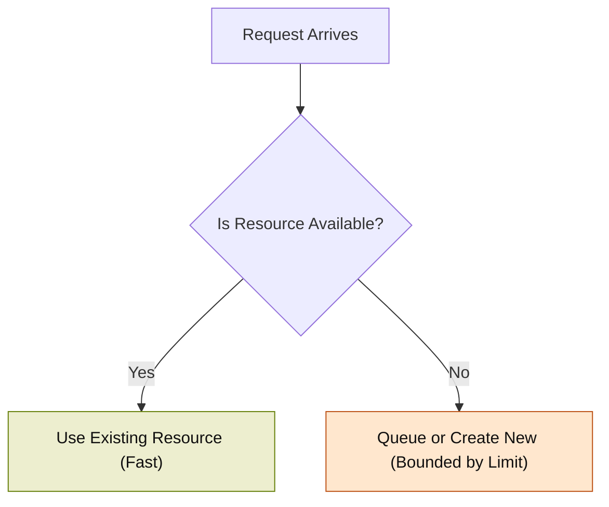

# Concept Explainer Skill

Use this skill whenever the user asks to explain a concept, keyword, architecture pattern, query, or technical topic, or asks for a first-principles breakdown with diagrams. Global rules (`~/.agent-rules/AGENTS.md`) apply in full; this skill adds the explainer workflow only.

## Core Directives

1. **Mechanism First, Exact Terms** (global rules 8 and 9):
   - Explain the physical or runtime mechanism before any code syntax.
   - Use exact production terms. Define each term once and reuse it with no synonym drift.
   - Use an analogy only when it maps 1:1 onto the real mechanism, and say where it breaks. Never use childish analogies.
   - Write in ASD-STE100: sentences of 25 words or fewer, one idea each, active voice. Prefer ASCII box/pipe flows and tables over text walls.

2. **Proportional Depth (Don't Overcomplicate Small Concepts)**:
   - **Small/Single Concepts** (e.g., *pool max size*, *foreign key*, *memoization*, *debounce*, *ReLU*): Keep the explanation brief, crisp, and focused. Do not go unnecessarily deep into assembly, compiler internals, or advanced edge cases.
   - **System/Architecture Concepts** (e.g., *RAG pipeline*, *OAuth2 flow*, *Transformer attention*): Structure into clear, progressive stages.
   - **Tooling & DevOps Concepts** (e.g., *Git*, *Linux CLI*, *Docker*, *NGINX*, *Cloud VMs*): Provide real-world terminal commands and production config snippets rather than synthetic Python wrappers.

3. **First-Principles Thinking Framework (When Foundational / Deep / Systems Questions are Asked)**:
   Whenever a user asks for a first-principles explanation, or when breaking down fundamental infrastructure, OS, or systems software (e.g., Docker, Linux Kernel, Sockets, Compilers, Memory Models), structure the breakdown from raw physics/silicon to user space:
   - **Genesis & Historical Necessity (The Breaking Point)**: What was the physical, economic, or engineering failure point before this existed? Trace the ancestral lineage (e.g., bare-metal waste -> VM hypervisor tax -> chroot -> jails -> cgroups -> Docker).
   - **The Ground Truth (Demystifying the Buzzword)**: Expose the raw reality (e.g., *"There is no such thing as a container in the Linux kernel; it is simply a standard process with an `nsproxy` and `css_set` constraint"*).
   - **Hardware to Silicon Substrate**: Explain what the CPU (Ring 0 vs Ring 3), MMU (virtual memory pages), and hardware buses actually do during execution.
   - **Kernel Primitives**: Detail the exact kernel subsystems and syscalls (`clone`, `unshare`, `pivot_root`, namespaces, cgroups v2, OverlayFS, capabilities, seccomp).
   - **The Runtime Hierarchy (Call Chain from CLI to Silicon)**: Step-by-step trace from user command to kernel trap (e.g., CLI -> REST/gRPC -> daemon -> containerd -> shim -> runc -> kernel syscall -> process execution).
   - **Chronological Evolution to the Present Day**: Detailed timeline from founding/invention, major pivots, container/platform wars, standardization (OCI/CNCF), to modern frontiers (eBPF, Wasm, microVMs).

4. **Output Modality (Direct In-Chat vs. Dedicated `.md` File)**:
   - **Direct In-Chat Explanations (Default for Meanings & Short Queries)**: If the user asks for the meaning of a term, a definition, a short clarification, or questions about phrases in existing files, respond directly in the chat with a concise, high-density breakdown. Do **not** create a `.md` file, and do **not** touch parent course files for short/definition queries.
   - **Dedicated `.md` File (Deep Dives & Explicit Requests)**: Only create a markdown file in `explanations/<topic-slug>.md` when the user asks for a comprehensive architectural deep-dive, a full topic note, or explicitly asks for an explanation file/note to be created.

5. **Enforce Two-Way (Bidirectional) Hyperlinking (When Writing `.md` Files Only)**:
   - **Forward Link (in Explanation Note)**: In the explanation markdown file header, include a `> **Reference / Context**:` block hyperlinking back to the related main concept file(s) in `course-path/` (e.g. `[09_building_apis_with_fastapi.md](../course-path/phase-0-engineering-foundations/09_building_apis_with_fastapi.md)`).
   - **Reverse Link (in Main Concept File)**: Immediately open the related main concept file in `course-path/` and ensure it contains an `### 🔬 Architectural Deep-Dives & Explanations` subsection under `## 1. Overview` (or append to it if it exists), adding the new explanation with a repo-relative markdown link and a 1-line summary:
     ```markdown
     - [<topic-slug>.md](../../explanations/<topic-slug>.md) — <Brief 1-sentence architectural summary>.
     ```
   - **Chat Response Link**: Output a clean, clickable markdown link in the chat using a path relative to the repo root: `[📄 Open Full Explanation Note (<Topic>)](explanations/<topic-slug>.md)`.

---

## Markdown File Template (`explanations/<topic-slug>.md`)

```markdown
# 📌 <Topic Name>

> **Reference / Context**: [09_building_apis_with_fastapi.md](../course-path/phase-0-engineering-foundations/09_building_apis_with_fastapi.md) | [Optional Related Explanation](./another-explanation.md)

---

### 1. 🎯 What is it? (The Mechanism)
1-2 sentences that state the mechanism in exact production terms.

---

### 2. 💡 The Analogy
A real physical or production system that maps 1:1 onto the mechanism. Say where it breaks. Never childish.

*Example*: "A connection pool works like an airport taxi rank with a fixed number of licensed taxis. Passengers queue when every taxi is out. The analogy breaks on reuse: a taxi never keeps state from the last passenger, but a pooled connection can."

---

### 3. 🎨 Visual Flowchart (Mermaid)
A clean, visual Mermaid diagram (`flowchart TD`, `flowchart LR`, or `sequenceDiagram`) illustrating the exact mechanism, state transition, or comparison.


Color only through the shared Flexoki `classDef` palette in `course-utils/per-topic-deepdive-generator.md`. No per-node `style` lines.

---

### 4. ⚡ Quick Code / Practical Example (Minimal & Clear)
A short, practical snippet or table showing how it looks in code or configuration.

---

### 5. ⚠️ Pro-Tip / Common Gotcha
1 key rule-of-thumb or common pitfall to avoid.
```

---

## Execution Workflows

### Mode A: Short Explanations & Terminology Meanings (In-Chat Only)
1. Provide the direct, mechanism-first explanation **directly in the chat**. Add an analogy only when it maps 1:1 onto the mechanism.
2. **Visuals in Chat**: **Never use Mermaid code blocks in chat responses** (the chat UI does not render Mermaid). Instead, use:
   - **Unicode/ASCII Box Diagrams** (`┌─┐`, `└─┘`, `│`, `──>`) for architecture and state transitions.
   - **Text-Tree Hierarchies** (`├──`, `└──`, `│`) for parent-child or file structures.
   - **Markdown Comparison Tables** for relational concepts.
3. Keep it high-density, sharp, and focused.
4. Do **not** create a `.md` file in `explanations/`.
5. Do **not** modify or link within `course-path/` files.

### Mode B: Deep Dives & Explicit Note Requests (Dedicated `.md` File)
1. **Step 1 — Create Explanation Note**: Write the comprehensive visual explanation, Mermaid diagrams, analogies, and code snippets to `explanations/<topic-slug>.md` with header links back to the main concept file(s).
2. **Step 2 — Update Main Concept File (Reverse Link)**: Open the related main concept file in `course-path/` (e.g., `09_building_apis_with_fastapi.md`) and register the explanation under `### 🔬 Architectural Deep-Dives & Explanations`.
3. **Step 3 — Minimal Chat Response**: In the chat response, keep output strictly minimal:
   - A 1-2 sentence core takeaway.
   - A prominent clickable markdown link:
     `👉 [View Full Explanation Note: explanations/<topic-slug>.md](explanations/<topic-slug>.md)`

