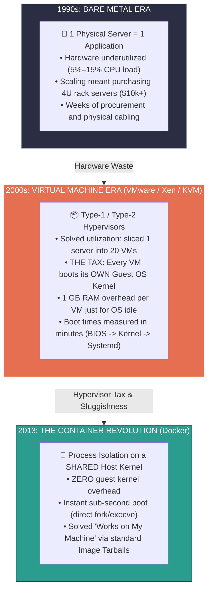
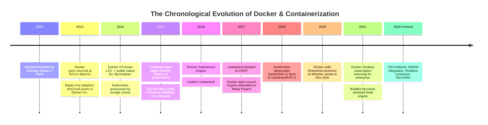
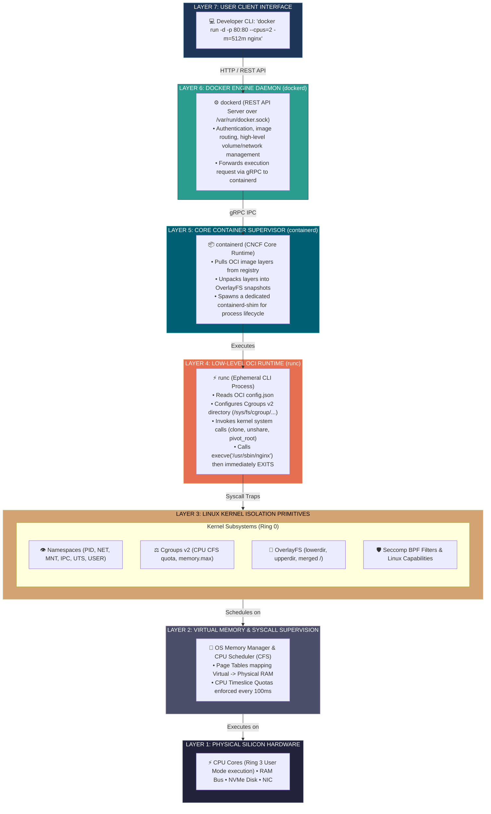

# 📌 Docker from First Principles: History, Genesis, and Hardware-to-Software Systems Architecture

> **Reference / Context**: [11_docker_and_compose.md](file:///d:/Madhan_Utils/learning/courses/ai-ml-course/course-path/phase-0-engineering-foundations/11_docker_and_compose.md) | [posix-unix-linux-gnu-kernel-terminal-shell.md](file:///d:/Madhan_Utils/learning/courses/ai-ml-course/explanations/posix-unix-linux-gnu-kernel-terminal-shell.md) | [what-is-the-os-kernel.md](file:///d:/Madhan_Utils/learning/courses/ai-ml-course/explanations/what-is-the-os-kernel.md) | [docker-container-architecture.md](file:///d:/Madhan_Utils/learning/courses/ai-ml-course/explanations/docker-container-architecture.md) | [docker-image-architecture.md](file:///d:/Madhan_Utils/learning/courses/ai-ml-course/explanations/docker-image-architecture.md) | [docker-layer-architecture.md](file:///d:/Madhan_Utils/learning/courses/ai-ml-course/explanations/docker-layer-architecture.md) | [docker-images-containers-layers-overlayfs.md](file:///d:/Madhan_Utils/learning/courses/ai-ml-course/explanations/docker-images-containers-layers-overlayfs.md)

---

### 1. 🎯 The Irreducible First-Principles Truth

[Certain] **There is no such thing as a "container" inside the Linux kernel.**

If you search the entire Linux kernel source code repository (`torvalds/linux`), you will never find a `struct container`. 

A Docker container is not a lightweight virtual machine. It does not possess a virtual CPU, virtual motherboard, virtual BIOS, or guest operating system. 

At the hardware and operating system level, a container is **strictly an ordinary Linux user space process** running directly on the host CPU cores. What makes it appear to be an independent "container" is that the Linux kernel forces this process to wear:
1. **A Blindfold (Linux Namespaces)**: Restricts what system resources the process can **see** (processes, network devices, filesystem mounts, user IDs).
2. **A Straitjacket (Control Groups / Cgroups)**: Restricts how much physical resource the process can **consume** (CPU cores, RAM bytes, disk I/O, process count).
3. **An Illusionist Filesystem (OverlayFS)**: Stacks read-only directory archives into a unified directory tree that looks like an entire Linux OS root (`/bin`, `/etc`, `/usr`).
4. **A Security Cage (Capabilities & Seccomp)**: Strips root privileges down to restricted system call subsets so the process cannot compromise the host kernel.

```
Ordinary Linux Process:
[ task_struct ] ──> Global Namespaces (sees whole host) ──> Unlimited CPU/RAM

Container Process:
[ task_struct ] ──> Isolated Namespaces (sees only itself) ──> Cgroup Limits (e.g. 512MB RAM)
```

---

### 2. 💡 The Genesis: What Problem Did Docker Solve? (1990s – 2013)

To understand Docker from first principles, we must understand the three distinct eras of computing infrastructure that collapsed under their own weight.



#### A. The "Matrix of Hell" (The Software Packaging Crisis)
Before 2013, shipping software was a combinatorial nightmare:
* You had **$N$ applications** (Node.js 14, Python 2.7, Python 3.8, Ruby on Rails, PostgreSQL 9.6).
* You had **$M$ deployment environments** (Developer MacBook OSX, QA server on CentOS 6, Staging on Debian 7, Production on Red Hat Enterprise Linux 5, Cloud on AWS EC2).
* Every single app had dependencies on specific versions of C libraries (`glibc 2.14` vs `glibc 2.17`), Python packages, and system binaries. Installing App A would upgrade `libssl.so`, which instantly broke App B.
* The infamous developer refrain: *"It works on my machine!"* Sysadmin reply: *"Then we will ship your machine to production!"* Docker literally took that joke and turned it into an industry standard.

#### B. The Ancestral Lineage (The Primitives Docker Stood On)
Docker did not invent container technology. It democratized kernel features that existed for decades:
1. **1979 — `chroot` (Unix V7)**: Introduced the `chroot()` system call, allowing a process's apparent root directory (`/`) to be locked to a specific subfolder. *(Easily escapable; lacked network, PID, or memory boundaries).*
2. **2000 — FreeBSD Jails**: Derrick Hitchcock expanded `chroot` to isolate processes, IP addresses, and filesystem hierarchies.
3. **2004 — Solaris Containers (Zones)**: Sun Microsystems created complete OS-level virtualization with dedicated resource management.
4. **2006–2007 — Google "Process Containers" (cgroups)**: Google engineers Paul Menage and Rohit Seth authored process resource isolation for internal Borg clusters, later merged into Linux Kernel 2.6.24 as **Control Groups (cgroups)**.
5. **2008 — LXC (LinuX Containers)**: Combined Linux namespaces and cgroups into the first complete container implementation on standard Linux.
   - *Why didn't LXC take over?* LXC was treated like a mini virtual machine. It lacked a standard image format, content-addressable layer caching, single-command distribution, and a developer-friendly CLI.

---

### 3. 📜 The Complete Chronological History (2008 – Present)



#### Detailed Chronology:
* **2008–2010 (The dotCloud Era)**: Solomon Hykes, Sebastien Pahl, and Jerome Petazzoni founded **dotCloud**, a French Platform-as-a-Service (PaaS) company in Paris (later backed by Y Combinator). They built internal orchestration software in Python and Go that ran customer code inside isolated Linux processes using LXC and AUFS (Another Union File System).
* **March 20, 2013 (The PyCon Lightning Talk)**: At PyCon in Santa Clara, Solomon Hykes gave a 5-minute lightning talk demonstrating Docker. The ability to write a simple text file (`Dockerfile`), build a portable artifact, and run it anywhere with a single CLI command stunned the software world.
* **October 2013**: dotCloud recognized that Docker was orders of magnitude bigger than their hosting business; they sold the dotCloud PaaS and renamed the entire company to **Docker Inc.**
* **March 2014 (Docker 0.9 & `libcontainer`)**: Docker removed its dependency on LXC. They authored **`libcontainer`** in Go, interacting directly with Linux kernel namespaces, cgroups, and capabilities without external wrappers.
* **2014–2016 (The Container Wars)**: Docker released **Docker Swarm**, attempting to dominate the cluster orchestration layer. Concurrently, Google open-sourced **Kubernetes** (based on a decade of experience with its internal system, Borg). The industry pushed back against Docker Inc.'s attempt at a proprietary, monolithic monopoly.
* **June 2015 (The OCI Peace Treaty)**: To prevent fracturing the industry, Docker, CoreOS, Google, Red Hat, and the Linux Foundation formed the **Open Container Initiative (OCI)**. They standardized two specifications:
  1. **`image-spec`**: How an image manifest, config, and layer tarballs must be structured.
  2. **`runtime-spec`**: How a container must be unpacked and executed on any OS.
  Docker extracted `libcontainer` and donated it as **`runc`**, the universal OCI reference implementation.
* **2016–2017 (Deconstruction into `containerd`)**: Docker decoupled its monolithic daemon into modular layers, creating **`containerd`** to supervise runc processes. In 2017, Docker donated `containerd` to the **CNCF (Cloud Native Computing Foundation)** and renamed its upstream open-source code to **The Moby Project**.
* **December 2020 (Kubernetes Deprecates `dockershim`)**: Kubernetes officially deprecated `dockershim` in v1.20 (removed in v1.24). K8s nodes now talk directly to `containerd` or `CRI-O` via the Container Runtime Interface (CRI), bypassing the heavy `dockerd` daemon entirely.
* **2021–Present (The Modern Era)**: Docker Inc. refocused on developer productivity. BuildKit became the standard next-generation build engine (parallel execution, cache mounts). Docker added support for **Rootless containers** (running without host root), **multi-arch builds** (Apple Silicon ARM64 / AMD64), and experimental runtimes like **Wasm (WebAssembly)** and **MicroVMs** (Kata Containers / AWS Firecracker).

---

### 4. 🔬 Hardware to Software: The 7-Layer Container Execution Stack

To see how a command typed on your keyboard translates into transistors switching in physical silicon, examine the complete stack:



---

### 5. ⚙️ Deep-Dive into the Hardware & Kernel Primitives

#### A. Hardware Level: CPU Execution Modes & Memory
* **Ring 0 vs. Ring 3**:
  - x86_64 and ARM64 CPUs have privilege protection levels. The Linux Kernel executes in **Ring 0 (Supervisor Mode)**, possessing unrestricted access to all CPU instructions, memory registers, and hardware devices.
  - All user applications execute in **Ring 3 (User Space Mode)**.
  - **The Container Reality**: A containerized process runs in **Ring 3 on the physical host CPU cores**. It does **not** run inside a hypervisor guest instruction loop. There is zero hardware instruction emulation. An integer addition or matrix multiplication inside a Docker container runs at the exact same clock cycle speed as native bare metal.
* **Memory Management Unit (MMU) & Page Tables**:
  - In a Virtual Machine, memory access requires **Nested Page Tables (EPT/NPT)**: Guest Virtual $\rightarrow$ Guest Physical $\rightarrow$ Host Physical. This causes TLB cache miss penalties.
  - In Docker, memory translation is single-level: Process Virtual Address $\rightarrow$ Physical RAM Page via the host MMU.

#### B. The 4 Kernel Pillars Under the Hood

##### 1. Linux Namespaces (The "Blindfold" — What the Process Sees)
Namespaces partition global kernel resources into discrete virtual views. When a container process queries the kernel, the kernel checks the process's `nsproxy` struct and returns only what belongs to its namespace:

| Namespace Flag | System Resource Isolated | What the Container Sees |
|---|---|---|
| `CLONE_NEWPID` | Process ID Tree | Sees itself as PID 1 (`/sbin/init` or app). Host sees it as e.g. PID 14285. |
| `CLONE_NEWNET` | Network Devices, Stacks & Ports | Own `lo` loopback, own virtual interface `eth0`, private routing table & iptables. |
| `CLONE_NEWNS` (MNT)| Filesystem Mount Points | Own isolated root filesystem tree (`/`). Host mounts are invisible. |
| `CLONE_NEWIPC` | Inter-Process Communication | Isolated System V IPC and POSIX message queues. Cannot shared-memory hack other apps. |
| `CLONE_NEWUTS` | Hostname & Domain Name | Custom hostname (e.g., `container-db-prod`) without altering the host's hostname. |
| `CLONE_NEWUSER`| User and Group IDs | Container UID 0 (root) maps to an unprivileged host UID (e.g., UID 10001). |
| `CLONE_NEWCGROUP`| Cgroup Root Directory | Hides host cgroup layout from container inspection. |
| `CLONE_NEWTIME`| Monotonic & Boot Clocks | Lets containers adjust their clock offsets without disrupting host NTP. |

##### 2. Control Groups / Cgroups v2 (The "Straitjacket" — What the Process Consumes)
While namespaces hide things, **cgroups throttle and meter things**. In modern Linux kernels, Cgroups v2 provides a unified hierarchy mounted at `/sys/fs/cgroup`:
* **CPU Limiting (`--cpus=2`)**:
  - Controlled by the Completely Fair Scheduler (CFS) bandwidth controller via `/sys/fs/cgroup/<id>/cpu.max`.
  - Stored as two numbers: `quota` and `period`. For example, `200000 100000` means: *In every 100,000 microseconds (100ms window), this container process group is allowed at most 200,000 microseconds of CPU core time across all cores*. If it exceeds this, the kernel scheduler throttles it (deschedules its threads).
* **Memory Limiting (`-m=512m`)**:
  - Tracked in `/sys/fs/cgroup/<id>/memory.max`.
  - When the process attempts to allocate page $N+1$ exceeding 512MB, the Linux kernel invokes the **OOM (Out-of-Memory) Killer** to terminate the container process (`Exit Code 137`).
* **PID Limiting (`--pids-limit=100`)**:
  - Limits maximum concurrent tasks in `/sys/fs/cgroup/<id>/pids.max` to prevent fork bombs from crashing the host machine.

##### 3. Union Filesystem (OverlayFS — How the OS Image is Assembled)
Docker images are not disks; they are stacked directories union-mounted by the Linux kernel:
* **`lowerdir`**: Stack of read-only image layers (unpacked `.tar.gz` blobs).
* **`upperdir`**: The container's single, private read-write directory.
* **`workdir`**: Internal scratchpad for atomic rename operations.
* **`merged`**: The virtual unified mount point that the container's PID 1 actually sees as `/`.
* **Copy-on-Write (CoW)**: If the container modifies `/etc/hosts`, the kernel copies the file from `lowerdir` into `upperdir` and modifies the copy.
* **Whiteouts**: If the container deletes a file, OverlayFS creates a character device `0:0` (`.wh.<file>`) in `upperdir` to mask the lower file.

##### 4. Security Cage: Capabilities and Seccomp
Even if a container runs as UID 0 (`root`), it is **not true root** on the machine:
* **Linux Capabilities (`cap_drop=ALL`, `cap_add=...`)**: Linux splits root into ~40 discrete capabilities. Docker drops dangerous capabilities by default (e.g., `CAP_SYS_ADMIN`, `CAP_SYS_RAWIO`, `CAP_SYS_BOOT`, `CAP_NET_ADMIN`). A container root cannot reboot the machine or reflash BIOS firmware.
* **Seccomp (Secure Computing Mode)**: A BPF (Berkeley Packet Filter) filter in the kernel that intercepts every syscall made by the container process. Docker's default seccomp profile disables over 40 dangerous syscalls (e.g., `kexec_load`, `reboot`, `sys_ptrace`, `mount`).

---

### 6. ⚔️ Virtual Machines vs. Containers: Hardware-Level Matrix

| Dimension | 🖥️ Virtual Machine (KVM / VMware) | 📦 Docker Container (runc / containerd) |
|---|---|---|
| **Virtualization Boundary**| **Hardware Level (Hypervisor)** | **Operating System Level (Kernel Syscalls)** |
| **Kernel Instance** | Dedicated Guest Kernel per VM | **Shared Host Linux Kernel** |
| **CPU Execution** | Hypervisor emulates vCPU instructions (intercepted by VT-x / AMD-V) | **Direct native execution on physical host CPU (Ring 3)** |
| **Memory Overhead** | 500 MB – 2 GB RAM per VM just to boot the guest OS | **~0 MB idle overhead** (only memory used by the process) |
| **Startup Latency** | 30 seconds to 3 minutes (BIOS $\rightarrow$ GRUB $\rightarrow$ Kernel $\rightarrow$ Systemd) | **50 to 500 milliseconds** (standard Linux `fork()` + `execve()`) |
| **Storage Architecture** | Fixed-size virtual disk image (`.qcow2`, `.vmdk`, 20–100 GB) | Content-addressable layered diffs sharing read-only layers |
| **Isolation Strength** | **Hardware-enforced** (hypervisor memory tagging, near-zero leakage) | **Software-enforced** (kernel namespaces; shared kernel attack surface) |
| **I/O Performance** | VirtIO virtualized disk/network drivers (moderate overhead) | **Near-native bare-metal I/O throughput** |

---

### 7. 🧪 First-Principles Proof: Building a "Container" Without Docker

To prove that Docker is just kernel primitives, you can build and run a container using standard Linux tools in 4 commands:

```bash
# 1. Create a root directory and unpack a minimal Alpine filesystem
mkdir -p /tmp/my-container/rootfs
curl -sL https://dl-cdn.alpinelinux.org/alpine/v3.19/releases/x86_64/alpine-minirootfs-3.19.1-x86_64.tar.gz | tar -xz -C /tmp/my-container/rootfs

# 2. Create a Cgroup v2 limit (50MB RAM limit)
mkdir -p /sys/fs/cgroup/demo-container
echo "52428800" > /sys/fs/cgroup/demo-container/memory.max

# 3. Attach current shell to the cgroup
echo $$ > /sys/fs/cgroup/demo-container/cgroup.procs

# 4. Launch isolated shell using Linux namespaces (PID, Mount, Network, UTS, IPC)
unshare --mount --uts --ipc --net --pid --fork \
    chroot /tmp/my-container/rootfs /bin/sh

# Inside this shell:
/ # hostname my-isolated-box
/ # ps aux
# PID 1 is /bin/sh! The host's 400 processes are completely invisible!
```
[Certain] This exact sequence is what `runc` automates under the hood when you run `docker run`.

---

### 8. ⚠️ Critical Systems Gotchas & Uncomfortable Realities

1. **Containers Do Not Protect Against Kernel Exploits**: Because all containers share the single host Linux kernel, any privilege-escalation kernel bug (e.g., Dirty COW, Dirty Pipe) compromises the entire physical server and all other containers running on it.
2. **"Docker on Windows/Mac" is a Virtual Machine Illusion**: Because Docker requires Linux kernel namespaces and cgroups, running Docker on macOS or Windows secretly launches a lightweight Linux Virtual Machine (Hyper-V / WSL2 / Apple Hypervisor Framework) in the background. The containers run inside that Linux VM, not directly on Darwin or Windows NT.
3. **Multi-Tenancy in Public Clouds**: For untrusted multi-tenant workloads (e.g., AWS Lambda, Fly.io), raw Docker containers are insufficient. Cloud providers use **MicroVMs** (like **AWS Firecracker**) or sandboxed runtimes (like **Google gVisor**) to provide hardware-isolated guest kernels with container-like sub-second boot times.
