# 📌 From CPU Silicon and Registers to Global System Resources: The Hardware-to-Kernel Architecture

> **Reference / Context**: [10_linux_cli.md](file:///d:/Madhan_Utils/learning/courses/ai-ml-course/course-path/phase-0-engineering-foundations/10_linux_cli.md) | [11_docker_and_compose.md](file:///d:/Madhan_Utils/learning/courses/ai-ml-course/course-path/phase-0-engineering-foundations/11_docker_and_compose.md) | [linux-namespaces-explained.md](file:///d:/Madhan_Utils/learning/courses/ai-ml-course/explanations/linux-namespaces-explained.md) | [what-is-the-os-kernel.md](file:///d:/Madhan_Utils/learning/courses/ai-ml-course/explanations/what-is-the-os-kernel.md)

---

### 1. 🧱 What is "CPU Silicon"? (From Purified Sand to Transistors and Hard Chips)

[Certain] When systems engineers say **"on the silicon"**, they are referring to the absolute physical floor of computing: a postage-stamp-sized slice of hyper-purified crystalline silicon (element 14 on the periodic table, $Si$) onto which billions of microscopic electronic switches (**transistors**) are etched using photolithography.

```text
┌──────────────────────────────────────────────────────────────────────────────────┐
│                   FROM RAW QUARTZ SAND TO A COMMERCIAL PROCESSOR                 │
├───────────────────┬───────────────────┬───────────────────┬──────────────────────┤
│ 1. Raw Quartz     │ 2. Silicon Wafer  │ 3. EUV Litho-     │ 4. Packaged Hard     │
│    Sand (SiO2)    │    (300mm Ingot)  │    graphy         │    Chip (CPU)        │
│                   │                   │                   │                      │
│ Purified to       │ Sliced with       │ Billions of       │ Die cut, soldered to │
│ 99.9999999% pure  │ diamond wire saws │ FinFET/GAAFET     │ substrate, capped    │
│ electronic grade  │ into ultra-flat   │ switches etched   │ with copper IHS for  │
│ monocrystal       │ mirror discs      │ with 13.5nm light │ socket installation  │
└───────────────────┴───────────────────┴───────────────────┴──────────────────────┘
```

---

#### 1.1 The Anatomy & Physics of the Transistor: The Electronic Switch

A mechanical light switch uses human fingers to push two pieces of copper together to complete a circuit. An **electronic switch (transistor)** does the exact same thing, but with **zero moving parts**, controlled purely by an electric voltage field at billions of cycles per second.

The workhorse of modern chips is the **MOSFET** (Metal-Oxide-Semiconductor Field-Effect Transistor) and its modern 3D successors (**FinFET** and **GAAFET** / Gate-All-Around).

```text
               [ GATE ] (Control Terminal)
                  │
                  ▼  Gate Voltage (e.g. +0.8V)
         ┌─────────────────┐
         │ Gate Electrode  │
         ├─────────────────┤
         │ Dielectric Oxide│ <── Insulating Barrier (SiO2 / Hafnium Oxide)
 ┌───────┴─────────────────┴───────┐
 │ [SOURCE]      CHANNEL   [DRAIN] │
 │  N-Doped    (P-Silicon)  N-Doped│
 └─────────────────────────────────┘
      │                        │
      ▼                        ▼
  Electrons Enter         Electrons Exit
```

Every transistor has three functional terminals:

1. **Source**: Where charge carriers (electrons) enter the switch.
2. **Drain**: Where electrons exit the switch to deliver current to downstream circuits.
3. **Gate**: The control valve. It sits directly above the electron path, separated by an ultra-thin insulating dielectric oxide layer (just a few atoms thick) so no current actually leaks into the gate.

##### How It Switches States:

* **The "OFF" State (Binary `0`)**: With `0V` on the Gate, the P-type silicon channel between Source and Drain lacks free electrons. The path acts as an electrical insulator. No current flows ($I = 0$).
* **The "ON" State (Binary `1`)**: Applying a positive voltage (~`0.7V` to `1.0V`) to the Gate creates an **electrostatic field**. This field pulls mobile electrons from deep in the silicon substrate upward, forming a microscopic conductive "inversion channel" directly under the oxide layer. Electrons surge from Source to Drain at near the speed of light.

##### Transistor Evolution:

* **Planar MOSFET**: Flat 2D gates used up to the 28nm era. As gates shrank below 20nm, electrons began leaking through the channel even when turned OFF (quantum tunneling leakage).
* **FinFET (3D)**: The silicon channel was raised up into a vertical 3D "fin", allowing the Gate to wrap around it on **3 sides** for tighter electrical control (used from 22nm down to 3nm).
* **GAAFET (Gate-All-Around / Nanosheets)**: The channel is split into multiple horizontal ribbon-like nanosheets completely surrounded by the Gate on all **4 sides** (used in bleeding-edge 3nm and 2nm nodes).

---

#### 1.2 How Transistors are Placed on Silicon: Photolithography & Fabrication

Transistors are not placed by tiny mechanical tweezers; they are chemically grown and optically printed onto silicon wafers in billion-dollar cleanrooms (fabs):

```text
[ Silicon Wafer ] 
       │
       ▼ Spin-coat light-sensitive liquid polymer
[ Photoresist Layer Applied ]
       │
       ▼ EUV Laser (13.5nm wavelength) projected through Photomask (Circuit Blueprint)
[ Pattern Exposure ]
       │
       ▼ Chemical wash dissolves light-struck photoresist
[ Etching & Patterning ]
       │
       ▼ High-velocity ion beam blasts Boron/Phosphorus into exposed silicon
[ Ion Implantation (Doping) ]
       │
       ▼ Deposit 15–20 vertical tiers of microscopic copper wires
[ Metallization & Interconnects ]
```

1. **Growing the Monocrystal (Czochralski Process)**: Raw quartz sand ($SiO_2$) is reduced in electric arc furnaces to metallurgical silicon, then purified chemically to **99.9999999%** ("nine nines") purity. A single seed crystal is dipped into molten silicon at 1,425°C and slowly pulled upward while rotating, creating a massive, 100-kilogram cylinder of flawless monocrystalline silicon called an **ingot** (or boule).
2. **Wafer Slicing**: The ingot is sliced with diamond wire saws into razor-thin discs (typically **300mm / 12 inches** in diameter and 0.77mm thick) and polished to mirror flatness at the atomic scale.
3. **Extreme Ultraviolet (EUV) Photolithography**:
   * The wafer is coated with a microscopic film of light-sensitive polymer called **photoresist**.
   * A gigantic EUV lithography machine (manufactured by ASML) vaporizes microscopic molten tin droplets with a laser 50,000 times a second to generate short-wavelength **13.5nm EUV light**.
   * This light bounces off ultra-precise atomic mirrors, passes through a **photomask** (a stencil containing the circuit layout), and projects the nanoscale transistor patterns onto the photoresist.
4. **Etching & Doping (Ion Implantation)**:
   * The exposed photoresist is washed away with chemical developers.
   * High-energy plasma gas **etches** away the exposed silicon layers.
   * An ion accelerator fires charged donor atoms (such as Phosphorus to create extra electrons, or Boron to create electron holes) directly into the silicon crystal lattice at hundreds of kilometers per second.
5. **Metallization (Multi-Layer Wiring)**:
   * Once billions of transistors are formed on the base silicon floor, they cannot function without wires.
   * The fab deposits between **15 and 20 vertical layers of microscopic copper and cobalt interconnects**, insulated by low-k dielectric glass, creating a subterranean highway network connecting billions of gates across the chip.

---

#### 1.3 How Wafers are Made into Hard Chips (Packaging & Physical Assembly)

A completed silicon wafer contains hundreds of identical processor circuits printed side-by-side, but it is fragile as a pane of glass and cannot be plugged into a motherboard. It must undergo **Packaging**:

```text
┌─────────────────────────────────────────────────────────────┐
│ CROSS-SECTION OF A FINISHED HARD CHIP (PACKAGE)             │
│                                                             │
│       [ Integrated Heat Spreader (IHS) - Nickel-Plated Cu ] │
│       ┌─────────────────────────────────────────────┐       │
│       │        Thermal Interface Material (TIM)     │       │
│       ├─────────────────────────────────────────────┤       │
│       │   SILICON DIE (Transistors & Micro-wiring)  │       │
│       ├─────────────────────────────────────────────┤       │
│       │   Underfill Epoxy & Micro-Solder Bumps      │       │
│ ┌─────┴─────────────────────────────────────────────┴─────┐ │
│ │ MULTI-LAYER FIBERGLASS / ORGANIC SUBSTRATE (PCB)        │ │
│ └─────┬─────────────────────────────────────────────┬─────┘ │
│       │  Pins / Solder Balls (LGA Pads / BGA Array) │       │
│       ▼                                             ▼       │
│   Motherboard CPU Socket                        Motherboard │
└─────────────────────────────────────────────────────────────┘
```

1. **Wafer Probing & Binning**: Automated test needles contact every die on the 300mm wafer. Chips with defects caused by microscopic airborne dust particles are mapped out and marked as dead or disabled (e.g., binning an 8-core die down to a 6-core chip).
2. **Dicing**: A high-speed diamond blade or laser cuts along the streets of the wafer, slicing it into hundreds of individual, bare rectangular silicon pieces called **Bare Dies**.
3. **Die Attach (Flip-Chip Bonding)**: The bare die is flipped upside-down. Thousands of microscopic solder bumps on the die align with copper pads on an organic multi-layer **package substrate** (the green fiberglass board you see under a CPU). Solder is reflowed in an oven, and an epoxy underfill is injected underneath to absorb thermal stress.
4. **Chiplets & Interposers (Modern 2.5D / 3D Packaging)**: Modern processors (like AMD Ryzen, Apple Ultra, or Intel Xeon) no longer rely on a single massive monolithic die. Instead, multiple modular dies (CPU compute chiplets, Memory controllers, and I/O dies) are bonded side-by-side on an ultra-dense silicon bridge or **interposer** (e.g., TSMC CoWoS or Intel EMIB).
5. **The Integrated Heat Spreader (IHS)**: Because silicon dies are tiny and brittle, a thick lid made of nickel-plated copper called the **Integrated Heat Spreader (IHS)** is placed over the die, bonded with indium solder or high-performance thermal paste. This protects the silicon die from cracking under cooler pressure and spreads heat outwards to the CPU cooler heatsink.
6. **Socket Interface**: The underside of the substrate is fitted with an array of gold-plated contacts:
   * **LGA (Land Grid Array)**: Flat gold pads (common on modern Intel & AMD desktop sockets) that press against socket pins on the motherboard.
   * **BGA (Ball Grid Array)**: Tiny solder balls permanently melted directly onto laptop and smartphone motherboards.

---

#### 1.4 Which Part Stores Data & How It is Physically Stored

A CPU does not store data in one generic place. It uses three distinct physical transistor architectures depending on required speed versus persistence:

```text
┌──────────────────────────────────────────────────────────────────────────────────┐
│ THE MEMORY HIERARCHY: PHYSICAL TRANSISTOR STORAGE MECHANISMS                     │
├───────────────────┬───────────────────┬───────────────────┬──────────────────────┤
│ 1. Registers &    │ 2. CPU Caches     │ 3. System RAM     │ 4. NVMe / SSD        │
│    Execution Core │    (L1, L2, L3)   │    (DRAM)         │    (NAND Flash)      │
├───────────────────┼───────────────────┼───────────────────┼──────────────────────┤
│ Mechanism:        │ Mechanism:        │ Mechanism:        │ Mechanism:           │
│ Flip-Flop Latches │ 6T SRAM Cell      │ 1T-1C Cell        │ Floating-Gate / CTF  │
│ (20–30 Transistors│ (6 Transistors    │ (1 Transistor +   │ Transistor           │
│ per bit)          │ per bit)          │ 1 Capacitor)      │                      │
├───────────────────┼───────────────────┼───────────────────┼──────────────────────┤
│ How Stored:       │ How Stored:       │ How Stored:       │ How Stored:          │
│ Cross-coupled     │ Continuous        │ Physical electric │ Electrons quantum-   │
│ logic inverter    │ cross-inverter    │ charge trapped    │ tunneled & trapped   │
│ feedback loop     │ voltage feedback  │ in microscopic    │ in floating oxide    │
│ (Voltage State)   │ (Voltage State)   │ trench capacitor  │ pocket (Persistent)  │
├───────────────────┼───────────────────┼───────────────────┼──────────────────────┤
│ Speed:            │ Speed:            │ Speed:            │ Speed:               │
│ < 0.5 nanoseconds │ 1 – 10 nanoseconds│ ~60 nanoseconds   │ ~10,000–50,000 ns    │
├───────────────────┼───────────────────┼───────────────────┼──────────────────────┤
│ Persistence:      │ Persistence:      │ Persistence:      │ Persistence:         │
│ Volatile (lost at │ Volatile (lost at │ Volatile (decays  │ Non-Volatile (holds  │
│ power cut)        │ power cut)        │ in milliseconds)  │ charge for years)    │
└───────────────────┴───────────────────┴───────────────────┴──────────────────────┘
```

##### 1. Registers & CPU Caches (SRAM — Static Random Access Memory)

* **Where It Lives**: Directly etched on the CPU core silicon, surrounding the execution ALU.
* **The Circuit**: Built from **6 transistors per single bit of memory (6T SRAM cell)**:
  * Four transistors are wired as two cross-coupled CMOS inverters (Inverter A feeds Inverter B, and Inverter B feeds Inverter A).
  * Two additional transistors act as access gates to read and write the cell.
* **How It Stores Data**: **Continuous electrical voltage feedback**. If Node Q is set to high voltage (`1`), it drives the opposite node $\bar{Q}$ to ground (`0`), which in turn locks Node Q at `1`. It requires **no capacitors** and **no memory refreshing**. As long as electrical power flows, the bits stay locked indefinitely with sub-nanosecond read/write latency.

##### 2. System RAM (DRAM — Dynamic Random Access Memory)

* **Where It Lives**: On external memory sticks (DDR4 / DDR5 RAM DIMMs) plugged into motherboard slots.
* **The Circuit**: Built from **1 transistor and 1 capacitor (1T-1C cell)** per bit:
  * The capacitor physically stores an electric charge (charged = `1`, discharged = `0`).
  * The single transistor acts as an isolation gate to connect the capacitor to the bit line for reading/writing.
* **How It Stores Data**: **Physical electrostatic charge in a capacitor**. Because microscopic capacitors naturally leak electrons through their dielectric barriers within milliseconds, DRAM is "dynamic"—the memory controller must repeatedly read, amplify, and re-charge every capacitor in RAM thousands of times every second (the **DRAM Refresh Cycle**).

##### 3. Persistent Storage (NAND Flash — NVMe SSDs & USB Drives)

* **Where It Lives**: In dedicated black silicon chips soldered onto SSD circuit boards.
* **The Circuit**: Built from specialized **Floating-Gate MOSFETs** or **Charge Trap Flash (CTF)** cells:
  * Between the control gate and the silicon channel lies an electrically isolated, floating "island" of polysilicon or silicon nitride completely enveloped by insulating oxide.
* **How It Stores Data**: **Trapped electrons via Quantum Tunneling**. When writing data, a high voltage pulse (~15–20V) forces electrons to literally tunnel through the oxide insulator into the isolated floating gate (Fowler-Nordheim Tunneling). Once the voltage is removed, the electrons remain physically imprisoned inside the trap for years without any electrical power. The trapped electrical negative charge alters the threshold voltage required to turn the transistor ON, allowing read circuits to detect whether a cell is holding a `0` or a `1`.

---

Everything in computing—operating systems, kernel data structures, Docker containers, and AI neural networks—is purely a mathematical abstraction stacked on top of these microscopic silicon switches toggling between high and low voltage states billions of times per second.

---

### 2. 🎯 Physical Core Primitives: Instruction Pointers and Register Values

[Certain] Your CPU silicon cannot think, plan, or remember. It is a blind mechanical state machine driven by a clock crystal. At any given picosecond, the CPU only understands two physical primitives: **Registers** (its immediate physical scratchpad) and the **Instruction Pointer** (its execution bookmark).

```text
┌────────────────────────────────────────────────────────────┐
│ PHYSICAL CPU CORE (Silicon Substrate)                      │
│                                                            │
│  [ General-Purpose Hardware Registers ]                    │
│   • RAX = 0x000000000000002A  <── Value: 42 (Math/Return)  │
│   • RBX = 0x00007FFE5A20B100  <── Value: Memory Pointer    │
│   • RSP = 0x00007FFE5A20AFE8  <── Value: Top of Stack (RAM)│
│                                                            │
│  [ The Special Register: Instruction Pointer ]             │
│   • RIP = 0x0000000000401122  <── The "Bookmark" in RAM    │
└──────────────────────────────┬─────────────────────────────┘
                               │
               Fetches byte at │ address 0x00401122
                               ▼
┌────────────────────────────────────────────────────────────┐
│ SYSTEM RAM (Your Program's Code Segment)                   │
│                                                            │
│   Address         Machine Instruction                      │
│   0x00401120 ───> MOV RAX, 5                               │
│   0x00401122 ───> ADD RAX, 10    <── [CPU EXECUTES THIS]   │
│   0x00401125 ───> RET                                      │
└────────────────────────────────────────────────────────────┘
```

#### What is a Register & Register Value?

* **Register**: A tiny, ultra-fast storage bucket etched directly into the CPU core silicon using flip-flops. Access latency is under **1 nanosecond**, compared to ~60–100 nanoseconds for motherboard RAM. A standard modern 64-bit x86 CPU has only 16 general-purpose registers (`RAX`, `RBX`, `RCX`, `RDX`, `RSI`, `RDI`, `RBP`, `RSP`, `R8`–`R15`).
* **Register Value**: The raw 64-bit binary bit pattern (integers, memory addresses, or ASCII fragments) currently trapped inside that physical circuit.
* **The Analogy**: If RAM is a massive warehouse across the city, **Registers are what you are holding in your left and right hands**. The CPU cannot directly add two numbers sitting on a disk or even in RAM; it must copy them into physical registers first, execute the arithmetic circuit, and write the value back.

#### What is the Instruction Pointer (`RIP` / `PC`)?

The **Instruction Pointer** (named `RIP` on 64-bit x86/Intel/AMD, or `PC` / Program Counter on ARM) is a dedicated hardware register holding the **exact virtual RAM address** of the next machine instruction the CPU must execute.

1. **Fetch**: The CPU reads the address in `RIP` (e.g. `0x00401122`).
2. **Execute**: It pulls the instruction byte from RAM/cache and runs it through the ALU (Arithmetic Logic Unit).
3. **Advance**: `RIP` is automatically incremented to point to the next instruction (`0x00401125`).
4. **Branches (`if`, loops, function calls)**: When code calls a function or executes a loop, the CPU simply overwrites `RIP` with a completely new target address in RAM.

---

### 3. 🧬 The Kernel Process Illusion: `task_struct`

[Certain] A "process" does not exist in CPU hardware. Hardware only knows instructions and registers. A process is purely a software illusion maintained by a ~7 kilobyte C structure in kernel RAM: **`struct task_struct`**.

If that struct is deleted, the process ceases to exist.

```mermaid
flowchart TD
    subgraph KERNEL_MEM ["Kernel RAM: struct task_struct (~7 KB)"]
        PID["pid_t pid (Thread ID)<br>pid_t tgid (Process ID)"]
        COMM["char comm[16] ('nginx', 'python')"]
        STATE["volatile long state (Running, Sleeping, Zombie)"]
        MM["struct mm_struct *mm (Virtual Memory & Page Tables)"]
        FILES["struct files_struct *files (Open File Descriptors)"]
        CRED["struct cred *cred (UID, GID, Capabilities)"]
        NS["struct nsproxy *nsproxy (Namespace Isolation Tables)"]
        TIME["start_time, utime, stime (CPU Clock Accounting)"]
    end

    PID --- COMM --- STATE --- MM --- FILES --- CRED --- NS --- TIME
    style KERNEL_MEM fill:#1e293b,stroke:#3b82f6,color:#fff
```



#### How the Kernel Tracks Every Running Program

The Linux kernel tracks thousands of concurrent processes using three core structures:

1. **The Circular Doubly-Linked List (`tasks`)**:
   Inside every `task_struct`, a `struct list_head tasks` links to the `next` and `prev` processes. Every task on the OS is linked into this master ring starting at `init_task` (PID 0). Commands like `ps` walk this list.
2. **The PID Radix Tree / IDR Table**:
   To find a process by number without iterating through thousands of list items, the kernel indexes all `task_struct` pointers in a radix tree (`idr`). When you run `kill -9 4521`, the kernel resolves PID 4521 to its RAM address in $O(1)$ constant time.
3. **Scheduler Runqueues (CFS / EEVDF)**:
   The CPU scheduler stores active, runnable tasks inside red-black trees sorted by virtual runtime (`vruntime`).

#### Process Lifecycle: How the Data is Populated

Processes are never born from scratch; they are cloned from existing parents via `fork()` or `clone()`:

```text
┌────────────────────────────────────────────────────────┐
│ USER SPACE (Ring 3)                                    │
│   fork() / clone() Syscall                             │
└──────────────────────────┬─────────────────────────────┘
                           │ CPU Trap Instruction (syscall / svc)
                           ▼
┌────────────────────────────────────────────────────────┐
│ KERNEL SPACE (Ring 0)                                  │
│                                                        │
│  1. dup_task_struct()                                  │
│     ├── Allocates ~7KB from SLAB Cache (kmem_cache)    │
│     └── Clones parent's task_struct as baseline        │
│                                                        │
│  2. copy_process() Overwrites & Isolates Child State   │
│     ├── alloc_pid() ──> Assigns new integer from bitmap│
│     ├── ktime_get_ns() ──> Records start_time counter  │
│     └── Sets nsproxy, files_struct, and mm_struct      │
│                                                        │
│  3. wake_up_new_task()                                 │
│     ├── state = TASK_RUNNING                           │
│     └── Enqueues pointer into Scheduler Runqueue (CFS) │
└──────────────────────────┬─────────────────────────────┘
                           ▼
┌────────────────────────────────────────────────────────┐
│ HARDWARE CPU CORE (Ring 3 Context Restored)            │
│   Child executes next machine instruction              │
└────────────────────────────────────────────────────────┘
```

#### Where the Code Lives and Where it Executes

* **Kernel Source Location**:
  * Struct Definition: `include/linux/sched.h` (`struct task_struct`)
  * Process Spawning & Cloning: `kernel/fork.c` (`copy_process()`, `dup_task_struct()`)
  * PID Allocation: `kernel/pid.c` (`alloc_pid()`)
  * Scheduler Queues: `kernel/sched/core.c` and `kernel/sched/fair.c`
* **Execution Space & Privilege**:
  * **Ring 0 (Kernel Mode)**: User space code running in Ring 3 cannot touch `task_struct` memory. Any unauthorized read/write triggers a hardware page fault from the CPU's Memory Management Unit (MMU).
  * **Physical Location**: Allocated from the host physical RAM using the kernel's dedicated **SLUB / SLAB allocator** (`task_struct` cache `kmem_cache`).

#### The Context Switch: Bridging Registers and `task_struct`

Because an 8-core CPU can only run 8 instructions simultaneously, the kernel rapidly swaps processes in and out of the hardware registers:

```text
1. Freeze Process A:
   Timer interrupt fires ──> CPU switches to Ring 0 ──> Kernel copies the CPU's
   current physical registers (RAX, RBX, RSP, RIP) into Process A's `task_struct`.

2. Resume Process B:
   Kernel loads Process B's saved register values from its `task_struct`
   into the CPU's physical registers.

3. The Switch:
   The moment the hardware Instruction Pointer (`RIP`) is overwritten with
   Process B's saved memory address, the CPU resumes Process B seamlessly.
```

---

### 4. 🏛️ Core Operating System Tables & Subsystems

When an operating system boots, the kernel sets up several central tables to manage system assets:

```text
┌───────────────────────────────────────────────────────────────────────────┐
│                      SHARED LINUX HOST KERNEL RAM                         │
├───────────────────┬───────────────────┬───────────────────┬───────────────┤
│ Global Process    │ Global Network    │ Global Filesystem │ Global User   │
│ Table             │ Stack             │ Tree (VFS)        │ Database      │
│ (task_struct list)│ (Socket Hashes)   │ (Root '/')        │ (struct cred) │
│                   │                   │                   │               │
│ [PID 1] [PID 2]   │ [0.0.0.0:80]      │ /bin  /etc  /var  │ UID 0 (root)  │
│ [PID 14285]...    │ [0.0.0.0:443]     │ /home /proc /sys  │ UID 1000      │
└───────────────────┴───────────────────┴───────────────────┴───────────────┘
```

#### 1. Global Process Table

* **What it is**: The collection of all `task_struct` instances linked in kernel memory.
* **Why it is global**: The kernel maintains a single global PID counter (up to `pid_max`, typically 32,768 or 4,194,304). Every executing program occupies one integer slot. If a process is PID `5420`, no other program on the computer can hold PID `5420`.

#### 2. `ps aux`

* **What it is**: A standard user-space utility from the `procps-ng` package (`ps` = process status):
  * `a`: Shows processes for **all users** (not just your current terminal session).
  * `u`: Displays the output in **user-oriented format** (username, CPU%, MEM%, start time).
  * `x`: Includes processes with **no controlling terminal** (daemons, system background tasks).
* **How it works**: It does not query a database. It simply iterates over the `/proc` virtual directory (e.g. `/proc/1`, `/proc/5420`). Because the process table is global, `/proc` exposes every running task on the entire physical host.

#### 3. Global Network Stack

* **What it is**: The kernel networking subsystem—including network interfaces (`eth0`, `lo`), the IP routing table (`ip route`), firewall rules (`nftables`/`iptables`), and the **socket hash table**.
* **Why it is global**: The kernel tracks connections via a tuple `(Protocol, Local IP, Local Port, Remote IP, Remote Port)`. If Nginx binds to `0.0.0.0:80`, that slot is filled in the kernel's TCP socket table. Any second application attempting to listen on port `80` is rejected with `EADDRINUSE` (*"Address already in use"*).

#### 4. Global Filesystem

* **What it is**: The Virtual File System (VFS) switchboard. Unlike Windows (which assigns distinct drive letters `C:`, `D:`), Linux unifies all disks, partitions, and virtual filesystems (`/dev`, `/sys`, `/proc`) into a single inverted tree rooted at `/`.
* **Why it is global**: The path `/etc/passwd` points to the exact same physical storage blocks for every program executing on the operating system.

#### 5. Global User Database

* **What it is**: The kernel security credential subsystem, mapping execution authority to numeric User IDs (**UID**) and Group IDs (**GID**).
* **Why it is global**: UID `0` is `root` everywhere. If a process running with UID `0` issues a `kill` signal or unmounts a drive, the kernel grants unconditional permission across all files and processes on the machine.

---

### 5. 🌐 How This Collection Becomes "Global System Resources"

An operating system kernel has one fundamental mandate: **arbitrate shared access to finite physical and logical abstractions**.

| Concept            | Systems Engineering Definition                                                                                                           |
| :----------------- | :--------------------------------------------------------------------------------------------------------------------------------------- |
| **Resource** | Any finite, addressable handle or state bucket managed by the kernel (a PID integer, an IP:port pair, a filesystem path, a memory page). |
| **Global**   | Having a single, shared, unpartitioned scope across the entire physical operating system.                                                |

When a computer boots without containerization:

1. Every process draws from **one shared pool of Process IDs** (Process Table).
2. Every process shares **one set of 65,535 TCP/UDP ports** (Network Stack).
3. Every process navigates **one unified directory tree** (Filesystem).
4. Every process answers to **one ultimate superuser** (User Database).

This collection of unified, shared kernel tables constitutes the **Global System Resources**.

---

### 6. 🧩 The Bridge to Namespaces: Breaking the Global Monopoly

Because global system resources are unified by default, multiple applications inevitably collide:

* Two web services cannot both use port `80`.
* Two microservices cannot both run as PID `1`.
* An insecure service running as `root` can compromise the host.

**Linux Namespaces** solve this without virtualization. Instead of duplicating the OS or hypervisor, the kernel adds a pointer inside `task_struct`:

```text
struct task_struct
   └── struct nsproxy *nsproxy ──> Points to private namespace buckets:
                                    ├── pid_ns   (Private PID 1)
                                    ├── net_ns   (Private port 80 & eth0)
                                    ├── mnt_ns   (Private root '/')
                                    └── user_ns  (Private UID 0 mapped to host UID 10001)
```

Namespaces take **Global System Resources** and partition their lookup tables into isolated views—providing the foundational illusion upon which Docker and all container runtimes exist.
