# From Classical Physics to Modern CPU Silicon: The Chronological & Causal Discovery Chain

> **Scope**: A unified, first-principles chronicle tracking the unbroken chain of human discovery from classical mechanics and electrostatics to quantum solid-state physics, semiconductor devices, EDA synthesis, and modern sub-3nm Gate-All-Around (GAAFET) microprocessor fabrication.

---

## Master Chronological & Causal Map

```mermaid
flowchart TD
    classDef mech fill:#2b2d42,stroke:#8d99ae,stroke-width:2px,color:#edf2f4;
    classDef elec fill:#1d3557,stroke:#457b9d,stroke-width:2px,color:#f1faee;
    classDef quant fill:#3a0ca3,stroke:#7209b7,stroke-width:2px,color:#f72585;
    classDef semi fill:#005f73,stroke:#0a9396,stroke-width:2px,color:#e9d8a6;
    classDef ic fill:#9b2226,stroke:#ae2012,stroke-width:2px,color:#ee9b00;

    A["1638-1687: Classical Mechanics<br>(Galileo, Newton)<br>Matter, Mass, Kinematics, Force, Momentum"]:::mech --> B["1720-1850: Energy & Thermodynamics<br>(Leibniz, du Châtelet, Joule)<br>Work, Kinetic & Potential Energy"]:::mech
    B --> C["1752-1800: Electrostatics<br>(Franklin, Coulomb, Volta)<br>Charges (+/-), Coulomb's Law, Voltage, Capacitors"]:::elec
    C --> D["1800-1831: Electrodynamics<br>(Volta, Ohm, Faraday)<br>DC Current, Resistors, Induction, AC Current"]:::elec
    D --> E["1897-1913: Atomic Structure<br>(Thomson, Rutherford, Bohr)<br>Electrons, Protons, Quantized Orbitals"]:::quant
    E --> F["1924-1931: Quantum Mechanics & Band Theory<br>(Schrödinger, Pauli, Bloch)<br>Lattice, Bandgap, Conductors vs Insulators"]:::quant
    F --> G["1939-1940: Semiconductor Engineering<br>(Russell Ohl, Shockley)<br>Doping (N-type/P-type), P-N Junction Diode"]:::semi
    G --> H["1947-1959: Transistors<br>(Bardeen, Brattain, Shockley, Atalla, Kahng)<br>BJT (NPN/PNP) & MOSFET (NMOS/PMOS/CMOS)"]:::semi
    H --> I["1958-1960: Integrated Circuits<br>(Kilby, Noyce, Hoerni)<br>Monolithic Silicon & Planar Process"]:::ic
    I --> J["1966-1971: State Retention & Memory<br>(Dennard, Kahng & Sze, Intel)<br>Bistable 6T SRAM, 1T-1C DRAM, Floating-Gate Flash"]:::ic
    J --> K["1970-1985: VLSI & EDA Revolution<br>(Mead-Conway, Synopsys, Cadence)<br>Logic Synthesis, Place & Route, STA"]:::ic
    K --> L["2000-2026+: Modern CPU Silicon<br>(Hu, ASML, TSMC, Intel)<br>EUV Lithography, FinFET, GAAFET Nanosheets"]:::ic
```

---

## Table of Contents

1. [Epoch I: Classical Mechanics and the Kinematics of Matter (1638–1687)](#epoch-i-classical-mechanics-and-the-kinematics-of-matter-16381687)
2. [Epoch II: Work, Mechanical Energy, and Gravitational Potential (1686–1850)](#epoch-ii-work-mechanical-energy-and-gravitational-potential-16861850)
3. [Epoch III: Electrostatics — Electric Charge, Coulomb&#39;s Law, and Voltage (1752–1800)](#epoch-iii-electrostatics--electric-charge-coulombs-law-and-voltage-17521800)
4. [Epoch IV: Electrodynamics — Continuous Current, Resistance, and Circuits (1800–1831)](#epoch-iv-electrodynamics--continuous-current-resistance-and-circuits-18001831)
5. [Epoch V: The Microscopic Subatomic World (1803–1913)](#epoch-v-the-microscopic-subatomic-world-18031913)
6. [Epoch VI: Quantum Mechanics and Solid-State Band Theory (1900–1931)](#epoch-vi-quantum-mechanics-and-solid-state-band-theory-19001931)
7. [Epoch VII: Semiconductor Engineering — Doping and the P-N Junction Diode (1939–1940)](#epoch-vii-semiconductor-engineering--doping-and-the-p-n-junction-diode-19391940)
8. [Epoch VIII: Active Solid-State Switches — BJTs and FETs (1947–1963)](#epoch-viii-active-solid-state-switches--bjts-and-fets-19471963)
9. [Epoch IX: The Monolithic Integrated Circuit and Planar Revolution (1958–1968)](#epoch-ix-the-monolithic-integrated-circuit-and-planar-revolution-19581968)
10. [Epoch X: State Retention and Memory Architecture — How Silicon Traps 0s and 1s (1966–1971)](#epoch-x-state-retention-and-memory-architecture--how-silicon-traps-0s-and-1s-19661971)
11. [Epoch XI: VLSI, Electronic Design Automation (EDA), and Modern Chip Design (1970–Present)](#epoch-xi-vlsi-electronic-design-automation-eda-and-modern-chip-design-1970present)
12. [Epoch XII: Nanometer CPU Silicon, Quantum Breakdown, and 3D Gate Architecture (2000–Present)](#epoch-xii-nanometer-cpu-silicon-quantum-breakdown-and-3d-gate-architecture-2000present)
13. [Comparative Synthesis & Landmark Experiments Map](#comparative-synthesis--landmark-experiments-map)
14. [Conclusion: The Unbroken Thread](#conclusion-the-unbroken-thread)

---

## Epoch I: Classical Mechanics and the Kinematics of Matter (1638–1687)

Before we can manipulate charge carriers inside a nanometer silicon channel ([what-is-a-nanometer-silicon-channel.md](file:///d:/madhan-utils/learning/courses/ai-ml-course/explanations/what-is-a-nanometer-silicon-channel.md)), physics had to define what objects are, how they occupy space, and what causes their position to alter over time.

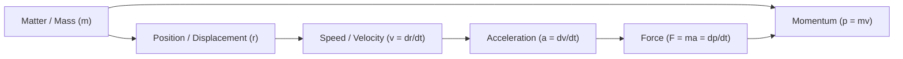

### 1. Matter and Mass

- **Matter**: Anything that occupies spatial volume (has physical dimensions) and possesses mass.
- **Mass ($m$)**: An intrinsic, scalar property of matter that quantifies its resistance to acceleration when subjected to a net external force (inertial mass), and determines the magnitude of mutual attraction with other bodies (gravitational mass). Measured in kilograms ($\text{kg}$).

---

### 2. The Spatial Kinematic Chain: Galileo Galilei & Diluting Gravity (1638)

#### The Empirical Dilemma
For nearly 2,000 years, Western thought was imprisoned by Aristotle's assertion that heavy objects fall faster than light ones in direct proportion to their weight, and that an object requires continuous pushing to remain in motion. But testing free fall directly was impossible with 17th-century water drips or pulse-counting; a dropped stone hits the ground in a fraction of a second, far too fast for human reaction times.

#### The Breakthrough Experiment: The Inclined Plane (*Piano Inclinato*)
In his 1638 masterpiece *Discourses and Mathematical Demonstrations Relating to Two New Sciences*, **Galileo Galilei** devised a brilliant method to "dilute" gravity:

```
        ● Bronze Sphere (m)
         \ 
          \  Polished Vellum-Lined Groove
           \
            \  Angle θ (1° - 5°)                 [ Clepsydra / Water Clock ]
             \                                    ┌───────────┐
              \                                   │  Water    │
               \                                  └─────┬─────┘
                \                                       │ Spout
                 \                                      ▼ Glass Vial
──────────────────┴───────────────────────────────► Jeweler's Balance (Grains)
```

1. **The Apparatus**: A straight wooden beam 12 cubits long (approx. $5.5\text{ m}$) and half a cubit wide, into which a groove was cut as straight and smooth as possible, lined with polished parchment (vellum) to reduce friction to near-zero. He rolled hard, polished bronze spheres down the ramp.
2. **The Timing Mechanism (The Clepsydra)**: Lacking a stopwatch, Galileo elevated a large bucket of water high above his bench, soldering a thin brass pipe to its base. When he released the sphere, he opened a finger-plug; when the sphere clicked past marked points on the ramp, he pinched the spout shut. He weighed the collected water on an ultra-sensitive jeweler's balance to a fraction of a grain.
3. **The Observation**: 
   - Over 1 unit of time, the sphere rolled 1 unit of distance.
   - Over 2 units of time, the sphere rolled 4 units of distance.
   - Over 3 units of time, the sphere rolled 9 units of distance.
   - In successive equal time intervals, the distance traversed followed the sequence of odd numbers: $1, 3, 5, 7, 9\dots$
   - Most critically: whether he rolled a heavy bronze ball or a lighter one, **the time to traverse the track was identical**.
4. **The Epiphany & Mathematical Formulation**:
   Acceleration is independent of mass. Distance scales with the square of elapsed time:

   $$
   d \propto t^2 \implies s(t) = \frac{1}{2} a t^2
   $$

   - **Position Vector ($\vec{r}$)**: Location in spatial coordinates relative to an origin.
   - **Velocity ($\vec{v}$)**: The vector time-rate of change of displacement:
     $$
     \vec{v} = \frac{d\vec{r}}{dt} = \lim_{\Delta t \to 0} \frac{\Delta \vec{r}}{\Delta t}
     $$
   - **Acceleration ($\vec{a}$)**: The vector time-rate of change of velocity:
     $$
     \vec{a} = \frac{d\vec{v}}{dt} = \frac{d^2\vec{r}}{dt^2}
     $$

#### The Double-Incline Thought Experiment (Discovery of Inertia)
Galileo placed two facing inclined ramps together in a V-shape. A sphere released from height $h$ on the left ramp rolled down and ascended the right ramp to virtually the same vertical height $h$. If he lowered the angle of the right ramp, making it longer and gentler, the sphere still climbed to height $h$. 
*The inescapable logical conclusion*: If the right ramp were laid completely flat (zero incline), the ball would roll forward **forever at constant velocity**, seeking a height it could never reach. Motion does not require a sustained force; only *changes* in motion do.

---

### 3. Newton's Synthesis: The Moon-Apple Test & The Three Laws (1687)

#### The Empirical Dilemma
Galileo had solved kinematics on Earth. Johannes Kepler had mapped the elliptical orbits of planets around the Sun. But no one knew if the mysterious force holding planets in orbit had anything to do with the force pulling falling stones to Earth.

#### The Breakthrough Experiment & Calculation: The Moon-Apple Verification (1666/1687)
Refugeed at his family estate in Woolsthorpe during the Great Plague of London, **Sir Isaac Newton** realized that if Earth's gravity extends into space, it must pull the Moon toward Earth just as it pulls an apple from a bough:

1. **The Apparatus (The Earth-Moon System as a Cosmic Laboratory)**:
   - At Earth's surface ($r = 1\text{ Earth radius} \approx 6,371\text{ km}$), an apple accelerates downward at $g \approx 9.81\text{ m/s}^2$.
   - Astronomical parallax established that the Moon orbits at a distance of $R_{moon} \approx 60\text{ Earth radii}$.
2. **The Inverse-Square Hypothesis**:
   If the gravitational force weakens with the square of distance ($F \propto 1/r^2$), then at 60 times the distance, Earth's gravitational pull on the Moon must be diluted by $60^2 = 3,600$:
   
   $$
   a_{moon\_expected} = \frac{g}{60^2} = \frac{9.81}{3600} \approx 0.002725 \, \text{m/s}^2
   $$
3. **The Empirical Test**:
   Newton calculated the Moon's actual inward centripetal acceleration ($a_c = v^2 / r$) from its orbital period of $27.32\text{ days}$ ($2.36 \times 10^6\text{ seconds}$) and orbital radius ($3.84 \times 10^8\text{ meters}$):
   
   $$
   v = \frac{2\pi R_{moon}}{T} \approx \frac{2\pi (3.84 \times 10^8\text{ m})}{2.36 \times 10^6\text{ s}} \approx 1022 \, \text{m/s}
   $$
   $$
   a_c = \frac{v^2}{R_{moon}} = \frac{(1022)^2}{3.84 \times 10^8} \approx 0.00272 \, \text{m/s}^2
   $$

The calculated centripetal acceleration matched the inverse-square gravitational prediction to within a fraction of a percent! In his 1687 *Principia*, Newton unified the heavens and the Earth under a single mechanical framework.

#### Newton's Laws of Motion

- **Linear Momentum ($\vec{p}$)**: The quantity of motion:
  $$
  \vec{p} = m\vec{v} \quad [\text{kg}\cdot\text{m/s}]
  $$
- **Newton's First Law (Law of Inertia)**:
  $$
  \sum \vec{F}_{ext} = 0 \implies \frac{d\vec{v}}{dt} = 0 \implies \vec{v} = \text{constant}
  $$
- **Newton's Second Law (Fundamental Law of Dynamics)**:
  $$
  \vec{F}_{net} = \frac{d\vec{p}}{dt} = m\frac{d\vec{v}}{dt} = m\vec{a} \quad [\text{Newtons, N} = \text{kg}\cdot\text{m/s}^2]
  $$
- **Newton's Third Law (Action-Reaction)**:
  $$
  \vec{F}_{A \to B} = -\vec{F}_{B \to A}
  $$
- **Universal Law of Gravitation**:
  $$
  F_g = G \frac{m_1 m_2}{r^2} \quad (G \approx 6.674 \times 10^{-11} \, \text{N}\cdot\text{m}^2/\text{kg}^2)
  $$

> **The Causal Bridge to Silicon**: 
> Modern gate channels operate on charge carriers accelerated by an electric field ($\vec{F} = q\vec{E} = m^*\vec{a}$). Without Galileo's and Newton's definitions of mass, acceleration, and inertia, physics could neither calculate the effective mass ($m^*$) of an electron inside a silicon crystal lattice nor predict carrier velocity saturation when clock frequencies exceed $5\text{ GHz}$.

---

## Epoch II: Work, Mechanical Energy, and Gravitational Potential (1686–1850)

### What Drove the Next Step?

Newton's vector mechanics ($\vec{F}=m\vec{a}$) required computing direction vectors at every infinitesimal point in three-dimensional space. For complex multi-body systems, tracking directional vectors became mathematically intractable. Physicists urgently needed a **scalar quantity** that remains invariant (conserved) across state transitions regardless of the path taken.

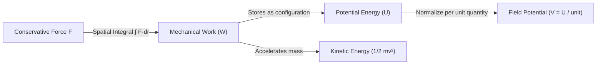

---

### 1. The Great "Vis Viva" Controversy & Du Châtelet's Clay Impact Experiment (1720s–1740s)

#### The Empirical Dilemma
In the late 17th century, a fierce intellectual war erupted across Europe. Sir Isaac Newton and René Descartes asserted that an object's destructive "quantity of motion" was strictly proportional to its linear momentum ($p = mv$). German polymath **Gottfried Wilhelm Leibniz** vehemently disagreed, arguing that nature conserved a scalar "living force" (*vis viva*), which he claimed scaled with velocity squared ($mv^2$). For decades, neither side could experimentally prove their claim because momentum and kinetic energy both increase with speed.

#### The Breakthrough Experiment: Dropping Brass Spheres into Soft Clay
In the 1720s, Dutch physicist **Willem 's Gravesande** devised a definitive physical experiment, later analyzed, mathematically formalized, and championed across Europe by the brilliant French natural philosopher **Émilie du Châtelet**:

```
        (●) Height h  ──► Velocity v   ──► Penetration depth: 1d 
        
        (●) Height 4h ──► Velocity 2v  ──► Penetration depth: 4d  (Not 2d!)
        
        (●) Height 9h ──► Velocity 3v  ──► Penetration depth: 9d  (Not 3d!)
        ────────────────────────────────────────────────────────
        [             Soft, Uniformly Prepared Clay Bed        ]
```

1. **The Apparatus**: A smooth bed of soft, uniformly kneaded potter's clay. Identical solid brass spheres were suspended from calibrated release mechanisms at varying heights: $1\text{ unit}$, $4\text{ units}$, $9\text{ units}$, and $16\text{ units}$ above the clay.
2. **The Mechanics**: From Galileo's kinematics, falling from 4 times the height gives an object exactly twice the impact speed ($v = \sqrt{2gh}$). 
3. **The Empirical Result**:
   - If Newton was right and destructive work scaled with momentum ($mv$), the ball with twice the speed should penetrate **twice as deep**.
   - **The clay revealed the truth**: The sphere dropped from $4\times$ height penetrated **exactly $4$ times deeper**. The sphere dropped from $9\times$ height (traveling at $3\times$ speed) plunged **$9$ times deeper**.
4. **Du Châtelet's Mathematical Proof (1740)**:
   In *Institutions de Physique*, du Châtelet demonstrated that the work done to deform the clay was proportional to the square of the velocity ($v^2$). Integrating Newton's Second Law with respect to displacement yielded the Work-Energy Theorem:

   $$
   W = \int_{x_1}^{x_2} F \, dx = \int_{x_1}^{x_2} m a \, dx = \int_{v_1}^{v_2} m v \, dv = \frac{1}{2}m v_2^2 - \frac{1}{2}m v_1^2
   $$

   $$
   E_k = \frac{1}{2}m v^2 \quad [\text{Joules, J}]
   $$

Du Châtelet had proven that kinetic energy is fundamentally quadratic with respect to speed—a reality that modern processor architects grapple with every single day when calculating dynamic switching power.

---

### 2. James Prescott Joule and the Mechanical Equivalent of Heat (1843–1850)

#### The Empirical Dilemma
By the early 19th century, physicists treated heat as an invisible, weightless fluid called "caloric" that flowed from hot bodies to cold bodies. But if caloric was an indestructible substance, where did the endless heat generated by boring bronze cannons (noted by Count Rumford in 1798) come from?

#### The Breakthrough Experiment: The Paddle-Wheel Calorimeter
English physicist and brewer **James Prescott Joule** possessed extraordinary experimental precision, having commissioned mercury thermometers capable of reading temperature increments as small as $\frac{1}{200}\text{th}$ of a degree Fahrenheit.

```
       Suspended Lead Weights (m)
              │
              ▼ (Falls distance h)
          [ Pulley ] ═════════ (Spool)
                                  │ Rotates
                                  ▼
                    ┌─────────────────────────┐
                    │  Calorimeter Tank (Water)│
                    │   ┌───┐                 │  ◄── Precision Thermometer
                    │   │ █ ┼── Vanes         │      (Measures ΔT to 1/200°F)
                    │   └───┘ Rotating Paddles│
                    └─────────────────────────┘
```

1. **The Apparatus**: A thermally insulated copper container filled with a carefully weighed mass of water. Submerged inside was a rotating brass axle equipped with 8 sets of brass paddle wheels, intermeshed with 4 sets of fixed vanes to prevent fluid swirling and maximize viscous fluid shear.
2. **The Drive Mechanism**: The central axle was wound with cord connected via frictionless pulleys to two heavy lead weights ($29\text{ pounds}$ each) suspended outside the tank.
3. **The Methodology**: Joule allowed the lead weights to fall from a measured height of $63\text{ inches}$ ($1.6\text{ m}$), winding them back up and repeating the drop twenty times in succession. The mechanical potential energy lost was:
   $$
   W = m g h_{total}
   $$
4. **The Discovery**: As the submerged paddles sheared through the water, mechanical friction transformed the churning motion into internal thermal motion. Joule measured a steady, undeniable rise in water temperature.
5. **The Unification**: Joule established that mechanical work and thermal heat are direct manifestations of the same conserved physical quantity: **Energy**. He determined that:
   $$
   1 \text{ calorie} \approx 4.184 \text{ Joules}
   $$

---

### 3. Potential Energy ($U$) and Gravitational Potential ($V_g$)

- **Potential Energy ($U$)**: The energy stored within a physical system by virtue of the relative spatial configuration of its parts against a conservative force field ($\vec{F} = -\nabla U$).
- **Gravitational Potential Energy ($U_g$)**:
  - Near Earth's surface ($g = 9.81 \, \text{m/s}^2$):
    $$
    U_g = mgh
    $$
  - In a general radial gravitational field:
    $$
    U_g(r) = - \int_{\infty}^{r} \vec{F}_g \cdot d\vec{r} = - \frac{G M m}{r}
    $$
- **Gravitational Potential ($V_g$)**: The potential energy *per unit test mass*. It represents the landscape property of space independent of what object you place there:
  $$
  V_g(r) = \frac{U_g(r)}{m} = -\frac{GM}{r} \quad [\text{J/kg}]
  $$

> **The Causal Bridge to Silicon**: 
> Joule's equivalence of mechanical work and thermal dissipation directly governs modern microprocessors. When a transistor switches, stored electrostatic potential energy in gate capacitors ($U = \frac{1}{2} C V^2$) is discharged directly through the silicon channel into thermal vibrations (phonons). Modern server CPUs consuming $350\text{ Watts}$ in an area the size of a postage stamp represent a heat flux density ($\sim 100\text{ W/cm}^2$) rivaling the surface of the Sun—all governed by the thermodynamic laws Joule and du Châtelet unveiled.

---

## Epoch III: Electrostatics — Electric Charge, Coulomb's Law, and Voltage (1752–1800)

### What Drove the Next Step?

Newtonian gravitation explained why celestial and terrestrial masses attract, but it completely failed to explain why rubbed amber attracts feathers, why cat fur crackles in the dark, or why lightning shatters trees. Gravity has only one polarity: it is strictly attractive. Electricity required an entirely new, dual-polarity fundamental property of matter that could both violently attract *and* violently repel.

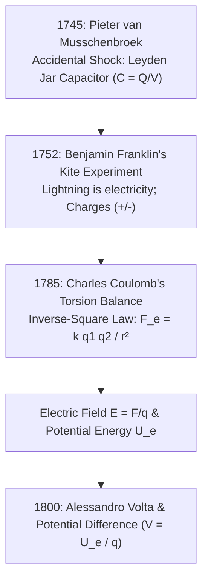

---

### 1. Pieter van Musschenbroek and the Accidental Shock: The Leyden Jar (1745)

#### The Empirical Dilemma
In the early 18th century, electrostatic friction machines could generate sparks by spinning glass globes against dry hands, but the charge vanished into thin air within milliseconds. Scientists assumed electricity was an ethereal gas that continually evaporated.

#### The Breakthrough Experiment: Trapping the "Electrical Fire"
In 1745, Dutch physicist **Pieter van Musschenbroek** at the University of Leiden attempted to preserve the electrical fluid by pouring water into a glass wine vial, hoping the water would absorb and retain the charge.

```
                  Electrostatic Friction Machine
                              │  Sparks
                              ▼
                        ┌───────────┐  Brass Wire
                        │     │     │
                        │  ┌──┴──┐  │
                        │  │Water│  │  ◄── Glass Bottle (Dielectric)
                        └──┴─────┴──┘
                             ▲
                             │ Hand holding jar (Ground plate)
                    [ Shock across Chest! ]
```

1. **The Apparatus**: A glass bottle filled with water, stoppered with a cork through which an iron nail / brass wire dangled into the water. The wire was connected to a spinning friction generator.
2. **The Accident**: Holding the outside of the glass flask with one hand, Musschenbroek reached out with his other hand to detach the brass wire from the charging machine.
3. **The Convulsion**: In that instant, Musschenbroek completed the circuit. Months of accumulated electrostatic charge discharged directly through his arms and chest. He was knocked unconscious and suffered severe muscle spasms, writing to René Réaumur: *"The arm and all the body are affected in a terrible manner... the kingdom of France could not induce me to suffer the shock a second time."*
4. **The Physical Principle**: Musschenbroek had inadvertently invented the **Capacitor**:
   - The conductive water inside acted as Plate 1.
   - Musschenbroek's hand on the outside acted as Plate 2 (connected to Earth ground).
   - The glass wall acted as the **dielectric insulator**.
   Charges did not evaporate; they were bound across the thin glass barrier by mutual electrostatic attraction across the dielectric!

$$
Q = C V \implies C = \frac{\varepsilon_r \varepsilon_0 A}{d} \quad [\text{Farads, F}]
$$

---

### 2. Benjamin Franklin's Philadelphia Kite & Key Experiment (June 1752)

#### The Empirical Dilemma
Was the terrifying power of thunder and lightning fundamentally the same phenomenon as the tiny static sparks produced by rubbing glass rods with silk?

#### The Breakthrough Experiment: The Silk Kite into the Thunderstorm
In June 1752, **Benjamin Franklin** and his 21-year-old son William walked into a field outside Philadelphia as a convective thunderstorm rolled in:

```
        ⚡ Thundercloud (Intense Static Negative Charge)
          \
           \  Wet Hemp Twine (Conductive when soaked)
            \
             \
              \      [ Shed / Undercover Roof ]
               \       │
                ▼      ▼ Dry Silk Ribbon (Insulator held by Franklin)
             ( Iron Key ) ──► [ Knuckle Sparks / Leyden Jar Charging ]
```

1. **The Apparatus**: A kite made from a large silk handkerchief stretched over two crossed cedar strips. To the top of the upright stick, Franklin affixed a sharp, pointed iron wire pointing 12 inches skyward to draw electrical fluid.
2. **The Isolation Setup**: The kite was flown on a common hemp twine. At the bottom of the twine, Franklin tied an iron house key. Crucially, between the key and his hand, he tied a length of **dry silk ribbon**, and stood under the dry awning of a cow shed so the silk would never get wet. (Dry silk is a non-conductive insulator, protecting Franklin from fatal electrocution).
3. **The Breakthrough Moment**: As rain soaked the hemp twine, Franklin observed loose hemp fibers standing erect and repelling one another like bristles on a brush. He brought his knuckle within an inch of the iron key: a bright, sharp blue spark leaped to his finger, accompanied by a loud crack.
4. **The Verification**: Franklin brought an uncharged Leyden jar to the key, charging it to full capacity directly from the sky. He used this sky-charge to ignite spirits of wine and perform all standard laboratory static experiments.
5. **Franklin's Unifying Theory**:
   - Electricity is not two separate substances, but a **single conserved fluid**.
   - Bodies with an excess of electrical fluid he designated as **Positive (+)**.
   - Bodies with a deficit he designated as **Negative (-)**.
   - *The Fundamental Law of Electrostatics*: Like charges repel; opposite charges attract.

---

### 3. Charles-Augustin de Coulomb and the Torsion Balance (1785)

#### The Empirical Dilemma
Franklin had shown that charges attract and repel, but how did the force scale with distance? Because charged bodies quickly leak charge into humid air, and the forces between tiny charged objects are on the order of micronewtons, standard mechanical scales were completely useless.

#### The Breakthrough Experiment: The Torsion Balance
In 1785, French military engineer **Charles-Augustin de Coulomb** constructed an apparatus capable of measuring forces as minuscule as $10^{-7}\text{ Newtons}$ (the weight of a speck of dust):

```
                   Torsion Micrometer Head (360° Scale)
                            │
                     Fine Silver Wire (Torsion Constant κ)
                            │
            ┌───────────────┼───────────────┐
            │               │               │
     Paper Vane      Needle (Silk/Shellac)  Gilded Pith Ball A (Charge q1)
   (Air Damper)                             ▲
                                            │  Distance r
                                            ▼
                                   Gilded Pith Ball B (Charge q2, Fixed)
```

1. **The Apparatus**: A glass cylinder topped by a tall glass tube. Suspended from the very top by a fine silver wire was an insulating needle made of silk and shellac. At one end of the needle was a tiny ball of elderberry pith coated in gold leaf; at the other end was a paper disc to damp oscillations.
2. **The Measurement**: Coulomb lowered a second identically charged pith ball through a hole in the lid, placing it next to the first ball. Like charges repelled, pushing the movable ball away and twisting the silver wire.
3. **The Torque Balance**: Coulomb turned the micrometer dial at the top of the wire to twist the suspension against the electrostatic repulsion until the balls were brought to known separation distances ($r$). The mechanical restoring torque of the silver wire was precisely linear with the angle of twist ($\tau = \kappa \theta$).
4. **The Invariable Law**: Coulomb proved that the repulsive and attractive forces obeyed an exact inverse-square law:

$$
\vec{F}_e = \frac{1}{4\pi\varepsilon_0} \frac{q_1 q_2}{r^2} \hat{r} = k_e \frac{q_1 q_2}{r^2} \hat{r}
$$

Where $k_e \approx 8.987 \times 10^9 \, \text{N}\cdot\text{m}^2/\text{C}^2$, and $\varepsilon_0 \approx 8.854 \times 10^{-12} \, \text{F/m}$.

---

### 4. Electric Field ($\vec{E}$), Electric Potential Energy ($U_e$), and Voltage ($V$)

To eliminate the philosophical paradox of "action at a distance," Michael Faraday and James Clerk Maxwell introduced the concept of the physical **Field**:

- **Electric Field ($\vec{E}$)**: The force exerted per unit positive test charge at any spatial coordinate:
  $$
  \vec{E} = \frac{\vec{F}_e}{q} \quad [\text{N/C} \text{ or } \text{V/m}]
  $$
- **Electric Potential Energy ($U_e$)**: The total mechanical work required to assemble a configuration of charges from infinite separation:
  $$
  U_e(r) = \frac{1}{4\pi\varepsilon_0} \frac{q_1 q_2}{r} \quad [\text{Joules, J}]
  $$
- **Electric Potential / Voltage ($V$)**: The electric potential energy *normalized per unit charge*:
  $$
  V = \frac{U_e}{q} = - \int_{\infty}^{r} \vec{E} \cdot d\vec{l} \quad [\text{Volts, V} = \text{Joules/Coulomb, J/C}]
  $$
- **Potential Difference ($\Delta V$)**: The work needed to move $1\text{ Coulomb}$ of charge from point $A$ to point $B$:
  $$
  \Delta V = V_B - V_A = -\int_{A}^{B} \vec{E} \cdot d\vec{l}
  $$

> **The Causal Bridge to Silicon**: 
> A modern MOSFET gate is literally Musschenbroek's Leyden jar shrunk down to nanometer dimensions. The conductive gate metal is Plate 1, the silicon inversion channel is Plate 2, and a $1.5\text{ nm}$ layer of high-$\kappa$ dielectric ($\text{HfO}_2$) is the glass bottle. When you apply $V_{DD} = 0.8\text{V}$, Coulomb's electrostatic force pulls billions of electrons across the silicon substrate toward the dielectric interface, forming the conductive channel that allows CPU logic states to switch.

---

## Epoch IV: Electrodynamics — Continuous Current, Resistance, and Circuits (1800–1831)

### What Drove the Next Step?

Leyden jars discharged their entire stored electrostatic charge in a violent microsecond spark. You cannot power a telegraph, run an experiment, or execute a computation with an instantaneous explosion. Humanity desperately needed a continuous, regulated pump for electric charge: an **Electromotive Force (EMF)**.

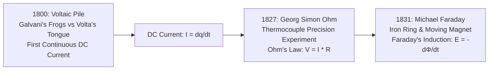

---

### 1. Luigi Galvani vs. Alessandro Volta: The Frog Muscle Controversy & The Voltaic Pile (1800)

#### The Empirical Dilemma
In 1780 at the University of Bologna, physician **Luigi Galvani** was dissecting frogs on a table near a static electric machine. When his assistant touched an exposed crural nerve with a metal scalpel while a spark jumped across the room, the frog's leg kicked violently. Later, Galvani hung frog legs from a brass hook onto an iron balcony railing; every time the wind blew the leg against the iron, the muscles convulsed. Galvani declared he had discovered **"Animal Electricity"**—an organic fluid unique to living tissue.

#### The Counter-Experiment: Alessandro Volta's Tongue Test (1792)
Physicist **Alessandro Volta** doubted that electricity originated within the biological tissue. He suspected the frog muscle was merely acting as a moist, passive detector.

```
                  Silver Coin (Top of Tongue)
                      ┌───────────────┐
                      │    SILVER     │
            ══════════╪═══════════════╪═══════════ (External Wire Contact)
                      │  HUMAN TONGUE │  ◄── Saliva acts as Electrolyte!
            ══════════╪═══════════════╪═══════════
                      │     ZINC      │
                      └───────────────┘
                   Zinc Disc (Under Tongue)
                   [ Sharp Acidic/Metallic Taste = Continuous Current Flow! ]
```

1. **The Apparatus**: Volta placed a piece of silver (or copper) on the upper surface of his wet tongue, and a piece of zinc underneath. He then brought the edges of the two dissimilar metals into contact with a copper wire.
2. **The Observation**: Instantly, Volta experienced a sharp, sour, acrid metallic taste on his palate that persisted as long as the metals touched. When he reversed the metals, the sensation altered. 
3. **The Conclusion**: The electricity was not animal in origin! It was generated at the **contact boundary of two dissimilar metals** separated by a moist conductive solution (an electrolyte). The frog's leg was merely an ultra-sensitive bio-galvanometer.

#### The Breakthrough Invention: The Voltaic Pile (1800)
To amplify this contact potential into a formidable power source, Volta stacked repeating modular cells:

```
          (+) Positive Terminal (Copper / Silver)
              ┌────────────────────────┐  Copper Disc
              ├────────────────────────┤  Brine-Soaked Cardboard (Electrolyte)
              ├────────────────────────┤  Zinc Disc
              ├────────────────────────┤  Copper Disc
              ├────────────────────────┤  Brine-Soaked Cardboard
              ├────────────────────────┤  Zinc Disc
              └────────────────────────┘
          (-) Negative Terminal (Zinc)
          [ Output: Continuous, Non-Decaying Direct Current (DC) ]
```

1. He alternated discs of **zinc** (which oxidized, releasing electrons: $\text{Zn} \to \text{Zn}^{2+} + 2e^-$) and **copper** (where reduction occurred), separated by discs of cardboard or leather saturated with salt water (brine).
2. By stacking 30 to 60 pairs in series, Volta created the world's first **chemical battery**. 
3. For the first time in human history, electric charge flowed as a continuous, steady stream:
   $$
   I = \frac{dq}{dt} \quad [\text{Amperes, A} = \text{Coulombs/second}]
   $$

---

### 2. Georg Simon Ohm and the Thermocouple Resistance Experiment (1826–1827)

#### The Empirical Dilemma
Following Volta's invention, scientists tried to determine the relationship between the length of a wire and the current flowing through it. But early experiments were plagued by chaos: Voltaic batteries polarized rapidly, as hydrogen gas bubbles accumulated on the copper plates, causing battery voltage to plunge erratically within seconds of closing the circuit.

#### The Breakthrough Experiment: Eliminating Battery Voltage Sag
In 1826, German high school teacher **Georg Simon Ohm** realized he had to eliminate chemical batteries entirely if he wanted true scientific repeatability. He turned to **Thomas Johann Seebeck's** discovery of thermoelectricity:

```
         Boiling Water Bath (100°C)          Melting Ice Bath (0°C)
            ┌───────────────┐                   ┌───────────────┐
            │ Hot Junction  │                   │ Cold Junction │
            │   (Cu - Bi)   │                   │   (Cu - Bi)   │
            └───────┬───────┘                   └───────┬───────┘
                    │                                   │
                    ▼ Invariant, Temperature-Stabilized EMF ▼
         ┌─────────────────────────────────────────────────────────┐
         │ Test Wire (Varying Length L, Diameter A: Cu, Brass, Fe) │
         └────────────────────────────┬────────────────────────────┘
                                      ▼
                        [ Torsion Galvanometer Needle ]
                        (Deflection Angle measured with Telescope)
```

1. **The Apparatus**: Ohm constructed a rigid U-shaped bismuth-copper thermocouple. One junction was submerged in a vessel of boiling water maintained at a steady $100^\circ\text{C}$; the other was plunged into a container of melting ice at $0^\circ\text{C}$. Because the temperature delta ($\Delta T = 100\text{ K}$) was rock-solid and stable, the Seebeck electromotive force remained absolutely constant over hours with zero voltage decay!
2. **The Measurement**: Ohm connected conductor wires made of copper, brass, and iron of precisely drawn lengths ($L$) and thicknesses ($A$). Above the conductor, he suspended a magnetic needle on a delicate torsion ribbon (an astatic galvanometer) and read the angular deflection using a telescope to avoid disturbing the air.
3. **The Empirical Discovery**:
   - For any given wire, current was strictly proportional to the applied temperature difference (voltage).
   - Increasing the wire length ($L$) reduced current in exact inverse proportion ($I \propto 1/L$).
   - Increasing cross-sectional area ($A$) increased current in direct proportion ($I \propto A$).
4. **Ohm's Law**:

$$
V = I \cdot R \implies R = \frac{V}{I} \quad [\text{Ohms, }\Omega = \text{V/A}]
$$

$$
R = \rho \frac{L}{A}
$$

Where $\rho$ is the intrinsic resistivity of the material ($\Omega\cdot\text{m}$).

- **Joule Heating (Electrical Dissipation)**:
  Electrons drifting through a conductor continuously collide with vibrating positive crystal lattice ions, converting kinetic energy into thermal lattice vibrations (phonons):
  $$
  P = V I = I^2 R = \frac{V^2}{R} \quad [\text{Watts, W} = \text{J/s}]
  $$

---

### 3. Michael Faraday and Electromagnetic Induction (1831)

#### The Empirical Dilemma
In 1820, Hans Christian Ørsted had accidentally discovered that an electric current deflects a compass needle—electricity produces magnetism. For 11 years, the greatest minds in Europe asked the inverse question: *Can magnetism produce electricity?* Scientists placed powerful magnets next to wire coils for days, but observed absolutely zero current on their galvanometers.

#### The Breakthrough Experiment: The Soft Iron Ring (August 29, 1831)
English self-taught bookbinder and experimentalist **Michael Faraday** broke the impasse with a brilliant physical insight: static magnetic fields do nothing; only **changing** magnetic flux can move charges.

```
       Battery (DC)
           │ Switch
           ▼
     ┌───────────┐
     │  Coil A   │  Primary Winding
     │ ░░░░░░░░░ │
     └───┬───┬───┘
      ┌──┴───┴──┐
      │Soft Iron│  Magnetic Flux Loop (Φ_B)
      │  Ring   │
      └──┬───┬──┘
     ┌───┴───┴───┐
     │  Coil B   │  Secondary Winding
     │ ░░░░░░░░░ │
     └─────┬─────┘
           ▼
     [ Galvanometer ] ──► "Twitches ONLY on Make or Break of Circuit!"
```

1. **The Apparatus**: Faraday took a soft iron ring with an outer diameter of $6\text{ inches}$. On one side, he wound three layers of insulated copper wire (**Coil A / Primary**), connected through a knife-switch to a Voltaic battery. On the opposing side of the ring, he wound a separate copper coil (**Coil B / Secondary**), isolated from the first and connected to a sensitive galvanometer.
2. **The Discovery Moment**:
   - The instant he **closed the switch** on Coil A, the galvanometer needle in Coil B jumped violently—and then immediately slumped back to zero, even while current continued pumping through Coil A!
   - While steady current flowed, the galvanometer showed nothing ($I = 0$).
   - The instant he **opened the switch** (breaking the circuit), the needle leaped in the **opposite direction**, and again returned to zero.
3. **The Moving Magnet Experiment**: Faraday quickly verified this by thrusting a bar magnet into a hollow coil of wire. Moving the magnet *in* induced a current in one direction; holding it stationary produced zero current; pulling it *out* induced current in the reverse direction.
4. **Faraday's Law of Induction**:
   An electromotive force ($\mathcal{E}$) is generated only by a **time-varying magnetic flux** ($\Phi_B$):

$$
\mathcal{E} = - \frac{d\Phi_B}{dt} \quad \text{where } \Phi_B = \iint \vec{B} \cdot d\vec{A}
$$

(The negative sign was formulated by Heinrich Lenz in 1834: the induced current always creates a magnetic field that opposes the change that produced it).

#### The Alternating Current (AC) Revolution vs. DC Microprocessors
Faraday's discovery led to the rotating alternator, where a coil spinning continuously inside a magnetic field produces sinusoidal **Alternating Current (AC)**:

$$
V(t) = V_{peak} \sin(\omega t)
$$

- **Why AC Won the Electrical Grid**: Nikola Tesla and George Westinghouse realized that AC can be stepped up to hundreds of thousands of volts using transformers ($\frac{V_p}{V_s} = \frac{N_p}{N_s}$). By stepping voltage up to hundreds of thousands of volts ($V \uparrow$), current drops to near-zero ($I \downarrow$). Because transmission line losses scale with $I^2 R$, this enabled long-distance power grids spanning continents.
- **Why Silicon Requires Pure DC**: Microprocessors are synchronous, binary state machines. A logic gate cannot tolerate a power rail that cycles through zero 120 times a second. Modern data centers take $13.8\text{ kV}$ AC grid lines, step them down, and run them through high-frequency switch-mode power supplies (SMPS) to deliver thousands of amperes of ultraclean, ripple-free **Direct Current (DC)** at $\sim 0.8\text{V}$ directly to CPU silicon.

---

## Epoch V: The Microscopic Subatomic World (1803–1913)

### What Drove the Next Step?

Ohm's, Volta's, and Coulomb's laws treated electricity as an infinitely divisible, continuous fluid. But this macroscopic view hit a wall: Why do copper and aluminum allow charges to drift effortlessly, while diamond, quartz, and rubber choke them completely? What *physically* is electric charge inside matter, and why is matter stable at all?

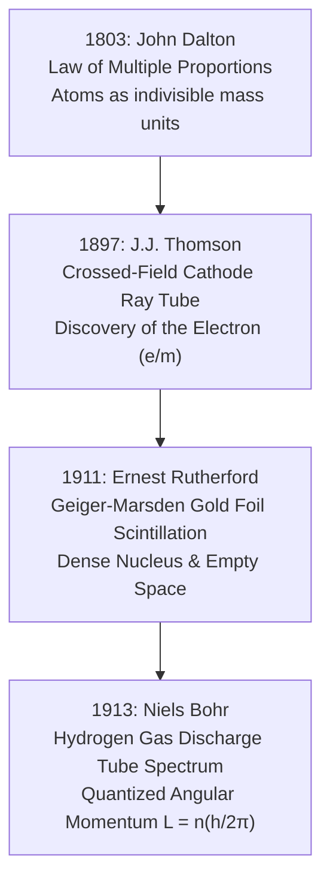

---

### 1. John Dalton and the Law of Multiple Proportions (1803)

#### The Empirical Dilemma
For millennia, alchemists debated whether matter could be subdivided infinitely or if it hit an indivisible bottom floor.

#### The Breakthrough Experiment: Weighing Reacting Gases
English chemist **John Dalton** performed rigorous stoichiometric mass measurements on chemical reactions of gases:
1. When carbon combines with oxygen, it forms two distinct gases: carbon monoxide ($\text{CO}$) and carbon dioxide ($\text{CO}_2$).
2. Dalton measured that $100\text{ g}$ of carbon reacts with exactly $133\text{ g}$ of oxygen to produce $\text{CO}$. But to produce $\text{CO}_2$, $100\text{ g}$ of carbon reacts with exactly $266\text{ g}$ of oxygen.
3. The ratio of oxygen masses combining with a fixed mass of carbon is:
   $$
   \frac{266}{133} = \frac{2}{1} \quad (\text{An exact integer ratio!})
   $$
4. **The Conclusion**: Nature does not blend substances like paints. Matter comes in discrete, indestructible atomic parcels with characteristic relative masses.

---

### 2. J.J. Thomson and the Discovery of the Electron (Cavendish Laboratory, 1897)

#### The Empirical Dilemma
When thousands of volts were applied across electrodes sealed in a glass tube evacuated to deep vacuum, a glowing green luminescence emanated from the negative cathode. German physicists (Hertz, Goldstein) insisted these "cathode rays" were waves in the luminiferous aether. British physicists suspected they were particles. Neither could prove it because the rays seemed impervious to electrostatic deflection.

#### The Breakthrough Experiment: Crossed Electric and Magnetic Fields
**Joseph John (J.J.) Thomson** realized that previous researchers failed to electrostatically deflect cathode rays because the residual gas in their tubes was ionizing, shielding the rays with a conductive plasma. Thomson used state-of-the-art vacuum pumps to drain the tube to $10^{-6}\text{ atmospheres}$, exposing the bare beam to pure fields:

```
    High Voltage Cathode (-)
           │
           ▼  Collimating Anode Slits (+)
     ┌─────┴─────┐
     │ ═══►═══►  │ ──► [ Narrow Beam of Rays ]
     └───────────┘
                       ┌─────────────────────────┐  (+) Charged Plate (Electric Field E)
                       │   ░░░░░░░░░░░░░░░░░░░   │
                       │ ═══════════════════════►│ ──► Phosphorescent Screen
                       │   ░░░░░░░░░░░░░░░░░░░   │     (Measures Deflection y)
                       └─────────────────────────┘  (-) Charged Plate
                             [ Electromagnets ]  ◄── Magnetic Field B (Perpendicular)
```

1. **Velocity Selector (Balancing $E$ and $B$)**: Thomson applied an electric field $\vec{E}$ between two internal metal plates, bending the ray upward. He simultaneously applied a perpendicular magnetic field $\vec{B}$ via external electromagnets, bending the ray downward. By tuning the fields until the glowing spot on the phosphorescent zinc sulfide screen hit the exact center (zero net deflection):
   $$
   qE = qvB \implies v = \frac{E}{B}
   $$
   Thomson measured the beam's speed at roughly $30,000\text{ km/s}$—nearly **$10\%$ of the speed of light**!
2. **Measuring Charge-to-Mass Ratio ($e/m$)**: Turning off the magnetic field, Thomson measured the vertical deflection ($y$) produced by the electric field alone:
   $$
   y = \frac{1}{2} a t^2 = \frac{1}{2} \left( \frac{qE}{m} \right) \left( \frac{L}{v} \right)^2 \implies \frac{q}{m} = \frac{2 y v^2}{E L^2}
   $$
3. **The Staggering Result**: The charge-to-mass ratio ($e/m$) was approximately:
   $$
   \frac{e}{m} \approx 1.76 \times 10^{11} \, \text{C/kg}
   $$
   This was **$1,836$ times larger** than the $e/m$ of a hydrogen ion (the lightest known object in chemistry).
4. **The Eureka**: Either the charge $e$ was gigantic, or the carrier mass $m$ was submicroscopic. Thomson concluded the latter: cathode rays were universal subatomic fragments plucked from the interiors of atoms—which he named **corpuscles**, later called **Electrons**.

---

### 3. Ernest Rutherford and the Geiger-Marsden Gold Foil Experiment (1909–1911)

#### The Empirical Dilemma
Thomson proposed the "Plum Pudding Model": an atom was a diffuse, gelatinous sphere of positive charge with tiny negative electrons embedded inside like raisins. If this were true, an atom had no concentrated electric fields.

#### The Breakthrough Experiment: Firing Alpha Particles at Gold Leaf
At the University of Manchester, **Ernest Rutherford** instructed his research assistants, **Hans Geiger** and undergraduate **Ernest Marsden**, to shoot high-energy alpha particles ($^4\text{He}^{2+}$, emitted by radioactive radium, possessing $7,300$ times the mass of an electron) through a sheet of beaten gold leaf:

```
     Lead Shielded Radium
           │ (Fires Alpha Beam: He²⁺)
           ▼
     ┌───────────┐
     │  ===►===► │ ──► Ultra-Thin Gold Foil (400nm thick, ~1000 atoms deep)
     └───────────┘             │
                               ├────────────────► 99.99% Pass Straight Through (Empty Space)
                               │
                               ▼ [ 1 in 8,000 Bounces Backwards! (> 90°) ]
                     Zinc Sulfide (ZnS) Screen
                     ◄── Eyepiece Microscope (Counting Scintillation Flashes in Dark)
```

1. **The Extreme Conditions**: The gold leaf was hammered to a gossamer thickness of just $400\text{ nm}$ (roughly $1,000$ atoms thick). Geiger and Marsden sat in total darkness for 30 minutes to adapt their dark vision, then peered through a microscope for grueling hours, counting individual, microscopic green flashes of light on a zinc sulfide screen.
2. **The Phenomenon**:
   - $99.99\%$ of the alpha particles passed through the foil as if it were empty air, with deflections under $1^\circ$.
   - But roughly **$1$ in every $8,000$ alpha particles** suffered violent collisions, ricocheting backwards at angles greater than $90^\circ$, some hurtling right back toward the source!
3. **Rutherford's Famous Stunned Reaction**:
   > *"It was quite the most incredible event that has ever happened to me in my life. It was almost as incredible as if you fired a 15-inch artillery shell at a piece of tissue paper and it came back and hit you."*
4. **The Nuclear Model (1911)**:
   Thomson's diffuse plum-pudding atom could never exert an electrostatic force strong enough to reverse a speeding alpha bullet. Rutherford proved that:
   - **$99.95\%$ of an atom's mass** and all its positive charge is crushed into an unimaginably dense central core: **the Nucleus** ($r \approx 10^{-15}\text{ m}$).
   - The outer boundary of the atom ($r \approx 10^{-10}\text{ m}$) is **$99.9999999999999\%$ empty space**, populated only by orbiting electrons.

---

### 4. Niels Bohr and the Quantized Hydrogen Spectrum (1913)

#### The Empirical Dilemma
Rutherford's planetary atom presented a catastrophic physics crisis: according to Maxwell's classical electrodynamics, an electron orbiting a positive nucleus is accelerating centripetally. An accelerating charge *must* continuously radiate electromagnetic waves. As it radiates energy, the electron must spiral inward and crash into the nucleus in less than $10^{-11}\text{ seconds}$. Under classical physics, every atom in the universe should collapse instantaneously into a blinding flash of light!

#### The Clue: Hydrogen Discharge Tubes
When hydrogen gas sealed in a glass tube at low pressure is excited by a high-voltage discharge, it glows with a soft magenta light. When passed through a glass prism or diffraction grating, it does **not** produce a continuous rainbow. It produces four discrete, razor-sharp colored lines:

```
  [ High-Voltage H2 Tube ] ──► [ Slit ] ──► [ Prism ]
                                                │
                                                ├── 656.3 nm (Red - H-alpha)
                                                ├── 486.1 nm (Cyan - H-beta)
                                                ├── 434.0 nm (Blue - H-gamma)
                                                └── 410.2 nm (Violet - H-delta)
```

In 1885, Swiss schoolteacher Johann Balmer noted an empirical formula for these lines:
$$
\frac{1}{\lambda} = R_H \left( \frac{1}{2^2} - \frac{1}{n^2} \right) \quad (n = 3, 4, 5, 6)
$$
No physicist on Earth could explain why.

#### Bohr's Breakthrough Postulate (1913)
Danish physicist **Niels Bohr** realized that classical physics did not apply inside the atom. He introduced three revolutionary quantum rules:
1. **Stationary States**: Electrons can only orbit at discrete radial distances where orbital angular momentum ($L$) is an integer multiple of reduced Planck's constant ($\hbar = h/2\pi$):
   $$
   L = m_e v r = n \hbar = n \frac{h}{2\pi} \quad (n = 1, 2, 3, \dots)
   $$
2. **Radiationless Orbits**: While an electron stays in an allowed stationary orbit, it radiates **zero** energy.
3. **Quantum Leaps**: An electron emits or absorbs a photon of light *only* when it jumps discontinuously between energy shelves:
   $$
   \Delta E = E_2 - E_1 = h \nu = \frac{hc}{\lambda}
   $$

> **The Causal Bridge to Silicon**: 
> Bohr's quantized electron orbitals form the bedrock of the entire semiconductor industry. In silicon (atomic number 14), Bohr's quantum numbers determine that its 14 electrons must occupy energy shells $1s^2 2s^2 2p^6 3s^2 3p^2$. The 4 outermost electrons in the $n=3$ shell are the **valence electrons**. When billions of silicon atoms pack together, these quantized orbitals hybridize into the diamond cubic crystal lattice, dictating every electronic property of CPU transistors.

---

## Epoch VI: Quantum Mechanics and Solid-State Band Theory (1900–1931)

### What Drove the Next Step?

Bohr's planetary model worked brilliantly for single-electron hydrogen, but broke down completely for multi-electron atoms like helium or silicon. More critically, classical physics predicted that *all* crystalline solids should conduct electricity because their outer electrons would simply float around the nuclei. Why did quartz glass choke electrical current with a trillion times higher resistance than copper? Why was silicon neither a good conductor nor an insulator? Classical physics had no answer.

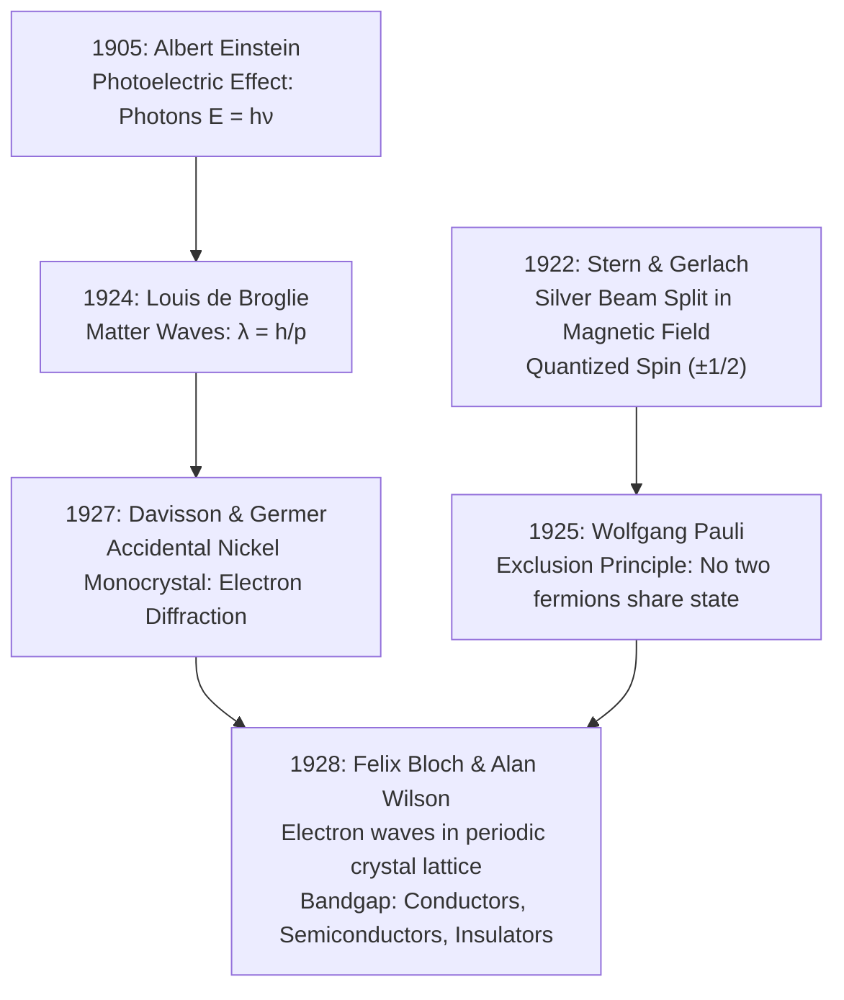

---

### 1. Albert Einstein and the Photoelectric Effect Experiment (1905)

#### The Empirical Dilemma
In 1902, German physicist **Philipp Lenard** shined ultraviolet light onto a polished metal plate inside an evacuated glass tube, ejecting electrons that were collected by a second plate. Under Maxwell's classical wave theory of light, light was an expanding electromagnetic wave:
- Cranking up the light's intensity (brightness) should deliver more energy to the electrons, making them fly out faster with higher kinetic energy.
- Dim light should take minutes or hours to deposit enough energy to liberate an electron.

#### The Breakthrough Experiment: What Really Happened
Lenard applied a negative reverse voltage (**Stopping Potential, $V_{stop}$**) to the collector plate to repel the incoming electrons until the current dropped to zero, directly measuring their maximum kinetic energy ($K_{max} = e V_{stop}$):

```
     Monochromatic Light Source (Frequency ν)
           │
           ▼ Quartz Window
     ┌─────┴─────┐
     │ ░░░░░░░░░ │ ──► Polished Emitter Plate (Work Function Φ)
     └───────────┘       │
                         ▼ Knocked-out Electrons (e-)
                   ┌───────────┐
                   │ Collector │ ◄── Reverse Retarding Voltage (V_stop)
                   └─────┬─────┘
                         ▼
                   [ Sensitive Micro-Ammeter ]
```

1. **The Classical Failure**: 
   - Making the light **1,000 times brighter** ejected 1,000 times more electrons per second, but their **maximum kinetic energy did not increase by even one micro-electronvolt**!
   - Dim ultraviolet light ejected electrons **instantaneously** (within $10^{-9}\text{ seconds}$), with zero warm-up delay.
   - Most baffling: Blindingly bright **red light** failed to eject a single electron, no matter how long the metal was blasted. Yet the dimmest, faintest **ultraviolet light** ejected electrons immediately!
2. **Einstein's Photon Theory (1905)**:
   Albert Einstein (awarded the 1921 Nobel Prize for this discovery) explained the anomaly by adopting Max Planck's 1900 blackbody quantum hypothesis ($E = h\nu$):
   - Light is not a continuous wave spreading through space; it travels as localized, indivisible packets of energy: **Photons**.
   - Electron ejection is a **one-on-one collision**: a single incoming photon collides with a single electron in the metal.
   - If the photon's energy ($h\nu$) is less than the metal's binding energy (**Work Function, $\Phi$**), no electron can ever escape, regardless of how many billions of photons strike the plate.
   - If $h\nu > \Phi$, an electron is knocked free instantly, carrying away the remaining energy as kinetic speed:

$$
K_{max} = h \nu - \Phi = e V_{stop}
$$

Light possesses dual particle and wave characteristics.

---

### 2. The Davisson-Germer Experiment: Electrons are Waves (1927)

#### The Empirical Dilemma
In 1924, French aristocrat **Louis de Broglie** made a radical theoretical leap: if light waves can behave like particles (photons), then material particles (like electrons) must possess an intrinsic wavelength:
$$
\lambda = \frac{h}{p} = \frac{h}{m v}
$$
Physicists dismissed this as pure mathematical fantasy. How could a hard, solid mass particle be a "wave"?

#### The Breakthrough Experiment: The Exploding Liquid-Air Bottle
At Bell Telephone Laboratories in New York, **Clinton Davisson** and **Lester Germer** were bombarding a target of polycrystalline nickel with a 54-electronvolt beam of electrons to study secondary electron emission:

```
     Electron Gun (54 eV, v ≈ 4,400 km/s)
           │
           ▼
     ┌───────────┐
     │  ===►===► │ ──► Recrystallized Nickel Monocrystal
     └───────────┘             │
                               │ Bragg Reflection off Atomic Planes (d = 0.091 nm)
                               ▼
                     [ Faraday Cup Detector ] ──► Sharp Intensity Peak at Angle θ = 50°!
```

1. **The Laboratory Accident**: In April 1925, a liquid-air storage flask exploded in the laboratory, shattering their vacuum chamber. High-temperature air rushed in, heavily oxidizing the pure nickel target with a thick black layer of nickel oxide.
2. **The Accidental Recrystallization**: To save the expensive nickel target, Davisson and Germer baked it in a high-temperature hydrogen oven at near-melting temperatures for weeks to reduce the oxide back to pure nickel. Unbeknownst to them, the prolonged heating caused the millions of tiny microscopic, randomly oriented nickel crystals to melt together and fuse into a **single, continuous monocrystal** with perfectly spaced atomic planes!
3. **The Astonishing Diffraction Peak**: When they pumped the tube back down to vacuum and fired the $54\text{ eV}$ electron beam at the newly annealed nickel crystal:
   - Instead of bouncing off randomly in all directions like billiard balls, the electrons scattered into sharp, concentric interference rings!
   - At an angle of exactly $\theta = 50^\circ$, the Faraday cup detector registered a violent, sharp **spike in electron intensity**.
4. **The Verification**: Using Bragg's law for crystal diffraction ($n\lambda = 2d \sin\theta$), Davisson calculated the wavelength of the electron beam:
   $$
   \lambda_{experimental} = 0.165 \, \text{nm}
   $$
   De Broglie's theoretical formula predicted:
   $$
   \lambda_{de\_Broglie} = \frac{h}{\sqrt{2 m_e E}} = \frac{6.626 \times 10^{-34}}{\sqrt{2(9.109 \times 10^{-31})(54 \times 1.602 \times 10^{-19})}} = 0.167 \, \text{nm}
   $$
The experimental match was unmistakable: **Electrons are physical waves**. They diffract, reflect, and interfere inside a crystal lattice just like ocean waves hitting the pillars of a pier.

---

### 3. The Stern-Gerlach Experiment & The Pauli Exclusion Principle (1922–1925)

#### The Empirical Dilemma
In classical mechanics, the magnetic dipole moment of an orbiting charge can point in any random direction across $360^\circ$ of three-dimensional space.

#### The Breakthrough Experiment: The Splitting Silver Beam (1922)
In Frankfurt, Germany, **Otto Stern** and **Walther Gerlach** vaporized pure metallic silver in an electric furnace at $1000^\circ\text{C}$, shooting a collimated beam of neutral silver atoms through an intensely non-uniform, inhomogeneous magnetic field created between a knife-edge pole and a grooved pole:

```
     Silver Vapor Furnace (1000°C)
           │
           ▼ Slit Collimator
     ┌─────┴─────┐
     │ ═══►═══►  │ ──► [ Inhomogeneous Magnetic Field (dB/dz) ]
     └───────────┘       ┌────────────────────────┐
                         │   ▲ Knife-Edge Pole    │
                         │ ══╪════════════════════╪═► ──► Glass Plate Target
                         │   ▼ Grooved Pole       │       [ Two Discrete Traces! ]
                         └────────────────────────┘       (Spin Up +1/2, Spin Down -1/2)
```

1. **The Classical Prediction**: Because the silver atoms tumbled randomly out of the furnace, classical physics dictated that their magnetic moments would be evenly distributed across all angles. The magnetic field should deflect them into a continuous vertical smear on the glass collector plate.
2. **The Quantum Reality**: The silver beam did not smear at all. It split into **two distinct, razor-sharp traces**, with absolute empty space in between!
3. **The Discovery of Spin**: Silver atoms have 47 electrons; the inner 46 electrons cancel each other out, leaving a single 47th valence electron in the $5s$ orbital. Stern and Gerlach had proven that an electron's intrinsic angular momentum is **quantized into only two orientations**: **Spin Up ($+1/2\hbar$)** and **Spin Down ($-1/2\hbar$)**.
4. **Wolfgang Pauli's Exclusion Principle (1925)**:
   Austrian physicist **Wolfgang Pauli** realized that electrons are fermions. His fundamental quantum law states:
   > *No two identical electrons in an atom or crystal lattice can occupy the same quantum state simultaneously ($n, l, m_l, m_s$).*

---

### 4. Felix Bloch, Alan Wilson, and the Band Theory of Solids (1928–1931)

#### The Synthesis: Electron Waves in Periodic Silicon Crystals
In 1928, Swiss physicist **Felix Bloch** combined de Broglie's matter waves, the Schrödinger wave equation:
$$
\left[ -\frac{\hbar^2}{2m}\nabla^2 + V(\vec{r}) \right]\psi(\vec{r}) = E\psi(\vec{r})
$$
and the periodic crystal lattice of solids. 

```
   Atomic Ion Core (V+)      Atomic Ion Core (V+)      Atomic Ion Core (V+)
           ▼                         ▼                         ▼
         ┌───┐                     ┌───┐                     ┌───┐
   ~~~~~~│ + │~~~~~~~~~~~~~~~~~~~~~│ + │~~~~~~~~~~~~~~~~~~~~~│ + │~~~~~~ Electron Wave ψ(r)
         └───┘                     └───┘                     └───┘
         ◄────── Lattice Constant a ─────►
```

1. **Bloch's Theorem**: An electron traveling through a crystal lattice does not collide with every atom like a pinball. Because the positive silicon ions are spaced with exquisite spatial periodicity ($V(\vec{r} + \vec{R}) = V(\vec{r})$), the electron wave function propagates as a plane wave modulated by the periodic lattice:
   $$
   \psi_k(\vec{r}) = e^{i \vec{k} \cdot \vec{r}} u_k(\vec{r})
   $$
2. **Formation of Forbidden Bandgaps ($E_g$)**:
   When the electron's quantum wavevector approaches the boundary of the crystal's Brillouin zone ($k = \pm \pi/a$), the forward-traveling wave and back-scattered wave destructively interfere and form stationary standing waves.
   - One standing wave clusters probability density directly on top of the positive atomic nuclei (lowering its electrostatic energy $\to$ **Valence Band, $E_v$**).
   - The other standing wave clusters probability density in the empty spaces between nuclei (raising its electrostatic energy $\to$ **Conduction Band, $E_c$**).
   - **Between these two energy solutions, no electron wave can physically propagate!** This forbidden energy gulf is the **Bandgap ($E_g = E_c - E_v$)**.
3. **Alan Wilson's Classification of Matter (1931)**:
   British physicist **Alan Wilson** applied the Pauli Exclusion Principle to these bands:

```
Energy (E)
  ▲
  │   [ Conduction Band (Empty at 0K) ]
  │   ─────────────────────────────────  <-- Conduction Band Edge (Ec)
  │
  │        FORBIDDEN BANDGAP (Eg)        (No quantum states allowed here)
  │
  │   ─────────────────────────────────  <-- Valence Band Edge (Ev)
  │   [ Valence Band (Full of bound e-) ]
  └───────────────────────────────────────────────────► Space
```

| Classification | Bandgap ($E_g$) | Physical Mechanism at Room Temp ($300\text{ K}$) | Material Examples |
| :--- | :--- | :--- | :--- |
| **Conductor** | $E_g = 0\text{ eV}$ (Bands overlap) | Valence and conduction bands overlap; electrons drift freely with infinitesimal electric fields | Copper, Aluminum, Silver |
| **Insulator** | $E_g > 5.0\text{ eV}$ | Wide bandgap; thermal vibrations ($k_B T \approx 0.026\text{ eV}$) cannot kick electrons across the chasm | Diamond ($5.47\text{ eV}$), Quartz $\text{SiO}_2$ ($9.0\text{ eV}$) |
| **Semiconductor** | $0.5\text{ eV} < E_g < 3.0\text{ eV}$ | Moderate bandgap; thermal energy can promote a tiny fraction of electrons, and conductivity can be chemically manipulated | **Silicon ($1.12\text{ eV}$)**, Germanium ($0.66\text{ eV}$) |

#### Silicon's Diamond Cubic Lattice
Silicon ($\text{Si}$, atomic number $14$) has 4 valence electrons in $3s^2 3p^2$. In a crystal, these orbitals undergo **$sp^3$ hybridization**, creating 4 symmetrical tetrahedral covalent bonds with adjacent silicon atoms:
- At absolute zero ($0\text{ K}$), all valence electrons are locked into covalent bonds. The valence band is completely full; the conduction band is completely empty. Pure silicon at $0\text{ K}$ is an absolute insulator!
- To turn this quantum insulator into a supercomputer, humanity had to figure out how to surgically inject free charge carriers into this bandgap without melting the crystal.

---

## Epoch VII: Semiconductor Engineering — Doping and the P-N Junction Diode (1939–1940)

### What Drove the Next Step?

At room temperature ($300\text{ K}$), pure (intrinsic) silicon has a tiny carrier concentration: only about $1.5 \times 10^{10}$ electrons per cubic centimeter are thermally kicked into the conduction band. Compare this to copper, which contains $8.5 \times 10^{22}$ free electrons per $\text{cm}^3$—copper has over **five trillion times** more mobile carriers than pure silicon. Intrinsic silicon is virtually an insulator. 

In the late 1930s, pre-WWII radar research faced a crisis: vacuum tubes were too bulky and had too much parasitic capacitance to detect microsecond microwave pulses. Engineers needed solid crystal rectifiers, but crystalline silicon was notoriously erratic and unpredictable.

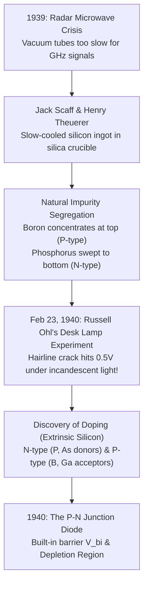

---

### 1. Russell Ohl and the Cracked Silicon Ingot (Bell Labs, February 23, 1940)

#### The Empirical Dilemma
At Bell Telephone Laboratories in Holmdel, New Jersey, radio researcher **Russell Ohl** was investigating why certain natural silicon crystals rectified high-frequency radio signals while others failed completely. Chemical analysis showed all the samples were supposedly $99.8\%$ pure silicon.

#### The Breakthrough Experiment: The Inadvertent Natural P-N Junction
Bell Labs metallurgists **Jack Scaff** and **Henry Theuerer** attempted to produce ultra-pure silicon by melting commercial silicon powder in an induction furnace inside a silica ($\text{SiO}_2$) crucible:

```
                  Scaff-Theuerer Melt (1450°C)
                             │
                             ▼  Slow Directional Freezing (Top to Bottom)
                   ┌───────────────────┐
                   │   P-TYPE REGION   │  ◄── Boron Leached from Silica Crucible (Top)
                   ├ - - - - - - - - - ┤  ◄── Visible Hairline Crack / Natural P-N Junction
                   │   N-TYPE REGION   │  ◄── Phosphorus Impurities Concentrated (Bottom)
                   └───────────────────┘
```

1. **The Apparatus & Ingot**: Because the crucible cooled slowly from top to bottom, impurities with differing crystallization solubilities naturally segregated:
   - Trace **boron** leached into the melt from the silica crucible walls, solidifying first in the upper half.
   - Trace **phosphorus** from the raw silicon remained dissolved in the liquid longer, concentrating in the bottom half.
   - Right in the middle, a visible, frosted hairline fracture developed between the two contrasting zones.
2. **The Discovery Moment (February 23, 1940)**:
   Russell Ohl cut a small rectangular rod from the cracked section of the ingot, soldered two copper leads to opposite ends across the fracture, and connected them to an oscilloscope and an analog voltmeter.
3. **The Desk Lamp Shock**:
   When Ohl flipped on an ordinary $40\text{W}$ incandescent gooseneck desk lamp to inspect the sample, **the voltmeter needle violently slammed to $0.5\text{ Volts}$**!
   - When he blocked the light with his hand, the voltage instantly vanished.
   - When he shined a flashlight on the crack, the voltage reappeared.
   - When he connected an AC signal generator, current flowed smoothly in one direction (P to N) with minimal resistance, but was completely choked off when the polarity was flipped (N to P)—displaying a rectification ratio exceeding $1,000:1$!
4. **The Kelly Demonstration**:
   Ohl called Bell Labs research director **Mervin Kelly** and team leader **William Shockley** to witness the phenomenon. Ohl connected the silicon slab to a tiny electric motor; when he shone a light on the hairline crack, the motor spun. 
   In that single cracked sliver of silicon, Ohl had discovered:
   1. The world's first **grown P-N junction**.
   2. The **solid-state rectifier diode**.
   3. The **silicon solar photovoltaic cell**.

---

### 2. Extrinsic Semiconductor Doping: Engineering Silicon's Lattice

Spectrographic analysis of Ohl's ingot unlocked the secret of semiconductor chemistry: electrical conductivity could be controlled across eight orders of magnitude by injecting trace impurities into the crystal lattice (typically $1$ dopant atom per $100,000$ to $100,000,000$ silicon atoms).

Doping is the deliberate introduction of foreign impurity atoms into an ultra-pure semiconductor crystal lattice (typically $1$ dopant atom per $100,000$ to $100,000,000$ silicon atoms).

#### N-Type Doping (Negative Majority Carriers)

- **Dopant**: Group 15 elements (Phosphorus $\text{P}$, Arsenic $\text{As}$).
- **Mechanism**: These atoms have **5 valence electrons**. When substituted into a silicon lattice site, 4 of their electrons form covalent bonds with adjacent silicon atoms. The **5th electron** is unbonded, loosely bound by only $\sim 0.045\text{ eV}$.
- **Result**: At room temperature, thermal energy ($k_B T = 0.026\text{ eV}$) ionizes nearly $100\%$ of these donors, kicking their 5th electron into the conduction band.
- **Majority Carriers**: Free electrons ($e^-$).
- **Fixed Ions Left Behind**: Positively charged donor ions ($\text{P}^+$ or $\text{As}^+$).

#### P-Type Doping (Positive Majority Carriers)

- **Dopant**: Group 13 elements (Boron $\text{B}$, Gallium $\text{Ga}$).
- **Mechanism**: These atoms have **3 valence electrons**. When substituted into the lattice, they cannot complete the 4th covalent bond with the neighboring silicon atom. This leaves an empty quantum state: **a hole ($h^+$)**.
- **What is a Hole?** A hole is the absence of an electron in an otherwise full valence band. When an adjacent valence electron jumps into this empty vacancy, the vacancy appears to move. A hole behaves mathematically and physically as a mobile particle with a **positive elementary charge ($+e = +1.602 \times 10^{-19}\text{ C}$)** and an effective mass.
- **Majority Carriers**: Holes ($h^+$).
- **Fixed Ions Left Behind**: Negatively charged acceptor ions ($\text{B}^-$).

> **Law of Mass Action**: In thermal equilibrium, the product of electron concentration ($n$) and hole concentration ($p$) is always constant:
>
> $$
> n \cdot p = n_i^2
> $$
>
> Where $n_i$ is the intrinsic carrier concentration ($\sim 1.5 \times 10^{10} \, \text{cm}^{-3}$ for silicon at $300\text{ K}$).

---

### 2. The P-N Junction Diode (1940)

When a P-type region and an N-type region meet within a single continuous crystal, a miraculous self-regulating boundary forms:

```
            P-REGION               DEPLETION REGION            N-REGION
       (Holes majority)          (Stripped of carriers)     (Electrons majority)
     ┌───────────────────────┬─────────────────────────┬───────────────────────┐
     │  h+    h+    h+    h+ │   (-)  (-)   (+)  (+)   │   e-    e-    e-    e-│
     │     h+    h+    h+    │   (-)  (-)   (+)  (+)   │      e-    e-    e-   │
     │  h+    h+    h+    h+ │   (-)  (-)   (+)  (+)   │   e-    e-    e-    e-│
     │  (Boron Acceptors B-) │   [Electric Field E ◄──]│ (Phosphorus Donors P+)│
     └───────────────────────┴─────────────────────────┴───────────────────────┘
                                 ◄── Diffuse h+
                                     Diffuse e- ──►
```

1. **Diffusion**: High concentration of electrons in the N-side diffuse across the junction into the P-side, while holes diffuse from the P-side to the N-side.
2. **Recombination**: At the interface, diffusing electrons fall into diffusing holes and cancel each other out.
3. **Depletion Region & Built-in Potential ($V_{bi}$)**:
   - When electrons vacate the N-side, they expose unshielded, immobile positive donor ions ($\text{P}^+$).
   - When holes vacate the P-side, they expose unshielded, immobile negative acceptor ions ($\text{B}^-$).
   - This strip of fixed space charge forms the **Depletion Region**.
   - These fixed charges create an intense internal **Electric Field ($\vec{E}$)** pointing from N to P.
   - The field exerts a force that opposes further diffusion. Thermal equilibrium is reached when drift current equals diffusion current.
   - The built-in barrier voltage for Silicon is:
     $$
     V_{bi} = \frac{k_B T}{q} \ln \left( \frac{N_A N_D}{n_i^2} \right) \approx 0.6\text{V} - 0.7\text{V}
     $$

#### Biasing the Diode

- **Reverse Bias (Positive terminal to N, Negative to P)**:
  - External voltage reinforces the internal field $\vec{E}$, widening the depletion zone. Barrier height increases ($V_{bi} + V_R$). Current drops to a negligible leakage current ($I \approx -I_s \approx 10^{-12}\text{A}$).
- **Forward Bias (Positive terminal to P, Negative to N)**:
  - External voltage counteracts the internal field, collapsing the depletion barrier ($V_{bi} - V_F$). Once applied voltage overcomes $\approx 0.7\text{V}$, billions of majority carriers flood across the junction, yielding high exponential current flow:

  $$
  I = I_s \left( e^{\frac{q V_D}{\eta k_B T}} - 1 \right) \quad \text{(Shockley Diode Equation)}
  $$

The P-N junction is the world's first solid-state **one-way valve (rectifier)** for electrical current.

---

## Epoch VIII: Active Solid-State Switches — BJTs and FETs (1947–1963)

### What Drove the Next Step?

A P-N junction diode is a passive, one-way valve: it can rectify AC to DC, but it cannot **amplify** a faint signal or act as an electronically toggled switch. To route telephone calls and build the earliest electronic computers, engineers relied on **Vacuum Tube Triodes** (invented by Lee de Forest in 1906). Vacuum tubes boiled electrons off a red-hot filament cathode inside an evacuated glass bulb, with a wire grid modulating electron flow to a positive plate anode.

#### The Fatal Flaws of Vacuum Tubes (The Impasse)
1. **Scorching Thermal Waste**: Filaments had to be heated to over $1,000^\circ\text{C}$, radiating massive heat and consuming kilowatts of power.
2. **Filament Burnout**: Like incandescent lightbulbs, filaments evaporated and snapped every few hundred hours. The **ENIAC computer (1946)**, containing $17,468$ vacuum tubes, broke down every two days as technicians scrambled to hunt down burned-out tubes.
3. **Bulky Scale**: Each tube was the size of a lightbulb. A computer with a billion vacuum tubes would require its own nuclear power station and occupy an entire city skyline.

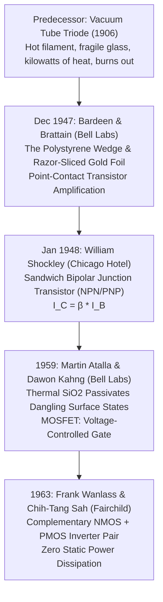

---

### 1. The Point-Contact Transistor: Bardeen, Brattain, and the Razor-Cut Gold Foil (Dec 1947)

#### The Empirical Dilemma
In 1945, Bell Labs formed a solid-state physics group led by theoretical physicist **William Shockley**. Shockley designed a field-effect amplifier: applying an electric field across a thin silicon slab should modulate the number of mobile charge carriers and amplify current. But every physical prototype failed completely: the measured current modulation was less than $1/1000\text{th}$ of theoretical predictions.
Theoretical physicist **John Bardeen** cracked the puzzle: when a semiconductor crystal ends at an abrupt boundary, dangling, unbonded chemical bonds trap incoming electrons at the surface. These **"trapped surface states"** created an electrostatic shield that blocked Shockley's external electric fields from penetrating into the channel.

#### The Breakthrough Experiment: The Polystyrene Plastic Wedge (December 16–23, 1947)
Experimentalist **Walter Brattain** began testing ways to bypass these trapped surface states. On December 16, 1947, Brattain made a daring mechanical contraption:

```
               Phosphor-Bronze Spring
                         │ (Presses down)
                   ┌─────┴─────┐
                   │Polystyrene│  Plastic Triangle
                   │   Wedge   │
                   └───┬───┬───┘
     Gold Foil Leaf A  │   │  Gold Foil Leaf B
     (Emitter Lead)    │   │  (Collector Lead)
                       ▼   ▼  ◄── Slit with Razor Blade under Microscope!
                    ┌─────────┐   (Gap ≈ 50 micrometers / 0.002 inches)
                    │Germanium│   N-Type Crystal Slab
                    └────┬────┘
                         │
                      Base (B)
```

1. **The Apparatus**: Brattain carved a triangular wedge of clear polystyrene plastic. He cemented an unbroken strip of gold foil around the sharp knife-edge apex of the wedge.
2. **The Microscopic Cut**: Placing the wedge under a microscope, Brattain took a surgical razor blade and carefully sliced through the gold foil right along the knife-edge tip. He had created two completely separate gold leaf contacts separated by barely **$50\text{ micrometers}$** ($0.002\text{ inches}$).
3. **The Contact**: Brattain suspended the plastic wedge from a phosphor-bronze spring and pressed the two razor-slit gold contacts down onto the surface of an N-type crystal slab of germanium.
4. **The Eureka Moment (December 23, 1947)**:
   - Gold Contact 1 was forward-biased (**Emitter**).
   - Gold Contact 2 was reverse-biased (**Collector**).
   - The germanium slab acted as the common ground (**Base**).
   When Brattain connected a carbon microphone to the Emitter and plugged headphones into the Collector circuit, he whispered into the microphone. John Bardeen put the headphones to his ears: **he heard Brattain's voice crystal-clear and amplified by 18-fold in volume**!
   The point-contact **transistor** (transfer-resistor) was born.

---

### 2. William Shockley's Hotel Room Epiphany: The Sandwich BJT (January 1948)

#### The Empirical Dilemma
William Shockley was consumed by professional jealousy: because Bardeen and Brattain had constructed the point-contact transistor on their own while Shockley was away, Bell Labs patent attorneys excluded Shockley's name from the initial patent application. Shockley knew that delicate gold-foil point contacts were mechanically fragile, noisy, and impossible to mass-produce reliably.

#### The Theoretical Synthesis (The Bismarck Hotel, Chicago)
In January 1948, Shockley isolated himself in a room at the Bismarck Hotel in Chicago for four weeks, working furiously around the clock:
1. He realized that amplification did not need to occur at erratic surface points. It could occur entirely within the **bulk interior** of a single continuous semiconductor crystal.
2. He designed a three-layer sandwich of alternating conductivity types: **N-P-N** or **P-N-P**:
   - **Emitter (E)**: Heavily doped ($N^{++}$) to flood carriers into the base.
   - **Base (B)**: Paper-thin (sub-micron) and lightly doped ($P$).
   - **Collector (C)**: Moderately doped ($N$) and large to collect incoming carriers.

```
                  NPN BIPOLAR JUNCTION TRANSISTOR
          Emitter (N++)         Base (P)           Collector (N)
        ┌───────────────┬──────────────────────┬───────────────────┐
        │  Electrons    │ Very Thin, Lightly   │  Swept through to │
        │  Injected ───►│ Doped Hole Region    │  Collector Lead   │
        └───────┬───────┴──────────┬───────────┴─────────┬─────────┘
                │                  │                     │
             Emitter              Base               Collector
               (E)                (B)                   (C)
```

3. **Operating Physics**:
   - Forward-biasing the Base-Emitter junction ($V_{BE} \approx 0.7\text{V}$) injects a tidal wave of electrons into the Base.
   - Because the Base is physically microscopic and contains very few holes, over $99\%$ of the injected electrons survive without recombining.
   - They strike the strong reverse-bias electric field of the Collector junction ($V_{BC} < 0$), which vacuums them across into the Collector.
4. **Current Gain ($\beta$)**:
   A minuscule base current ($I_B$) controls an avalanche collector current ($I_C$):
   $$
   I_C = \beta \cdot I_B \quad (\beta \approx 50 - 300)
   $$

In 1951, Bell Labs chemist **Morgan Sparks** fabricated the first functioning grown-junction BJT, validating Shockley's hotel-room equations. Bardeen, Brattain, and Shockley were jointly awarded the **1956 Nobel Prize in Physics**.

#### Why BJTs Were Discarded in Modern Microprocessors
BJTs are **current-controlled** switches. To keep a BJT turned ON, you must continuously pump a non-zero base current ($I_B > 0$). If a modern CPU with $50\text{ billion}$ transistors were built using BJTs, the base currents alone would draw tens of thousands of amperes, instantly melting the silicon into slag. Modern computing required a voltage-controlled switch that draws **zero gate current**.

---

### 3. Martin Atalla, Dawon Kahng, and the Thermal Oxide MOSFET (1959)

#### The Empirical Dilemma
In 1925, Austro-Hungarian physicist **Julius Edgar Lilienfeld** patented the concept of a field-effect transistor. But for 35 years, every laboratory on Earth failed to build one. Dangling chemical bonds on the semiconductor surface created a wall of trapped surface states ($N_{ss} \approx 10^{13} \, \text{states/cm}^2$) that completely swallowed any applied gate voltage.

#### The Breakthrough Experiment: Thermal Oxidation (Bell Labs, 1959)
Egyptian engineer **Martin (John) Atalla** joined Bell Labs in 1950 to study the chemistry of semiconductor surfaces. While others tried to clean silicon surfaces chemically, Atalla tried something radical: **growing a high-temperature glass barrier directly out of the silicon itself**:

```
                             GATE VOLTAGE (V_GS)
                                     │
                                ┌────┴────┐ (Evaporated Aluminum Gate)
                                │  GATE   │
            ┌───────────────────┴─────────┴───────────────────┐
            │        Thermally Grown Glass Oxide (SiO2)       │  ◄── Passivates Surface States!
    SOURCE  ├─────────────────┬─────────────┬─────────────────┤  DRAIN
      (N+)  │  N+ Source      │  INVERSION  │   N+ Drain      │   (N+)
    ────────┴────────┐        │   CHANNEL   │        ┌────────┴─────────
                     │        │ (Electrons) │        │
                     │        └─────────────┘        │
                     │      P-Type Silicon Body      │
                     └───────────────────────────────┘
```

1. **The Passivation Miracle**: In 1957, Atalla placed polished silicon wafers into a quartz tube furnace at $1000^\circ\text{C}$, flowing dry oxygen and steam. Oxygen atoms bonded covalently to the outermost silicon atoms, growing a pristine, pinhole-free film of **Silicon Dioxide ($\text{SiO}_2$)**. 
   - The chemical bonding satisfied the dangling surface bonds, dropping interface state density by **four orders of magnitude** (from $10^{13}$ to below $10^9 \, \text{states/cm}^2$).
   - The surface was magically neutralized!
2. **The First MOSFET (1959)**:
   Atalla's Korean colleague, **Dawon Kahng**, deposited an aluminum gate electrode on top of this thermal oxide layer, with two diffused $N^+$ regions on either side serving as the Source and Drain.
3. **The Inversion Layer Physics**:
   When a positive voltage was applied to the Gate ($V_{GS} > V_{th}$):
   - The electric field effortlessly penetrated the pristine $\text{SiO}_2$ dielectric.
   - It repelled holes from the interface and pulled a sheet of minority electrons from the substrate up to the surface.
   - This created an **Inversion Layer**: the physical **conductive silicon channel** connecting Source to Drain. In modern sub-3nm CPUs, this channel is sculpted down to $12\text{ to }18\text{ nm}$ in length and $3\text{ to }5\text{ nm}$ in thickness, operating as the fundamental digital switch for logic gates.
   - Because the gate is electrically insulated by dielectric, the gate current was virtually zero:
     $$
     I_G \approx 0 \, \text{Amperes}
     $$

The **MOSFET** (Metal-Oxide-Semiconductor Field-Effect Transistor) was born. It has become the most manufactured artificial artifact in human history, with an estimated **$13,000,000,000,000,000,000,000$ ($1.3 \times 10^{22}$)** MOSFETs produced to date!

---

#### MOSFET Operating Equations

- **Cutoff Region ($V_{GS} < V_{th}$)**:
  $$
  I_D \approx 0 \quad (\text{Switch OFF})
  $$
- **Linear / Triode Region ($V_{GS} > V_{th}$ and $V_{DS} < V_{GS} - V_{th}$)**:
  $$
  I_D = \mu_n C_{ox} \frac{W}{L} \left[ (V_{GS} - V_{th})V_{DS} - \frac{1}{2}V_{DS}^2 \right]
  $$
- **Saturation Region ($V_{GS} > V_{th}$ and $V_{DS} \ge V_{GS} - V_{th}$)**:
  The channel pinches off at the drain end. Current saturates and is modulated strictly by gate voltage:
  $$
  I_D = \frac{1}{2}\mu_n C_{ox} \frac{W}{L} (V_{GS} - V_{th})^2
  $$

  Where:
  - $W$ = Channel width, $L$ = Channel length
  - $C_{ox} = \frac{\varepsilon_{ox}}{t_{ox}}$ = Gate oxide capacitance per unit area
  - $\mu_n$ = Electron mobility

---

### 4. Comprehensive Taxonomy of FETs

```
                            FIELD-EFFECT TRANSISTORS (FETs)
                                         │
                 ┌───────────────────────┴───────────────────────┐
                 ▼                                               ▼
               JFET                                           MOSFET
     (Junction Field-Effect)                     (Metal-Oxide-Semiconductor)
                 │                                               │
        ┌────────┴────────┐                       ┌──────────────┴──────────────┐
        ▼                 ▼                       ▼                             ▼
   N-Channel           P-Channel              Depletion                     Enhancement
     JFET                JFET                   Mode                           Mode
                                       (Normally ON: Vgs=0)           (Normally OFF: Vgs=0)
                                                  │                             │
                                            ┌─────┴─────┐                 ┌─────┴─────┐
                                            ▼           ▼                 ▼           ▼
                                          NMOS        PMOS              NMOS        PMOS
                                                                          └─────┬─────┘
                                                                                ▼
                                                                              CMOS
                                                                     (Modern Digital Logic)
```

1. **JFET (Junction FET)**:
   - Uses a reverse-biased P-N junction directly as the gate barrier instead of an oxide insulator.
   - Disadvantage: If gate voltage flips to forward-bias ($V_G > 0.7\text{V}$), the gate conducts current and fails.
2. **MOSFET (Metal-Oxide-Semiconductor FET)**:
   - Insulated gate eliminates gate leakage current under both polarities.
   - **Enhancement Mode**: Channel does not exist at $V_{GS}=0$; turned ON by applying gate voltage.
   - **Depletion Mode**: Physical channel is implanted during manufacturing; conducting at $V_{GS}=0$; turned OFF by applying reverse gate voltage.
   - **NMOS**: Source/Drain are $N^+$, substrate is $P$. Current carried by fast electrons.
   - **PMOS**: Source/Drain are $P^+$, substrate is $N$. Current carried by slower holes.

---

### 5. Frank Wanlass and the CMOS Revolution: The Zero Static Power Revelation (1963)

#### The Empirical Dilemma
In the early 1960s, digital logic circuits were built using purely NMOS or purely PMOS transistors. But in an NMOS inverter, when the output was pulled to Logic 0, current flowed continuously from $V_{DD}$ through the pull-up load resistor straight to ground. If you built a chip with even $100,000$ NMOS gates, the idle standby current would consume kilowatts, burning up the chip.

#### The Breakthrough Experiment: Complementary Pairs (Fairchild, 1963)
At Fairchild Semiconductor, young physicist **Frank Wanlass** had a profound flash of insight: What if you pair an NMOS transistor with a PMOS transistor in a push-pull complementary symmetry?

```
                            VDD (+1.0V)
                                │
                         ┌──────┴──────┐
                         │  PMOS (P1)  │  ◄── Gate tied to Input
                         └──────┬──────┘
                                ├──────────── Output (V_out)
                         ┌──────┴──────┐
                         │  NMOS (N1)  │  ◄── Gate tied to Input
                         └──────┬──────┘
                                │
                            GND (0.0V)
```

1. **The Breadboard Test**: In 1963, Wanlass wired an NMOS and a PMOS transistor together on a test breadboard. He connected the common gates to an input voltage switch, tied the drains together to form the output, and hooked a sensitive analog micro-ammeter in series with the $V_{DD}$ power rail.
2. **The Shocking Reading**:
   - When $\text{Input} = 0\text{V}$ (Logic 0): PMOS is ON, NMOS is OFF. Output is $V_{DD}$. **Ammeter reads ZERO**.
   - When $\text{Input} = V_{DD}$ (Logic 1): PMOS is OFF, NMOS is ON. Output is $0\text{V}$. **Ammeter reads ZERO**.
   Wanlass tapped the glass face of his ammeter, convinced the meter movement was broken. He swapped in an ultra-sensitive pico-ammeter: the meter barely registered nanoamperes of parasitic reverse leakage.
3. **The Mechanism**: In either steady logic state (0 or 1), **one of the two transistors is ALWAYS completely turned OFF**. There is never a direct path from power to ground!
4. **Dynamic Switching Power**:
   Power is consumed *only* during the brief picosecond transition when the output changes state, charging or discharging the load capacitor $C_L$:

$$
P_{dynamic} = \alpha C_L V_{DD}^2 f_{clock}
$$

Where $\alpha$ is activity factor, $C_L$ is load capacitance, and $f_{clock}$ is processor clock frequency.

Wanlass and **Chih-Tang Sah** patented **CMOS (Complementary MOS)**. CMOS is the single reason modern smartphone and server CPUs can pack $50\text{ to }100\text{ billion}$ transistors onto a thumbnail-sized die without incinerating themselves on standby.

#### How a CMOS Inverter (NOT Gate) Works

- When $\text{Input} = 0\text{V}$ (Logic 0):
  - PMOS turns **ON** (conducts from $V_{DD}$ to Output).
  - NMOS turns **OFF** (blocks path to Ground).
  - $\text{Output} = V_{DD}$ (Logic 1).
- When $\text{Input} = V_{DD}$ (Logic 1):
  - PMOS turns **OFF** (blocks path from $V_{DD}$).
  - NMOS turns **ON** (pulls Output down to Ground).
  - $\text{Output} = 0\text{V}$ (Logic 0).

---

## Epoch IX: The Monolithic Integrated Circuit and Planar Revolution (1958–1968)

### What Drove the Next Step?

By the late 1950s, computing hardware slammed into an insurmountable engineering crisis dubbed by Bell Labs vice president Jack Morton as the **"Tyranny of Numbers"**:
- An advanced military computer or missile guidance system required over $200,000$ discrete components (transistors, diodes, resistors, capacitors).
- Every single component had two or three copper wire leads that had to be manually sorted, placed on a circuit board, and hand-soldered by human workers with a soldering iron under magnifying glasses.
- A system with $200,000$ components contained nearly **$500,000$ hand-soldered joints**. Even if every solder joint had a stellar $99.99\%$ reliability, statistically hundreds of joints were guaranteed to crack, oxidize, or shake loose under vibration every single week. Computers failed faster than technicians could repair them.

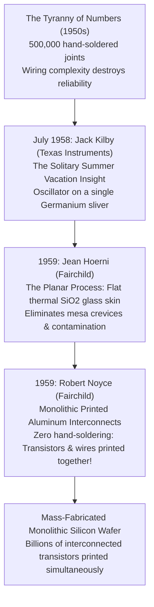

---

### 1. Jack Kilby's Solitary Summer: The Flying-Wire Hybrid IC (July–September 1958)

#### The Empirical Dilemma
Engineers assumed that resistors belonged to ceramic materials, capacitors belonged to mica or paper, and transistors belonged to semiconductors. Combining them required physical wires connecting disparate materials.

#### The Breakthrough Experiment: The Mandatory Vacation of 1958
In May 1958, soft-spoken electrical engineer **Jack Kilby** started work at Texas Instruments in Dallas. In July, the entire factory shut down for the mandatory two-week annual mass employee vacation. Having no accrued vacation days, Kilby had the TI research laboratory completely to himself for two weeks in absolute silence.

```
       [ Jack Kilby's Working Oscillator - Sept 12, 1958 ]
       Germanium Bar (1.6 mm x 11 mm glued to glass slide)
       ┌──────────────────────────────────────────────────────────┐
       │ Bulk Ge Resistor  │ P-N Junction Cap │ Mesa Transistor   │
       └─────────┬─────────┴────────┬─────────┴─────────┬─────────┘
                 │ (Hand-soldered)  │                   │
                 └─── Fine Flying Gold Wires ───────────┘
                                    │
                                    ▼
                         [ Oscilloscope Screen ]
                         (Undulating Green Sine Wave!)
```

1. **The "Monolithic" Realization**: Sitting at his lonely workbench, Kilby had a blindingly simple realization:
   > *"If all circuit components can be made of the exact same semiconductor material, they can all be carved directly out of a single chip of semiconductor!"*
   - **Resistors**: Can be carved from the bulk semiconductor material itself ($R = \rho L/A$).
   - **Capacitors**: Can be formed from a reverse-biased P-N junction depletion region ($C = \varepsilon A / d$).
   - **Switches**: P-N junction diodes and bipolar transistors.
2. **The Demonstration (September 12, 1958)**:
   Kilby took a sliver of single-crystal germanium measuring just $1.6\text{ mm} \times 11\text{ mm}$, glued it to a glass microscope slide, etched a mesa transistor, bulk resistors, and junction capacitors into the germanium, and tack-welded tiny flying gold wires across the top to connect them.
3. **The Oscilloscope Wave**: When Kilby hooked up a 10-volt battery to the germanium sliver in the presence of TI executives, an undulating green sinusoidal wave leaped across the cathode-ray oscilloscope screen at $1.3\text{ MHz}$. 
   *The limitation*: Kilby's IC still required microscopic gold wires tacked on by hand. It solved the material problem, but not the manufacturing problem.

---

### 2. Jean Hoerni, Robert Noyce, and the Monolithic Planar Revolution (1959)

#### The Problem with "Mesa" Transistors
Early transistors were 3D "mesas"—towers of silicon or germanium etched out of the wafer. Dust particles, moisture, and chemical residues settled in the microscopic crevices around the exposed P-N junctions, causing catastrophic electrical leakage and ruining yields.

#### Jean Hoerni's Planar Process (Fairchild Semiconductor, 1959)
Swiss physicist **Jean Hoerni**, one of the "Traitorous Eight" who founded Fairchild Semiconductor, proposed a radical counter-intuitive idea:
1. Keep the silicon surface completely **flat (planar)**.
2. Grow a protective glass skin of thermal silicon dioxide ($\text{SiO}_2$) over the entire wafer.
3. Use ultraviolet light through photographic negatives (**photolithography**) to etch tiny windows into the glass.
4. Diffuse dopants downward through the windows into the silicon.
5. **Leave the glass oxide permanently in place!** The glass skin sealed the sensitive P-N junction boundaries from air, dust, and moisture for all eternity.

#### Robert Noyce's Monolithic Interconnect (Fairchild, January 1959)
Fairchild general manager **Robert Noyce** looked at Hoerni's flat, glass-sealed planar wafer and had the crowning insight that launched Silicon Valley:

```
                  NOYCE'S MONOLITHIC PLANAR SILICON CHIP
      [ Evaporated, Photolithographically Etched Aluminum Metal Lines ]
       ══════════════════════╤═════════════════════════╤═══════════════
       ┌─────────────────────┴─────────────────────────┴──────────────┐
       │         Thermally Grown Glass Insulator (SiO2)               │
       ├─────────────────────┬─────────────────────────┬──────────────┤
       │   Transistor 1      │   Internal Silicon      │ Transistor 2 │
       │ (N+ / P / N+ Wells) │   Substrate Body        │ (N+ / P / N+)│
       └─────────────────────┴─────────────────────────┴──────────────┘
       [ All Transistors AND Interconnects Printed Simultaneously! ]
```

1. Noyce realized: *"Why are we hand-soldering little gold wires like Kilby? The surface of the chip is covered in insulating glass. We can print the wires directly on top of the glass!"*
2. **The Method**:
   - Evaporate a continuous blanket of aluminum metal across the entire top of the oxidized wafer.
   - Coat it with light-sensitive photoresist and expose it through a photographic mask of the wiring schematic.
   - Acid-etch away the unwanted metal, leaving flat aluminum traces running across the glass, dropping through etched contact holes to connect the transistors below.
3. **The Triumph**:
   - **Zero hand-soldering**.
   - **Zero flying wires**.
   - A million transistors, diodes, resistors, and all their connecting wires could be printed **simultaneously** onto a single silicon disc, just as a million letters are printed simultaneously on a newspaper printing press.

Jack Kilby and Robert Noyce were recognized as co-inventors of the Integrated Circuit (Kilby received the 2000 Nobel Prize in Physics; Noyce passed away in 1990). The monolithic silicon microchip had arrived.

---

## Epoch X: State Retention and Memory Architecture — How Silicon Traps 0s and 1s (1966–1971)

### What Drove the Next Step?

By 1965, the planar process allowed engineers to print dozens of interconnected transistors on a single monolithic silicon wafer. But a single transistor switch or combinational logic gate (such as NAND, NOR, or a CMOS Inverter) has a fatal limitation: **it possesses zero memory**. 
- A combinational gate's output voltage is strictly a transient function of its immediate input voltages: $V_{out}(t) = f(V_{in}(t))$.
- The moment the input voltage changes or disconnects, the previous output disappears into ground.
- Yet computation is inherently sequential: an Arithmetic Logic Unit (ALU) cannot multiply, evaluate loops, or run an algorithm without holding intermediate operands, keeping track of instruction pointers, and saving CPU state.

In early electronic computers, memory was an awkward mechanical or magnetic appendage. The ENIAC used banks of glowing vacuum-tube ring counters. The UNIVAC used ultrasonic acoustic mercury delay lines (cycling acoustic sound pulses through tubes of liquid mercury). By the late 1950s, the entire computer industry depended on **Magnetic Core Memory**: tiny rings of ferrite ceramic strung by hand onto matrices of threaded copper wires. Core memory was bulky, consumed massive current to flip magnetic domains, and could not be scaled down to microchips.

Physicists and engineers faced a foundational challenge: **How can a circuit composed purely of silicon switches, capacitors, and electric charges be forced to hold an invariant physical state (a `0` or a `1`) indefinitely?**

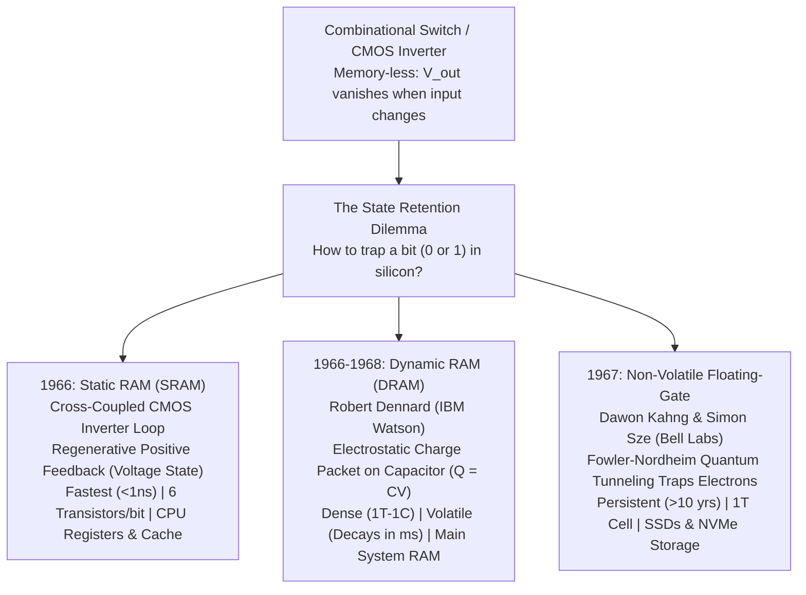

---

### 1. The Physical Reality of a "Bit": Voltage Windows and Noise Margins

Before constructing physical memory circuits, engineers had to solve a fundamental physics problem: **in nature, there is no such physical object as a "0" or a "1"**. The physical universe contains only continuous, noisy analog quantities—voltages, electric fields, and charge carrier densities.

If a bit were defined as a single exact voltage (e.g., $0.000\text{V} = \text{0}$ and $1.000\text{V} = \text{1}$), any stray thermal noise ($k_B T/q \approx 26\text{ mV}$) or electromagnetic interference from an adjacent wire would instantly corrupt data.

```
VOLTAGE (V)
   ▲
   │  ┌────────────────────────────────────────────────────────┐
   │  │ VALID LOGIC 1 (High Voltage Band: V_OH to V_DD)        │  <-- "1" State
   ├──┼────────────────────────────────────────────────────────┤
   │  │ High Noise Margin (NM_H = V_OH - V_IH)                 │
   ├──┼────────────────────────────────────────────────────────┤  <-- Input High Threshold (V_IH)
   │  │                                                        │
   │  │  FORBIDDEN UNCERTAINTY ZONE (Metastable Noise Band)    │  <-- Never stable in valid logic
   │  │                                                        │
   ├──┼────────────────────────────────────────────────────────┤  <-- Input Low Threshold (V_IL)
   │  │ Low Noise Margin (NM_L = V_IL - V_OL)                  │
   ├──┼────────────────────────────────────────────────────────┤
   │  │ VALID LOGIC 0 (Low Voltage Band: 0V to V_OL)           │  <-- "0" State
 0.0V ┴────────────────────────────────────────────────────────┘
```

#### Noise Margins and the Regenerative Property

To ensure absolute computational determinism, digital circuits enforce strict **Voltage Transfer Windows**:

- **$V_{OH}$ (Output High Voltage)**: The minimum voltage an operating gate outputs when asserting a Logic `1`.
- **$V_{OL}$ (Output Low Voltage)**: The maximum voltage an operating gate outputs when asserting a Logic `0`.
- **$V_{IH}$ (Input High Voltage)**: The lowest input voltage guaranteed to be recognized by a receiving gate as a Logic `1`.
- **$V_{IL}$ (Input Low Voltage)**: The highest input voltage guaranteed to be recognized by a receiving gate as a Logic `0`.

The safety buffers that protect signals against thermal and inductive noise are the **Noise Margins**:

$$
NM_L = V_{IL} - V_{OL}
$$

$$
NM_H = V_{OH} - V_{IH}
$$

#### The Regenerative Property

Because a CMOS inverter operates with a very high voltage gain ($|A_v| = |dV_{out}/dV_{in}| \gg 1$) through its transition region, any input voltage that drifts slightly away from the ideal power rails is aggressively restored to full rail ($V_{DD}$ or $0\text{V}$) at the output. 

Digital logic does not let analog noise accumulate over cascaded stages; the non-linear gain of the silicon switch continuously **regenerates** and snaps noisy voltages back into pristine binary levels.

---

### 2. Static State Storage: Cross-Coupled Inverters, Bistability, and the 6T SRAM Cell (1966)

#### The Empirical Dilemma
How do you build a circuit that preserves a voltage indefinitely after the driving circuit has disconnected, without relying on external mechanical switches?

#### The Breakthrough Concept: Regenerative Positive Feedback
In 1966, circuit designers connected two CMOS inverters head-to-tail in a closed circular feedback loop:

```
                  ┌──────────────────────────────────────────────┐
                  │                                              │
                  ▼                                              │
             ┌─────────┐                     ┌─────────┐         │
             │ Inverter│    Node Q           │ Inverter│ Node ~Q │
    Input ──►│    1    ├─────────┬──────────►│    2    ├───┬─────┘
             └─────────┘         │           └─────────┘   │
                                 ▼                         ▼
                              Stored                    Stored
                             State Q                 Complement ~Q
```

#### Mathematical Stability Analysis (The Bistable Attractor)
Consider the static transfer curves of the two inverters: $V_{out1} = f(V_{in1})$ and $V_{out2} = f(V_{in2})$. Because the output of Inverter 1 drives the input of Inverter 2, and the output of Inverter 2 drives Inverter 1:

1. **Loop Gain**: In the transition zone near $V_M \approx V_{DD}/2$, both inverters operate in their high-gain saturation region. The small-signal open-loop gain is:
   $$
   A_{loop} = \left( \frac{dV_{out1}}{dV_{in1}} \right) \cdot \left( \frac{dV_{out2}}{dV_{in2}} \right) = (-A_1) \cdot (-A_2) = +A_1 A_2 \gg 1
   $$
2. **The Unstable Saddle Point**: Because $A_{loop} > 1$, the intermediate state ($V_Q = V_{\bar{Q}} = V_{DD}/2$) is an unstable equilibrium (a saddle point). Any microscopic thermal voltage perturbation $\delta V$ experiences exponential growth:
   $$
   \frac{d(\Delta V)}{dt} = \frac{A_{loop} - 1}{\tau} \Delta V \implies \Delta V(t) = \Delta V_0 \exp\left( \frac{A_{loop}-1}{\tau} t \right)
   $$
3. **The Two Stable Attractors**: The voltage is violently repelled away from $V_M$ until one transistor enters cutoff and the other enters triode, collapsing $A_{loop}$ to zero. The circuit has exactly **two stable states**:
   - **State `1`**: $V_Q = V_{DD}$ (PMOS 1 ON, NMOS 1 OFF) $\implies V_{\bar{Q}} = 0\text{V}$ (PMOS 2 OFF, NMOS 2 ON).
   - **State `0`**: $V_Q = 0\text{V}$ (PMOS 1 OFF, NMOS 1 ON) $\implies V_{\bar{Q}} = V_{DD}$ (PMOS 2 ON, NMOS 2 OFF).

The circuit is **bistable**: it traps a bit within its own continuous voltage feedback loop.

---

#### The 6-Transistor (6T) SRAM Cell

To use this bistable latch as addressable computer memory, engineers added two NMOS access transistors, creating the standard **6T SRAM Cell**:

```
                       VDD (+1.0V)                 VDD (+1.0V)
                            │                           │
                     ┌──────┴──────┐             ┌──────┴──────┐
                     │  PMOS (P1)  │             │  PMOS (P2)  │  Pull-Up
                     └──────┬──────┘             └──────┬──────┘
                            │                           │
       Wordline (WL) ───────┼──────────────┬────────────┼─────── Wordline (WL)
             │              │              │            │              │
             ▼              │              │            │              ▼
       ┌───────────┐        │              │            │        ┌───────────┐
  BL ──┤ NMOS (A1) ├────────┼─── Node Q ───┴────────────┤        │ NMOS (A2) ├── ~BL
       │  Access   │        │     (Bit)            (~Bit)├───────┤  Access   │
       └───────────┘        │                           │        └───────────┘
                     ┌──────┴──────┐             ┌──────┴──────┐
                     │  NMOS (N1)  │             │  NMOS (N2)  │  Pull-Down
                     └──────┬──────┘             └──────┬──────┘
                            │                           │
                        GND (0.0V)                  GND (0.0V)
```

1. **Cell Components (6 Transistors)**:
   - **Pull-Up Transistors ($P_1, P_2$)**: Two PMOS transistors that tie the storage nodes to $V_{DD}$.
   - **Pull-Down Transistors ($N_1, N_2$)**: Two NMOS transistors that tie the storage nodes to Ground ($0\text{V}$).
   - **Access Transistors ($A_1, A_2$)**: Two NMOS pass-gates controlled by the horizontal **Wordline (WL)**, connecting internal nodes $Q$ and $\bar{Q}$ to vertical **Bitlines ($BL, \overline{BL}$)**.
2. **The Read Operation**:
   - Both bitlines ($BL$ and $\overline{BL}$) are precharged to $V_{DD}$.
   - The row decoder asserts the Wordline ($WL = V_{DD}$), turning ON access transistors $A_1$ and $A_2$.
   - If Node $Q = 0\text{V}$ and $\bar{Q} = V_{DD}$, NMOS $N_1$ and $A_1$ pull $BL$ down toward ground, discharging the bitline capacitance, while $\overline{BL}$ remains at $V_{DD}$.
   - A highly sensitive **Differential Sense Amplifier** detects the tiny differential voltage drop ($\Delta V \approx 50\text{ to }100\text{ mV}$) within picoseconds and outputs a clean digital `0`.
   - **Non-Destructive**: The read does not disturb the internal stored voltages.
3. **The Write Operation**:
   - The column write driver forces $BL$ to $0\text{V}$ and $\overline{BL}$ to $V_{DD}$ (to write a `0`).
   - The Wordline is pulsed ($WL = V_{DD}$).
   - Because the access transistor $A_1$ is intentionally sized with a higher channel width-to-length ratio ($W/L$) than the weak PMOS pull-up $P_1$ ($\beta_{access} > \beta_{pullup}$), the access transistor overpowers $P_1$, pulling Node $Q$ below the inverter threshold voltage.
   - The cross-coupled regenerative feedback immediately flips the opposite inverter, locking the new state into place.

#### Why SRAM Powers CPU Registers & Cache
- **Access Latency**: Blazing fast: $<0.5\text{ nanoseconds}$ for registers, $1\text{ to }10\text{ nanoseconds}$ for L1/L2/L3 cache.
- **Zero Refresh**: Operates indefinitely as long as $V_{DD}$ is powered.
- **The Tradeoff**: Requires **6 large transistors per single bit** (or 20–30 transistors for edge-triggered D-Flip-Flop registers with master-slave isolation). Storing 16 Gigabytes of data in SRAM would require hundreds of billions of transistors and an impossibly huge silicon die.

---

### 3. Dynamic State Storage: Robert Dennard and the 1T-1C DRAM Cell (IBM, 1966–1968)

#### The Empirical Dilemma
In 1966, an IBM System/360 mainframe memory module was a massive cabinet packed with millions of tiny magnetic ferrite donuts. A team of dozens of engineers at the IBM Thomas J. Watson Research Center in Yorktown Heights was trying to replace core memory using 6-transistor SRAM circuits. But the silicon area was too large and the cost per bit was uncompetitive.

#### The Breakthrough Experiment: Robert Dennard's Epiphany (1966)
IBM researcher **Dr. Robert Dennard** listened to his team's frustrations and went home to his study. Instead of trying to make a 6-transistor feedback loop smaller, he asked a radical first-principles physics question:
> *"Why do we need a complex feedback loop of active transistors to remember a state? In electrostatics, a capacitor naturally stores electric charge ($Q = CV$). Can't we just store a packet of electrons on a single microscopic capacitor, and use a single transistor as a valve to access it?"*

In 1968, Dennard received U.S. Patent 3,387,286 for the **Single-Transistor Dynamic Memory Cell (1T-1C DRAM)**.

```
                  Wordline (WL) [Row Select]
                             │
                             ▼ Gate
                       ┌───────────┐
     Bitline (BL) ─────┤ NMOS (M1) ├──────── Node S (Storage Node)
     [Column Sense]    │  Access   │              │
                       └───────────┘              ▼
                                            ┌─────┴─────┐
                                            │  Storage  │  C_s ≈ 25 - 35 fF
                                            │ Capacitor │  (Trench / Stacked Fin)
                                            └─────┬─────┘
                                                  │
                                             Plate Ground (V_DD / 2)
```

#### The 1T-1C Cell Architecture & Physics

1. **Components**:
   - Exactly **ONE access transistor** ($M_1$, NMOS).
   - Exactly **ONE storage capacitor** ($C_s \approx 25\text{ to }35\text{ femtofarads} = 10^{-15}\text{ F}$).
2. **State Representation**:
   - **Logic `1`**: Capacitor fully charged to $V_{DD}$ ($Q = C_s V_{DD}$). This stores a packet of approximately **$150,000\text{ to }200,000$ electrons**.
   - **Logic `0`**: Capacitor discharged to $0\text{V}$ ($Q \approx 0$).

---

#### The Physics of Destructive Read & Charge Sharing

Because the storage capacitor is microscopic ($C_s \sim 30\text{ fF}$), its charge cannot directly drive an output wire. When you read a DRAM cell, you must share its charge with the long, heavily capacitive Bitline wire ($C_{BL} \approx 200 - 400\text{ fF}$):

```
       Before Read:                           During Read (WL High):
       Bitline Precharged to V_DD / 2         Charges Equilibrate:
       
       C_BL (Large, ~300 fF)                  C_BL ════════════ C_s
       ┌────────────────────────┐             [ Shared Node Voltage V_final ]
       │ Charge: Q_BL           │                     │
       └────────────────────────┘                     ▼
       C_s  (Tiny, ~30 fF)                    Tiny ΔV = ±100mV to ±200mV!
       ┌────────────────────────┐
       │ Charge: Q_cell         │
       └────────────────────────┘
```

1. **Precharge**: The Bitline is precharged to half the supply voltage: $V_{pre} = \frac{1}{2} V_{DD}$.
2. **Charge Sharing**: The Wordline turns ON access transistor $M_1$. The charges on $C_{BL}$ and $C_s$ redistribute according to charge conservation:
   $$
   Q_{total} = C_{BL} \left(\frac{1}{2}V_{DD}\right) + C_s V_{cell} = (C_{BL} + C_s) V_{final}
   $$
3. **The Bitline Voltage Shift ($\Delta V_{BL}$)**:
   $$
   \Delta V_{BL} = V_{final} - \frac{1}{2}V_{DD} = \frac{C_s}{C_{BL} + C_s} \left( V_{cell} - \frac{1}{2}V_{DD} \right)
   $$
   Because $C_{BL} \approx 10 \times C_s$, the resulting voltage deviation on the bitline is minuscule:
   $$
   \Delta V_{BL} \approx \pm 100\text{ to }200\text{ millivolts}!
   $$
4. **Destructive Read & Sense-Amplifier Restoration**:
   - Reading the cell drains its stored charge onto the bitline—the data inside the capacitor is **destroyed** in the act of measurement!
   - A cross-coupled differential sense amplifier detects this faint $100\text{ mV}$ signal, rapidly snaps the bitline to full $V_{DD}$ (if reading `1`) or $0\text{V}$ (if reading `0`), and immediately **writes the original voltage back into $C_s$ before closing the Wordline**.

---

#### The Subthreshold Leakage Trap: Why DRAM is "Dynamic"

The storage capacitor $C_s$ is not an ideal insulator. Stored electrons continually bleed away through three distinct quantum and semiconductor leakage pathways:

1. **P-N Junction Reverse Leakage**: Minor thermal generation of electron-hole pairs across the access transistor's drain-substrate depletion junction ($I_{diff} + I_{gen} \approx 10^{-15}\text{ A}$).
2. **Subthreshold Channel Conduction**: Transistor $M_1$ is never $100\%$ OFF; subthreshold leakage current continually drains charge into the bitline.
3. **Dielectric Tunneling**: Quantum tunneling directly through the ultra-thin high-$\kappa$ capacitor dielectric.

```
Stored Charge Q(t)
   ▲
Q0 │═══════╗
   │       ╚═════╗
   │             ╚═════╗  Exponential Decay: Q(t) = Q_0 * exp(-t / RC)
1/2│ - - - - - - - - - ╚══════════  <-- Critical Threshold (Bit Lost if unrefreshed!)
   │
   └───────────────────────────────────────────────► Time (ms)
   ◄─── Refresh Window (Every 32ms - 64ms) ───►
```

Because charge decays exponentially ($Q(t) = Q_0 e^{-t/\tau}$), a DRAM cell loses its data within a fraction of a second.

#### The Dynamic Refresh Cycle
To maintain data integrity, the system memory controller must continuously sweep through every row of memory, reading and rewriting each capacitor every **$32\text{ to }64\text{ milliseconds}$** (the **DRAM Refresh Cycle**). If power or refresh is interrupted for even $100\text{ milliseconds}$, every capacitor discharges to zero and all data evaporates.

In October 1970, Intel launched the **Intel 1103**, the first commercially available $1,024$-bit ($1\text{ Kbit}$) MOS DRAM chip. Within two years, Dennard's 1T-1C cell had permanently displaced magnetic core memory across the computing industry. Today, every stick of DDR4/DDR5 system RAM and GDDR6/HBM graphics memory is built directly on Dennard's 1T-1C physics.

---

### 4. Non-Volatile State Storage: Dawon Kahng, Simon Sze, and Floating-Gate Flash Memory (Bell Labs, 1967)

#### The Empirical Dilemma
Both SRAM (6T feedback) and DRAM (1T-1C capacitors) share an unavoidable vulnerability: **they are volatile**. Cut the power rail, and all state disappears into heat. Early computers had to boot from punched paper tape, magnetic tape reels, or spinning magnetic hard disk drives with mechanical platters. The industry desperately needed a solid-state semiconductor memory that could trap electrons and hold data for decades with **zero electrical power applied**.

#### The Breakthrough Experiment: Dawon Kahng and Simon Sze (Bell Labs, 1967)
In 1967, Korean-American engineer **Dawon Kahng** (who had co-invented the MOSFET with Martin Atalla in 1959) and his colleague **Dr. Simon Min Sze** at Bell Labs conceived an ingenious physical device:
> *"What if we take a standard MOSFET, but insert an electrically isolated, floating metallic island between the control gate and the silicon channel, completely wrapped inside high-grade glass dielectric?"*

They had invented the **Floating-Gate Non-Volatile Memory Cell (Floating-Gate MOSFET)**.

```
                             CONTROL GATE (CG)
                                     │ (Wordline Voltage V_CG)
                         ┌───────────┴───────────┐
                         │   Polysilicon Gate    │
                         ├───────────────────────┤
                         │ Blocking Oxide (IPD)  │  ◄── Thick Dielectric (SiO2 / Al2O3)
                         ├───────────────────────┤
                         │  FLOATING GATE (FG)   │  ◄── Completely Isolated Electron Trap!
                         ├───────────────────────┤
                         │   Tunnel Oxide (~8nm) │  ◄── Ultra-thin Quantum Barrier
     SOURCE              ├───────────────────────┤              DRAIN
      (N+)     ──────────┴───────────────────────┴──────────     (N+)
   ────────────┤             Silicon Channel               ├────────────
               └───────────────────────────────────────────┘
                               P-Substrate
```

---

#### The Quantum Physics of Writing (Programming): Fowler-Nordheim Tunneling

Because the Floating Gate is completely surrounded by dielectric glass ($\text{SiO}_2$, bandgap $E_g \approx 9.0\text{ eV}$), it has zero physical wire contacts. Electrons cannot simply flow in through copper leads. They must be injected using **Quantum Mechanical Tunneling**:

1. **Fowler-Nordheim (FN) Tunneling**:
   - A high programming voltage ($V_{CG} \approx 18\text{ to }20\text{V}$) is applied to the Control Gate, while the substrate is grounded.
   - This creates an intense electrostatic field ($E_{ox} > 10\text{ MV/cm}$) across the ultra-thin ($8\text{ to }10\text{ nm}$) tunnel oxide layer.
   - The immense field tilts the rectangular energy barrier of the silicon dioxide into a narrow triangular quantum barrier.
   - Channel electrons pass directly *through* the classically forbidden energy barrier via quantum wave-function penetration:
     $$
     J_{FN} = A E_{ox}^2 \exp\left( -\frac{B}{E_{ox}} \right)
     $$
   - The electrons fall into the deep potential well of the Floating Gate and become physically trapped.
2. **Hot Carrier Injection (HCI)** (used in NOR Flash):
   - A high drain voltage ($V_D \approx 5\text{V}$) and gate voltage ($V_{CG} \approx 10\text{V}$) are applied.
   - Electrons accelerating through the channel pinch-off region acquire kinetic energies exceeding the $\text{Si}-\text{SiO}_2$ conduction band offset ($3.15\text{ eV}$).
   - These energetic "hot" electrons collide with the crystal lattice and scatter upward over the oxide barrier into the floating gate.

---

#### Reading the Bit: Modulating the Transistor Threshold Voltage ($\Delta V_{th}$)

Once electrons are trapped in the floating gate, how do you read the bit without discharging it?
You read it through **Electrostatic Field Screening**:

```
      ERASED CELL (No trapped e-)               PROGRAMMED CELL (Trapped e-)
      Threshold Voltage: V_th,low ≈ 1.5V         Threshold Voltage: V_th,high ≈ 4.5V
      
Drain Current (I_D)                        Drain Current (I_D)
  ▲                                          ▲
  │       [ Erased / "1" ]                   │                    [ Programmed / "0" ]
  │           /                              │                           /
  │          /                               │                          /
  │         /                                │                         /
  │        /                                 │                        /
  │       /     ◄────── V_read (2.5V) ──────►│                       /
  └──────┼──────────────┼────────────────────┴──────────────────────┼───────► V_CG
       V_th,low      V_read                                       V_th,high
       (ON: I > 0)                                                (OFF: I = 0)
```

1. **The Threshold Voltage Shift**:
   The trapped negative charge ($Q_{FG} < 0$) produces an opposing electric field that shields the silicon channel below. To turn the transistor channel ON, the control gate must provide an extra positive voltage to neutralize this trapped charge:
   $$
   \Delta V_{th} = -\frac{Q_{FG}}{C_{IPD}}
   $$
   Where $C_{IPD}$ is the capacitance between the Control Gate and the Floating Gate.
2. **Reading the Stored State**:
   - The memory controller applies an intermediate read voltage to the Control Gate: $V_{th,low} < V_{read} < V_{th,high}$ (e.g., $V_{read} = 2.5\text{V}$).
   - **If the cell is Erased (Logic `1`)**: The floating gate holds no excess electrons ($V_{th} \approx 1.5\text{V}$). Since $V_{read} > V_{th,low}$, the channel turns **ON**, conducting strong drain current ($I_D > 0$). The sense amplifier registers a **`1`**.
   - **If the cell is Programmed (Logic `0`)**: The floating gate is packed with trapped electrons ($V_{th} \approx 4.5\text{V}$). Since $V_{read} < V_{th,high}$, the channel remains completely **OFF** ($I_D = 0$). The sense amplifier registers a **`0`**.
3. **Decade-Long Data Retention**:
   At room temperature, the probability of an electron acquiring sufficient thermal energy ($k_B T = 0.026\text{ eV}$) to overcome the $3.15\text{ eV}$ oxide barrier is virtually zero ($P \sim \exp(-3.15 / 0.026) \approx 10^{-53}$). Trapped electrons remain trapped inside the floating gate for **over 10 to 100 years** with zero power applied!
4. **Multi-Level Cells (MLC, TLC, QLC)**:
   By using closed-loop iterative write pulses (Incremental Step Pulse Programming - ISPP), modern Flash controllers meter out exact numbers of electrons into the floating gate (or Silicon Nitride Charge Trap layer), sculpting **16 distinct threshold voltage distributions** within a single transistor. This allows a single microscopic cell to store **4 bits of data (QLC)** simultaneously!
5. **3D V-NAND Flash**:
   In modern solid-state drives (SSDs), chipmakers drill vertical cylindrical holes through 200 to 300+ alternating horizontal layers of gate metal and dielectric, wrapping charge-trap memory cells into vertical 3D skyscrapers holding terabytes of persistent data on a fingernail-sized die.

---

### 5. Comparative Memory Hierarchy & Physical Storage Modes

Every computer architecture organizes these physical storage technologies into a hierarchical pyramid, balancing the fundamental physics tradeoff between **access speed** (governed by wire RC delay and transistor gain) and **storage density** (governed by cell component count and physical isolation):

```
                                 ▲
                                / \     CPU Registers (D-Flip-Flops)
                               /   \    0.25ns - 0.5ns | ~24 Transistors/bit
                              /-----\
                             /       \   L1 & L2 Cache (6T SRAM)
                            /         \  0.8ns - 3ns | 6 Transistors/bit
                           /-----------\
                          /             \  L3 Shared Cache (Dense 6T SRAM)
                         /               \ 10ns - 20ns | 6 Transistors/bit
                        /-----------------\
                       /                   \  Main System Memory (DRAM)
                      /                     \ 50ns - 80ns | 1 Transistor + 1 Capacitor (1T-1C)
                     /-----------------------\
                    /                         \  Solid-State Storage (3D NAND Flash / SSD)
                   /                           \ 10µs - 50µs | 1 Transistor (holds 1-4 bits)
                  /-----------------------------\
```

| Memory Tier | Physical Storage Mechanism | Devices Per Bit | Typical Latency | Volatility & Data Lifetime | Primary Silicon Location |
| :--- | :--- | :--- | :--- | :--- | :--- |
| **CPU Registers** | **Regenerative Master-Slave Voltage Latch**: Cross-coupled inverters isolated by pass-gates. | ~20–30 Transistors | $0.25 - 0.5\text{ ns}$ (1 clock cycle) | **Volatile**: Lost instantly upon power-off; immune to leakage while powered. | Etched directly into ALU execution datapath |
| **L1 / L2 Cache** | **6T SRAM Cell**: Two cross-coupled CMOS inverters with differential NMOS access gates. | 6 Transistors | $0.8 - 3\text{ ns}$ (3–10 clock cycles) | **Volatile**: Lost upon power-off; zero refresh required while $V_{DD}$ is maintained. | Inside CPU Core, adjacent to pipeline stages |
| **L3 Cache** | **Dense 6T SRAM Cell**: Compact layout with shared ground lines and metal bitlines. | 6 Transistors | $10 - 20\text{ ns}$ (30–60 clock cycles) | **Volatile**: Lost upon power-off; zero refresh required. | Central CPU die, shared across all cores |
| **Main Memory (DRAM)** | **1T-1C Cell**: Physical electrostatic charge packet ($Q = C V$) on a $30\text{ fF}$ capacitor. | 1 Transistor + 1 Capacitor | $50 - 80\text{ ns}$ (~200 clock cycles) | **Volatile**: Decays within $<64\text{ ms}$; requires continuous dynamic refresh sweeps. | External DDR4/DDR5 DIMMs or soldered LPDDR |
| **Non-Volatile Flash (SSD)** | **Charge Trap / Floating Gate**: Electrons quantum-tunneled into isolated potential well ($\Delta V_{th}$). | 1 Transistor (1 to 4 bits) | $10 - 50 \, \mu\text{s}$ (50,000+ clock cycles) | **Non-Volatile**: Stored for $>10\text{ years}$ without power; wears out after $10^3 - 10^5$ erase cycles. | Dedicated NVMe / NAND Flash dies |

> **The Causal Bridge to Silicon Architecture**: 
> With the invention of static regenerative feedback (SRAM) and dynamic charge storage (DRAM) between 1966 and 1971, silicon circuits were no longer mere switches: they could store and remember state. Engineers could now combine combinational ALUs with sequential state registers, setting the stage for Carver Mead, Lynn Conway, and the birth of automated microprocessor VLSI design.

---

## Epoch XI: VLSI, Electronic Design Automation (EDA), and Modern Chip Design (1970–Present)

### What Drove the Next Step?

Between 1965 and 1975, Fairchild R&D director **Gordon Moore** observed that the number of transistors packed onto a silicon die was doubling every 18 to 24 months (**Moore's Law**).
By 1978, microchips held over $50,000$ transistors. But the industry had hit a cognitive brick wall:
- Every transistor and wire was hand-drawn by human draftsmen on giant multi-colored Mylar plastic sheets with precision X-Acto knives and tape.
- A single misplaced cut in a circuit with $50,000$ wires ruined an entire $6$-month project.
- Only a tiny priesthood of device physicists who understood diffusion equations could design integrated circuits. Computer architects who understood instruction sets had no way to translate software algorithms into physical silicon.

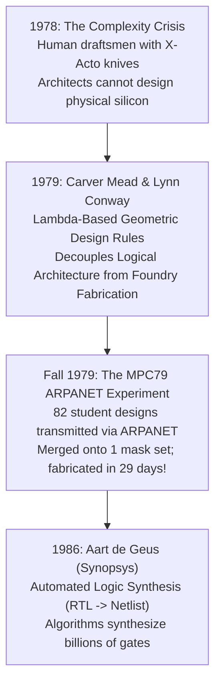

---

### 1. Carver Mead, Lynn Conway, and the MPC79 ARPANET Experiment (1979)

#### The Empirical Dilemma
In the late 1970s, semiconductor foundries jealously guarded proprietary manufacturing recipes. A circuit designed for an Intel fab could not be made at TI or Motorola. Designing a custom processor required an army of hundreds of physicists and years of trial-and-error layout.

#### The Breakthrough Experiment: The First Internet Chip Run (MPC79)
Caltech professor **Carver Mead** and Xerox PARC computer scientist **Lynn Conway** wrote the seminal textbook *Introduction to VLSI Systems* (1980) and launched a revolution:

```
    [ 12 Universities: MIT, Stanford, Berkeley, Caltech... ]
                          │
                          ▼ 82 Student RTL/Layout Designs
    [ THE ARPANET ] ═══════════════════════════════════════ (Early Internet)
                          │
                          ▼
           [ Xerox PARC (Lynn Conway) ] ──► Merged into 1 Master Wafer Layout
                          │
                          ▼ Transmitted via Mag Tape
           [ HP Commercial Silicon Foundry ] ──► Fabricated, Packaged, Shipped in 29 Days!
```

1. **The $\lambda$-Based Design Rules**: Mead and Conway realized you could abstract away messy transistor physics. They formulated scalable geometric layout rules based on a single dimensionless parameter, **$\lambda$** (half the minimum feature size):
   - A gate must be $2\lambda$ wide.
   - Metal lines must be separated by $3\lambda$.
   - By following simple grid rules, computer science students could design functioning digital circuits in software without knowing solid-state quantum mechanics.
2. **The Historic MPC79 Experiment (Fall 1979)**:
   Lynn Conway organized the world's first remote, multi-project wafer run:
   - Students at 12 universities (including MIT, Stanford, and UC Berkeley) used computer terminals to design custom VLSI chips.
   - Using the **ARPANET** (the embryonic internet), their digitized layout files were transmitted to Xerox PARC.
   - Conway wrote software to automatically tile all **82 independent designs** onto a single set of photolithography masks.
   - The master data tapes were delivered to a Hewlett-Packard foundry in Santa Clara.
3. **The Proof of Concept**: Exactly 29 days later, fabricated, diced, and packaged microchips were shipped back to the university students. The chips worked. 
4. **The Impact**: The Mead-Conway revolution completely **decoupled chip design from chip manufacturing**. It gave birth to the modern **Fabless-Foundry model** (enabling ARM, Apple, Qualcomm, and NVIDIA to design chips that TSMC manufactures) and spurred the creation of the Electronic Design Automation (EDA) industry.

---

### 2. Aart de Geus and the Invention of Automated Logic Synthesis (Synopsys, 1986)

In 1986, **Dr. Aart de Geus** and his colleagues founded **Synopsys**, releasing the **Design Compiler**:
- Chip designers no longer drew geometric shapes or schematics. They wrote abstract behavioral algorithms in Hardware Description Languages (HDL).
- The synthesis compiler transformed software `if-else` and `case` statements into optimized Directed Acyclic Graphs (DAGs) of Boolean logic gates (NAND, NOR, Inverters) using Espresso minimization algorithms, automatically meeting stringent nanosecond timing constraints.

---

### 3. The 8-Stage Modern Chip Design Pipeline

#### 1. Architecture & Specification

Architects define the high-level operational parameters of the processor:

- **ISA (Instruction Set Architecture)**: x86-64, ARMv9, RISC-V.
- Superscalar pipeline depth, branch prediction algorithms, Out-of-Order execution windows, ALU counts, L1/L2/L3 cache sizes, and memory buses.

#### 2. RTL (Register-Transfer Level) Description

Chip designers do not draw transistors. They write code in Hardware Description Languages (**SystemVerilog**, **VHDL**):

```systemverilog
// 4-bit synchronous accumulator register
module accumulator (
    input  logic       clk,
    input  logic       rst_n,
    input  logic [3:0] data_in,
    output logic [3:0] data_out
);
    always_ff @(posedge clk or negedge rst_n) begin
        if (!rst_n)
            data_out <= 4'b0000;
        else
            data_out <= data_out + data_in;
    end
endmodule
```

#### 3. Functional Verification & Simulation

Verification engineers write comprehensive testbenches using **UVM (Universal Verification Methodology)** to subject the RTL model to billions of randomized clock cycles, verifying that the logical behavior perfectly matches architectural specs before silicon is cut.

#### 4. Logic Synthesis

EDA synthesis tools (e.g., **Synopsys Design Compiler**, **Cadence Genus**) ingest the RTL code and a target foundry **Standard Cell Library** (containing pre-characterized physical NAND, NOR, Inverter, and Flip-Flop cells).
The synthesis engine performs Boolean logic minimization (using Karnaugh maps, Quine-McCluskey, and Espresso algorithms) and converts RTL into a **Gate-Level Netlist**: a structural graph of discrete logic gates and interconnection wires.

#### 5. Static Timing Analysis (STA)

Every clocked digital circuit operates on a synchronized heartbeat ($T_{clk}$). STA tools (e.g., **Synopsys PrimeTime**) calculate the propagation delay through every gate and wire path without dynamic simulation:

- **Setup Time ($T_{setup}$)**: Data must arrive at a flip-flop's input and stabilize *before* the clock edge arrives:
  $$
  T_{clk} \ge T_{cq} + T_{comb\_max} + T_{setup} - T_{skew}
  $$
- **Hold Time ($T_{hold}$)**: Data must remain stable *after* the clock edge to avoid corrupting the captured state:
  $$
  T_{cq} + T_{comb\_min} \ge T_{hold} + T_{skew}
  $$
- **Timing Slack**:
  $$
  \text{Slack} = T_{required} - T_{arrival}
  $$

  If $\text{Slack} < 0$, the chip will experience timing violations and fail to compute correctly at that clock frequency.

#### 6. Physical Design (Place and Route - P&R)

EDA physical design tools (e.g., **Cadence Innovus**, **Synopsys ICC2**) map the abstract netlist into physical 2D/3D silicon real estate:

1. **Floorplanning**: Arranging major blocks (Cores, GPU, Caches, Memory Controllers) on the die.
2. **Power Planning**: Constructing thick copper power rings and vertical/horizontal meshes to supply $V_{DD}$ and Ground with minimal $IR$-drop.
3. **Placement**: Placing billions of standard cell gates onto rows.
4. **Clock Tree Synthesis (CTS)**: Routing a symmetrical, balanced clock distribution network (H-tree) so that clock pulses arrive at all $50\text{ billion}$ flip-flops at the exact same picosecond.
5. **Routing**: Automated maze-routing algorithms trace $15\text{ to }20$ vertical layers of copper wires to connect all gate inputs and outputs without crossing or shorting.

#### 7. Physical Verification

- **DRC (Design Rule Checking)**: Verifies that geometric shapes do not violate foundry manufacturing constraints (minimum wire spacing, minimum fin widths).
- **LVS (Layout Versus Schematic)**: Extracts the transistor netlist from the drawn geometric layout shapes and compares it 1:1 against the synthesized schematic netlist to guarantee zero missing connections or short circuits.

#### 8. Tape-Out

The final validated layout is exported as an enormous multi-terabyte binary file (**GDSII** or **OASIS** format). It is shipped to the semiconductor foundry (TSMC, Intel, Samsung) to manufacture the physical photolithography reticle masks.

---

## Epoch XII: Nanometer CPU Silicon, Quantum Breakdown, and 3D Gate Architecture (2000–Present)

### What Drove the Next Step?

From 1974 through 2005, the semiconductor industry rode **Dennard Scaling** (formulated by IBM's **Robert Dennard**): as transistors shrank, their dimensions, operating voltage, and capacitance dropped proportionally, keeping power density constant while clock speeds skyrocketed from $1\text{ MHz}$ to $3.8\text{ GHz}$.
Around 2005 at the $65\text{nm}$ to $45\text{nm}$ nodes, Dennard scaling suffered a sudden, violent death:
1. **The Quantum Tunneling Wall**: The gate oxide layer ($\text{SiO}_2$) had been thinned down to **$1.2\text{ nanometers}$**—barely $5$ silicon atoms thick! At this atomic scale, classical mechanics completely evaporated. Electrons exploited their de Broglie wave function to tunnel straight through the glass barrier, leaking tens of amperes of current even when the CPU was completely idle.
2. **Drain-Induced Barrier Lowering (DIBL)**: As the Source and Drain grew within $20\text{ nm}$ of each other, the Drain's high positive voltage reached across the channel and lowered the electrostatic barrier, bypassing the Gate entirely. Transistors could no longer be turned OFF.

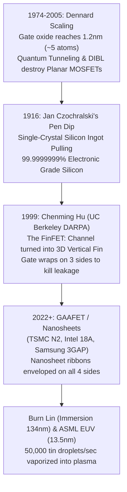

---

### 1. Jan Czochralski and the Accidental Fountain Pen: Single-Crystal Silicon (1916)

#### The Empirical Dilemma
In nature, silicon forms random polycrystalline clumps filled with grain boundaries. If you build a transistor across a grain boundary, crystal dislocations trap charges and short out the device. Microprocessors demand an atomically perfect, dislocation-free **single monocrystal** across an entire $300\text{mm}$ wafer.

#### The Breakthrough Experiment: The Inkpot Mistake (1916)
Polish chemist **Jan Czochralski** was studying the crystallization rates of metals in his laboratory:
1. **The Distracted Dip**: Working late into the night, Czochralski was taking handwritten notes next to a small crucible of molten tin. Distracted by his calculations, he absent-mindedly dipped his fountain pen nib into the crucible of liquid metal instead of his inkpot!
2. **The Solidifying Thread**: Realizing his error, he quickly pulled the pen nib upward out of the molten metal. To his astonishment, a fine, continuous thread of solid tin was pulled out behind the nib, freezing continuously as it left the melt surface.
3. **The X-Ray Revelation**: When Czochralski analyzed the metal filament under X-ray crystallography, he discovered it was not polycrystalline: **it was a single, unbroken monocrystal**. The metal nib had acted as a "seed crystal," aligning every subsequent atom into the exact same crystal orientation as it froze.
4. **The Modern Czochralski Process**:
   Today, every silicon wafer on Earth is grown using Czochralski's method:

```
                 CZOCHRALSKI MONOCRYSTAL GROWTH
                   Seed Crystal Rotate ↻ (Pull 1-2 mm/min)
                            │
                          ┌─┴─┐ Seed Crystal
                          │   │
                      ┌───┴───┴───┐
                      │           │
                      │  Growing  │  Silicon Boule (300mm Diameter, 2m Long)
                      │  Silicon  │  Single Dislocation-Free Monocrystal!
                      │   Boule   │
                      │           │
                      └───┬───┬───┘
                     ┌────┴───┴────┐
                   ┌─┘  Molten Si  └─┐  (1425°C Quartz Crucible)
                   │ ░░░░░░░░░░░░░░░ │  Pure Electronic-Grade Silicon (99.9999999%)
                   └─────────────────┘
```

- High-purity Electronic-Grade Silicon ($99.9999999\%$, "Nine Nines") is melted at $1425^\circ\text{C}$ in a rotating quartz crucible.
- A tiny seed crystal is dipped into the melt and slowly pulled upward while rotating counter to the crucible.
- This produces a pristine, continuous silicon cylinder (**boule**) weighing hundreds of kilograms, with zero atomic dislocations across trillions of atoms. Diamond saws slice the boule into $775 \, \mu\text{m}$ wafers, polished to a roughness under $0.1\text{ nanometers}$.

---

### 2. Chenming Hu and the FinFET Breakthrough (UC Berkeley, 1999)

#### The Empirical Dilemma
In 1996, DARPA convened the world's leading solid-state physicists to evaluate whether Moore's Law was dying. The consensus was grim: because planar MOSFETs leaked uncontrollable amounts of subthreshold current below $25\text{ nm}$ due to Drain-Induced Barrier Lowering (DIBL), transistor scaling was forecast to hit an impenetrable brick wall by 2005.

#### The Breakthrough Experiment: The Folded Channel
Professor **Chenming Hu** and his team at UC Berkeley (including Tsu-Jae King Liu and Jeffrey Bokor) refused to accept the 25nm limit. Hu reasoned that the problem was geometric: in a planar transistor, the gate sits only on top of the channel, while the bottom of the channel is far away from the gate and easily influenced by the drain.

```
   1. PLANAR MOSFET (Fails < 25nm)     2. FinFET (Chenming Hu, 1999)    3. GAAFET / Nanosheet (2024+)
   Gate on top only; Drain leaks       Gate wraps fin on 3 sides         Gate wraps all 4 sides of ribbons

          ┌─────────┐                         ┌───────────┐                    ┌───────────┐
          │  GATE   │                         │   GATE    │                    │   GATE    │
     ─────┴─────────┴─────               ┌────┤ (Wraps 3) ├────┐          ┌────┴───────────┴────┐
     [Channel (Leakage)]                 │    └─────┬─────┘    │          │ ┌─────────────────┐ │
     ─────────────────────               │  ┌───────┴───────┐  │          │ │ Silicon Ribbon  │ │
                                         │  │  3D Vert Fin  │  │          │ └─────────────────┘ │
                                         └──┤  (Channel)    ├──┘          │ ┌─────────────────┐ │
                                            └───────────────┘             │ │ Silicon Ribbon  │ │
                                                                          │ └─────────────────┘ │
                                                                          └─────────────────────┘
```

1. **The 3D Fin Architecture**: Hu pulled the silicon channel up out of the substrate into a thin, 3D vertical fin (named the **FinFET**, short for Fin Field-Effect Transistor).
2. **The Electrostatic Grip**:
   - The gate dielectric and electrode wrap around the vertical fin on **three sides** (left, top, right).
   - Because the silicon channel is squeezed between two opposing gate walls, the gate exerts complete electrostatic control over the entire volume of the channel.
   - The drain's electric field is shielded, completely suppressing DIBL and reducing subthreshold leakage current by **over $90\%$**.
3. **The Commercial Deployment (Intel 2011)**:
   In December 1999, Hu's team published the first working sub-20nm FinFET. In 2011, Intel stunned the tech world by deploying Hu's 3D architecture commercially under the name **"22nm 3-D Tri-Gate"** on their Ivy Bridge processors. FinFETs kept Moore's Law alive for another decade, powering every smartphone and supercomputer down to the $3\text{nm}$ generation.

---

### 3. Burn J. Lin's Water Immersion & ASML's Extreme Ultraviolet (EUV) Miracle

#### The 157nm Laser Disaster
By 2002, chip foundries were desperate to print features smaller than $65\text{ nm}$. Standard $193\text{ nm}$ Argon-Fluoride (ArF) excimer lasers were too blurry. The global semiconductor consortium spent hundreds of millions of dollars attempting to develop $157\text{ nm}$ fluorine lasers. But the $157\text{ nm}$ project was an unmitigated disaster: the energetic light shattered and cracked expensive calcium fluoride glass lenses, and photoresists absorbed the beam before it could expose the wafer.

#### The Breakthrough Experiment: Burn J. Lin's Water Drop (TSMC, 2002)
Dr. **Burn J. Lin**, Vice President of R&D at TSMC, proposed an audacious, deceptively simple solution:
1. Stop trying to build new lasers. Keep the existing, reliable $193\text{ nm}$ laser.
2. Put a single drop of ultra-purified water between the bottom objective lens and the silicon wafer!
3. **The Physics of Refraction**: Water has a refractive index of $n = 1.44$. Light passing from glass into water slows down and compresses its wavelength:
   $$
   \lambda_{effective} = \frac{\lambda_0}{n} = \frac{193 \, \text{nm}}{1.44} \approx 134 \, \text{nm}
   $$
4. Industry rivals initially ridiculed Lin's proposal, fearing bubbles and water contamination. But Lin proved it worked with flawless defect density. **Immersion Lithography** saved the semiconductor industry billions of dollars and allowed chips to scale from $45\text{nm}$ down to $7\text{nm}$.

#### ASML and Extreme Ultraviolet (EUV) Photolithography (2018–Present)
Below $7\text{ nm}$, even immersion water failed. Dutch giant **ASML** spent 20 years and over $\$10\text{ billion}$ to master soft X-rays at **$\lambda = 13.5\text{ nanometers}$**:

```
                       ASML EUV SOURCE CHAMBER (VACUUM)
     Droplet Generator (50,000 Molten Tin Droplets / Sec)
             │
             ▼
            (●) ◄── Laser Pulse 1 (Pre-Pulse flattens tin droplet into pancake)
             │
            (—) ◄── Laser Pulse 2 (Main 20kW CO2 Laser blasts tin into 200,000°C Plasma!)
             │
             ▼ Emits 13.5nm EUV Photons
     [ Molybdenum/Silicon Multilayer Bragg Collector Mirror ] ──► Vacuum Optical Train
```

1. **Tin-Droplet Plasma Generator**: A dispenser shoots $50,000$ microscopic droplets of molten tin ($\text{Sn}$) per second into a vacuum chamber.
2. A pulsed $20\text{ kW}$ industrial $\text{CO}_2$ laser fires two consecutive pulses at every single droplet:
   - The first pulse flattens the droplet into a microscopic pancake.
   - The second pulse vaporizes the tin into a scorching **$200,000^\circ\text{C}$ plasma** (hotter than the core of the Sun!), which emits $13.5\text{nm}$ EUV photons.
3. **Extreme Mirrors**: Because all matter (including air and glass) absorbs $13.5\text{nm}$ light, the entire optical train operates in a deep vacuum using ultra-pure mirrors coated with 40 alternating atomic layers of molybdenum and silicon, polished so smooth that the largest bump is smaller than a single atom!

---

### 4. GAAFETs (Gate-All-Around Nanosheets) & The Quantum Horizon (2022–2026+)

At $3\text{nm}$ and $2\text{nm}$ nodes (TSMC N2, Samsung 3GAP, Intel 18A), the vertical fins of FinFETs become too narrow ($<4\text{ nm}$) to prevent electrons from leaking across.
The industry has pivoted to **GAAFET (Gate-All-Around / Nanosheets / RibbonFET)**:
- The channel is horizontally sliced into multiple suspended ribbons of single-crystal silicon.
- The gate insulator and metal envelop each ribbon on **all four sides ($360^\circ$)**, providing the ultimate electrostatic containment allowed by the laws of physics.

---

### 5. Back-End of Line (BEOL): The Interconnect Metallization

Once billions of GAAFETs are fabricated in the front-end (FEOL), they must be wired together into a functioning supercomputer:
- A modern processor builds an intricate, microscopic skyscraper of **15 to 20 vertical metallization layers** above the silicon.
- Lower metal layers ($M_0, M_1$) use pure ruthenium, cobalt, or copper wires barely $10\text{ nm}$ wide to connect adjacent gates.
- Upper layers ($M_{15} - M_{18}$) are thick copper highways that route global power and clock trees with minimal $IR$-drop.
- Millions of vertical metal plugs (**vias**) connect layers together.
- Over **$100\text{ kilometers}$ of total copper wiring** is packed inside a single desktop CPU chip measuring only $1.5\text{ cm} \times 1.5\text{ cm}$!

```
                             BEOL METALLIZATION LAYERS
   Top Layer ──►  ┌────────────────────────────────────────────────────────┐  M15 (Power Mesh)
                  │      Thick Global Copper Power Lines & Clock Traces    │
                  ├────────────────────────────────────────────────────────┤
                  │     Intermediate Signal Routing (Layers M5 - M14)      │
                  ├────────────────────────────────────────────────────────┤
                  │     Tight Local Gate-to-Gate Wiring (Layers M0 - M4)   │
   Silicon ────►  ├────────────────────────────────────────────────────────┤
                  │  [GAAFET]    [GAAFET]    [GAAFET]    [GAAFET] [GAAFET] │  FEOL (Transistors)
                  └────────────────────────────────────────────────────────┘
```

---

## Comparative Synthesis & Landmark Experiments Map

| Domain / Milestone | Scientist(s) & Year | The Breakthrough Experiment & Apparatus | Fundamental Formula | Role in Modern Silicon Microprocessors |
| :--- | :--- | :--- | :--- | :--- |
| **Kinematics** | Galileo Galilei (1638) | **Inclined Plane & Water Clock**: Bronze balls rolled down vellum groove; elapsed time measured by weighing water droplets ($d \propto t^2$). | $\vec{v} = \frac{d\vec{r}}{dt}, \; \vec{a} = \frac{d\vec{v}}{dt}$ | Clock skew, electron velocity saturation, delay analysis |
| **Dynamics & Gravitation** | Isaac Newton (1687) | **Moon-Apple Calculation**: Compared apple fall ($9.8\text{m/s}^2$) to Moon's orbital acceleration ($g/60^2$), confirming inverse-square gravity. | $\vec{F} = m\vec{a}, \; F_g = G \frac{m_1 m_2}{r^2}$ | Mechanical stress & strain in silicon crystal lattices |
| **Work & Kinetic Energy** | du Châtelet & 's Gravesande (1740) | **Clay Bed Dropping Test**: Brass balls dropped from $1h, 4h, 9h$; balls at $2\times$ speed penetrated $4\times$ deeper, proving $E_k \propto v^2$. | $E_k = \frac{1}{2}mv^2, \; W = \int \vec{F} \cdot d\vec{r}$ | Dynamic switching power ($P \propto V^2$), gate transition work |
| **Heat Equivalence** | James Prescott Joule (1845) | **Paddle-Wheel Calorimeter**: Falling lead weights churned water; precision thermometer measured mechanical work converted to heat. | $W = J \cdot Q, \; P = I^2 R$ | Thermal dissipation, TDP limits ($350\text{W}$ server heat sinks) |
| **Capacitance** | Pieter van Musschenbroek (1745) | **The Leyden Jar**: Trapping static electricity in a water vial; touching wire while holding bottle produced a violent chest shock. | $Q = CV, \; C = \frac{\kappa \varepsilon_0 A}{d}$ | Gate oxide capacitance ($C_{ox}$), interconnect parasitic RC delay |
| **Electrostatics** | Charles Coulomb (1785) | **Torsion Balance**: Silver wire suspension counterbalanced micro-forces between gilded pith balls; verified inverse-square law. | $F_e = k_e \frac{q_1 q_2}{r^2}, \; V = \frac{U_e}{q}$ | Operating core voltages ($V_{DD} \approx 0.7 - 1.1\text{V}$), channel field |
| **Continuous Current (DC)** | Alessandro Volta (1800) | **Bimetallic Tongue Test & Voltaic Pile**: Dissimilar metals on tongue tasted sour; stacked zinc/copper/brine discs generated first steady current. | $I = \frac{dq}{dt}, \; \mathcal{E} = \Delta V_{contact}$ | Regulated DC voltage rails powering all digital logic gates |
| **Resistance** | Georg Simon Ohm (1827) | **Thermocouple Circuit**: Used boiling water ($100^\circ\text{C}$) and ice ($0^\circ\text{C}$) to prevent battery sag; measured magnetic needle deflection. | $V = IR, \; R = \rho \frac{L}{A}$ | On-state channel resistance ($R_{DS,on}$), metal interconnect IR-drop |
| **Induction & AC** | Michael Faraday (1831) | **Soft Iron Ring**: Closing switch on primary coil caused momentary needle deflection in secondary coil; changing flux induces EMF. | $\mathcal{E} = -\frac{d\Phi_B}{dt}$ | Global clock distribution, off-chip power transformation |
| **The Electron** | J.J. Thomson (1897) | **Crossed-Field Vacuum Tube**: Balanced electrostatic and magnetic deflection of cathode rays; measured $e/m$ at $1,836\times$ lighter than H. | $\frac{e}{m} \approx 1.76 \times 10^{11} \, \text{C/kg}$ | Subatomic mobile charge carrier in all electronic circuits |
| **The Atomic Nucleus** | Ernest Rutherford (1911) | **Gold Foil Scintillations**: Fired alpha particles at $400\text{nm}$ gold leaf; 1 in 8,000 bounced back, revealing dense positive nucleus. | $r_{nucleus} \sim 10^{-15}\text{m}$ | Atomic core stability, empty space within silicon atoms |
| **Quantized Orbitals** | Niels Bohr (1913) | **Hydrogen Spectral Lines**: Modeled Balmer discharge tube lines with quantized angular momentum; radiation only during quantum leaps. | $L = n\hbar, \; \Delta E = h\nu$ | Silicon valence electron shells ($1s^2 2s^2 2p^6 3s^2 3p^2$) |
| **Matter Waves** | Davisson & Germer (1927) | **Accidental Nickel Monocrystal**: Annealed nickel target diffracted electron beam into Bragg interference rings; proved electrons are waves. | $\lambda = \frac{h}{p}$ | Quantum electron transport, wavefunctions in nano-channels |
| **Quantized Spin** | Stern & Gerlach (1922) | **Splitting Silver Beam**: Inhomogeneous magnet split atomic beam into two discrete traces (spin $\pm 1/2$); basis for Pauli exclusion. | $S_z = \pm \frac{1}{2}\hbar$ | Pauli exclusion principle dictating band filling in solids |
| **Band Theory** | Felix Bloch & Alan Wilson (1928) | **Periodic Lattice Wave Equation**: Solved wavefunctions in periodic ion potentials; Bragg reflection created forbidden bandgaps ($E_g$). | $E_g = E_c - E_v$ | Semiconductor bandgap ($\text{Si} = 1.12\text{eV}$) gating conductive states |
| **Doping & P-N Diode** | Russell Ohl (1940) | **Cracked Ingot & Desk Lamp**: Silicon ingot with natural boron/phosphorus segregation jumped to $0.5\text{V}$ under light; one-way valve. | $n \cdot p = n_i^2, \; I = I_s(e^{qV/k_BT} - 1)$ | P-N source/drain junction boundaries, rectification, solar cells |
| **Point-Contact Transistor** | Bardeen & Brattain (1947) | **Razor-Slit Gold Polystyrene Wedge**: Two gold leaves $50\mu\text{m}$ apart on germanium; heard 18-fold amplified speech in headphones. | Transfer-Resistor | First active solid-state signal amplification |
| **Sandwich BJT** | William Shockley (1948) | **Chicago Hotel Room Derivation**: Derived minority carrier diffusion across ultra-thin bulk base layer; eliminated fragile point contacts. | $I_C = \beta I_B$ | Analog I/O drivers, bandgap precision voltage references |
| **MOSFET Switch** | Martin Atalla & Dawon Kahng (1959) | **Thermal Oxide Passivation**: $1000^\circ\text{C}$ steam grew pristine $\text{SiO}_2$ neutralizing surface states; evaporated metal gate created inversion layer. | $I_D \propto \mu C_{ox} \frac{W}{L}(V_{GS}-V_{th})^2$ | Universal digital switch for ALU, registers, cache, logic |
| **CMOS Inverter** | Frank Wanlass & Chih-Tang Sah (1963) | **Push-Pull Breadboard Test**: Paired NMOS and PMOS; ammeter dropped to zero nanoamps in static states; zero idle power dissipation. | $P_{dyn} = \alpha C_L V_{DD}^2 f_{clk}$ | Zero static power logic gates powering 100% of modern CPUs |
| **Monolithic Planar IC** | Jack Kilby & Robert Noyce (1958-59) | **Printed Aluminum Metallization**: Hoerni's flat $\text{SiO}_2$ glass skin + Noyce's evaporated aluminum interconnects eliminated hand-soldering. | Monolithic Silicon | Printing billions of transistors and wires simultaneously |
| **Static Memory (SRAM)** | Circuit Designers (1966) | **Bistable Regenerative Feedback**: Cross-coupled CMOS inverters create two stable voltage attractors ($Q, \bar{Q}$); 6T cell. | $A_{loop} = A_1 A_2 \gg 1, \; NM = V_{IL} - V_{OL}$ | CPU general-purpose registers, L1/L2/L3 on-chip cache |
| **Dynamic Memory (DRAM)** | Robert Dennard (1966) | **1T-1C Charge Reservoir**: Single access transistor gates microscopic capacitor ($Q = CV$); charge-sharing read requires refresh. | $Q = C_s V_{DD}, \; \Delta V_{BL} \approx \frac{C_s}{C_{BL}} \Delta V$ | High-density main system RAM (DDR4, DDR5, HBM) |
| **Non-Volatile Flash** | Dawon Kahng & Simon Sze (1967) | **Floating-Gate Electron Trapping**: Quantum tunneling injects electrons into isolated gate, shifting MOSFET threshold voltage ($\Delta V_{th}$). | $J_{FN} \propto E^2 e^{-B/E}, \; \Delta V_{th} = -\frac{Q_{FG}}{C}$ | Solid-state drives (SSDs), USB storage, BIOS ROM |
| **VLSI Revolution** | Carver Mead & Lynn Conway (1979) | **MPC79 ARPANET Wafer Run**: Dimensionless $\lambda$-rules; 82 student software designs merged onto one mask and fabricated in 29 days. | $\lambda$-Design Rules | Decoupled design from fabs; founded fabless-foundry model |
| **Monocrystal Pulling** | Jan Czochralski (1916) | **Accidental Fountain Pen Dip**: Dipped pen into molten tin, pulling single monocrystal thread; basis for $300\text{mm}$ silicon boules. | Dislocation-Free Crystal | Electronic-Grade Silicon ($99.9999999\%$) manufacturing |
| **3D FinFET Gate** | Chenming Hu (1999) | **DARPA Vertical Fin**: Squeezed silicon channel into 3D fin wrapped on 3 sides by gate; suppressed DIBL and killed 90% leakage. | Tri-Gate 3D Electrostatics | Saved Moore's Law from $22\text{nm}$ down to $3\text{nm}$ |
| **Immersion Lithography** | Burn J. Lin (2002) | **Water Droplet Refraction**: Placed water drop between lens and wafer; compressed $193\text{nm}$ laser light to effective $134\text{nm}$. | $\lambda_{eff} = \frac{\lambda_0}{n} = \frac{193}{1.44} \approx 134\text{nm}$ | Allowed optical scaling down to $7\text{nm}$ nodes |
| **EUV Soft X-Rays** | ASML (2018) | **Tin Droplet Plasma**: Blasted $50,000$ molten tin droplets/sec with pulsed $\text{CO}_2$ laser into $200,000^\circ\text{C}$ plasma emitting $13.5\text{nm}$ light. | $\lambda_{EUV} = 13.5\text{nm}$ | Sub-3nm GAAFET nanosheet microprocessor fabrication |

---

## Conclusion: The Unbroken Thread

Every smartphone and supercomputer is the culmination of this chain of human thought:

1. **Newton** defined force, mass, and acceleration to track moving bodies.
2. **Franklin, Coulomb, and Volta** showed that charge produces force and potential (voltage).
3. **Ohm and Faraday** harnessed continuous charge flow (current) and field storage (capacitance/inductance).
4. **Bohr, Schrödinger, and Bloch** revealed that electrons inside a silicon crystal lattice occupy discrete energy bands separated by a narrow forbidden bandgap.
5. **Ohl and Shockley** discovered that doping silicon with trace impurities allows us to manipulate this bandgap to create one-way diodes and amplifiers.
6. **Kahng, Atalla, Wanlass, and Sah** used electric fields to build zero-idle-power MOSFET and CMOS switches.
7. **Noyce and Hoerni** integrated these switches into a single flat planar silicon chip.
8. **Dennard, Kahng, and Sze** leveraged cross-coupled feedback loops, capacitor charge packets, and quantum-tunneled floating gates to transform transient electrical signals into persistent memory (0s and 1s).
9. **Mead, Conway, and EDA pioneers** converted software algorithms into billions of synthesized logic gates, registers, and execution pipelines.
10. **ASML, TSMC, and Intel** leveraged extreme ultraviolet photons to wrap gates around three-dimensional silicon nanosheets, switching billions of times per second.

Remove any single link from this chain, and modern computing ceases to exist.
