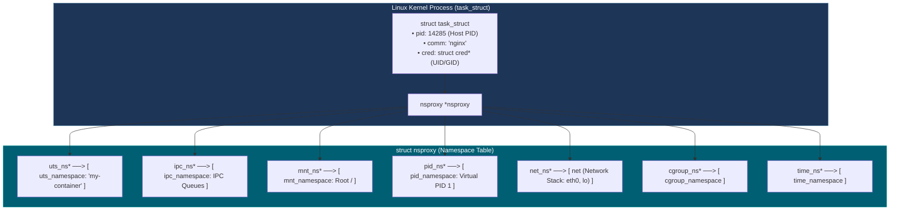
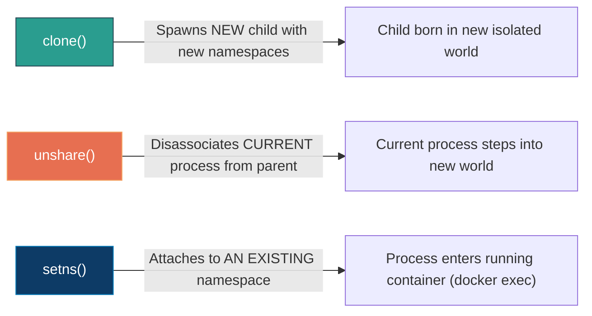

# 📌 Linux Namespaces: The Kernel Architecture of Process Illusion

> **Reference / Context**: [10_linux_cli.md](file:///d:/Madhan_Utils/learning/courses/ai-ml-course/course-path/phase-0-engineering-foundations/10_linux_cli.md) | [11_docker_and_compose.md](file:///d:/Madhan_Utils/learning/courses/ai-ml-course/course-path/phase-0-engineering-foundations/11_docker_and_compose.md) | [from-cpu-registers-to-global-system-resources.md](file:///d:/madhan-utils/learning/courses/ai-ml-course/explanations/from-cpu-registers-to-global-system-resources.md) | [docker-from-first-principles-hardware-to-software.md](file:///d:/Madhan_Utils/learning/courses/ai-ml-course/explanations/docker-from-first-principles-hardware-to-software.md) | [what-is-the-os-kernel.md](file:///d:/Madhan_Utils/learning/courses/ai-ml-course/explanations/what-is-the-os-kernel.md) | [docker-container-architecture.md](file:///d:/Madhan_Utils/learning/courses/ai-ml-course/explanations/docker-container-architecture.md)

---

### 1. 🎯 What are Linux Namespaces? (The Ground Truth)

[Certain] **Linux Namespaces do not virtualize hardware; they are kernel-level lookup filters.**

In a standard Linux operating system, global system resources are unified:

* One global process table (`ps aux` sees all running processes).
* One global network stack (only one program can bind to port `80` at a time).
* One global filesystem tree (one single root directory `/`).
* One global user database (UID `0` is root everywhere).

A **Linux Namespace** is a kernel data structure that partitions these global resources into isolated buckets. When a process queries the kernel (e.g. asking *"What is my PID?"* or *"What network interfaces exist?"*), the Linux kernel does not look at the global state. It checks that specific process's **`nsproxy` struct** and returns only the resources assigned to its namespace bucket.

```
Without Namespaces (Global):
[ Process A ] ──┐
[ Process B ] ──┼──> [ Global Linux Kernel Tables ] (All processes see each other)
[ Process C ] ──┘

With Namespaces (Partitioned):
[ Process A ] ──> [ Namespace 1 ] ──┐
                                     ├──> [ Single Shared Host Kernel ]
[ Process B ] ──> [ Namespace 2 ] ──┘
```

> [!IMPORTANT]
> **The Critical Distinction: Namespaces vs. Cgroups**
>
> * **Namespaces** control what a process can **SEE** (visibility isolation).
> * **Cgroups** control what a process can **USE** (resource throttling: CPU, RAM, I/O).
>   A process in a private PID namespace can still eat 100% of the host machine's CPU and RAM unless restricted by Cgroups.

---

### 2. 💡 The Real-World Analogy: The Apartment Complex

* Think of the physical Linux server as a **single high-rise apartment building**:
  - **Without Namespaces (Single Shared Dormitory)**: Every resident sleeps in one massive open hall. If someone plays loud music, everyone hears it. If someone turns on the shower, they share the single bathroom. If someone renames the front door, it affects everyone.
  - **With Namespaces (Private Apartments)**:
    - **Mount Namespace (`mnt`)**: Each apartment has its own locked front door and private kitchen cupboards. You cannot see or open your neighbor's pantry.
    - **Network Namespace (`net`)**: Each apartment has its own private mailbox, intercom number, and private Wi-Fi router. Multiple apartments can have a "TV in Room 1" (port 80) without signal collision.
    - **PID Namespace (`pid`)**: Inside Apartment 4B, the family numbers its members: Dad is #1 (PID 1), Mom is #2, Child is #3. Meanwhile, building security on the ground floor registers Dad as tenant #14285 across the entire city.
    - **User Namespace (`user`)**: Inside your apartment, you are "the boss" (UID 0 / root). But step into the building hallway, and building management treats you as an ordinary tenant (unprivileged UID 10001).

---

### 3. 🏛️ The 8 Linux Namespaces: Complete Reference Matrix

The Linux kernel has evolved 8 distinct namespaces over nearly two decades:

| Namespace         | CLI Flag / Syscall Constant | Kernel Version      | What It Isolates (What the Process Sees)                      | Real-World Container Effect                                                                                 |
| :---------------- | :-------------------------- | :------------------ | :------------------------------------------------------------ | :---------------------------------------------------------------------------------------------------------- |
| **Mount**   | `CLONE_NEWNS`             | Linux 2.4.19 (2002) | Filesystem mount points and drive mounts.                     | The container has its own private root`/`. Host mounts are completely hidden.                             |
| **UTS**     | `CLONE_NEWUTS`            | Linux 2.6.19 (2006) | Hostname and NIS domain name (`sethostname`).               | Container can set hostname to`api-server-prod` without altering the host's hostname.                      |
| **IPC**     | `CLONE_NEWIPC`            | Linux 2.6.19 (2006) | System V IPC objects and POSIX message queues.                | Container cannot sniff or alter shared memory (`shmget`) used by host processes.                          |
| **PID**     | `CLONE_NEWPID`            | Linux 2.6.24 (2008) | Process ID numbers and process trees.                         | Container process sees itself as**PID 1** (init). Host process tree is invisible.                     |
| **Network** | `CLONE_NEWNET`            | Linux 2.6.29 (2009) | Network interfaces, IP routing tables, firewall rules, ports. | Container gets its own loopback (`127.0.0.1`), private `eth0`, and binds to port 80/443 freely.         |
| **User**    | `CLONE_NEWUSER`           | Linux 3.8 (2013)    | User IDs (UIDs) and Group IDs (GIDs).                         | Container**root (UID 0)** maps to an unprivileged host UID (e.g. 10001). Mitigates container escapes. |
| **Cgroup**  | `CLONE_NEWCGROUP`         | Linux 4.6 (2016)    | The Cgroup root directory view (`/sys/fs/cgroup`).          | Prevents container from inspecting the host's overall cgroup layout.                                        |
| **Time**    | `CLONE_NEWTIME`           | Linux 5.6 (2020)    | Monotonic and Boot Clocks (`CLOCK_MONOTONIC`).              | Container can change its clock offsets without desynchronizing the host's NTP hardware clock.               |

---

### 4. 🎨 Kernel Architecture: How the Kernel Stores Namespaces

Inside the Linux kernel source code (`include/linux/nsproxy.h`), every process (`task_struct`) contains a pointer to an `nsproxy` structure:



* **Namespace Sharing**: If two processes share the exact same `nsproxy->net_ns` pointer, they are on the **exact same network stack** (this is how Kubernetes Pods allow multiple containers to communicate via `localhost`!).
* **Namespace Isolation**: If a process is given a new, distinct pointer, it enters a private sandbox.

---

### 5. 🔬 The 3 Core System Calls That Control Namespaces

Every container tool (`docker`, `podman`, `containerd`, `runc`) relies on three fundamental C system calls:



#### 1. `clone(int (*fn)(void *), void *stack, int flags, ...)`

* Creates a child process just like `fork()`, but accepts bitwise flags specifying which namespaces to isolate:

```c
// Spawns a child in new PID, Mount, and Network namespaces:
int pid = clone(child_fn, stack_top, CLONE_NEWPID | CLONE_NEWNS | CLONE_NEWNET | SIGCHLD, NULL);
```

#### 2. `unshare(int flags)`

* Allows a running process to break away from its current namespaces without spawning a new process:

```c
// Detaches current process into its own network and UTS namespaces:
unshare(CLONE_NEWNET | CLONE_NEWUTS);
```

#### 3. `setns(int fd, int nstype)`

* Joins an *already existing* namespace by referencing an open file descriptor from `/proc/<PID>/ns/`:

```c
// How 'docker exec' works: opens the target container's /proc/<PID>/ns/net, then:
setns(fd, CLONE_NEWNET); // The executing process joins the container's network!
```

---

### 6. 🛠️ Hands-On Inspection: Looking Under the Hood in Linux

On any Linux terminal (or WSL2), you can inspect the actual namespace descriptors for any process:

```bash
# 1. View all namespaces of your current shell (PID $$)
ls -l /proc/$$/ns/
```

##### Verified Terminal Output:

```text
lrwxrwxrwx 1 user user 0 Sep  7 14:00 cgroup -> 'cgroup:[4026531835]'
lrwxrwxrwx 1 user user 0 Sep  7 14:00 ipc    -> 'ipc:[4026531839]'
lrwxrwxrwx 1 user user 0 Sep  7 14:00 mnt    -> 'mnt:[4026531840]'
lrwxrwxrwx 1 user user 0 Sep  7 14:00 net    -> 'net:[4026531992]'
lrwxrwxrwx 1 user user 0 Sep  7 14:00 pid    -> 'pid:[4026531836]'
lrwxrwxrwx 1 user user 0 Sep  7 14:00 time   -> 'time:[4026531834]'
lrwxrwxrwx 1 user user 0 Sep  7 14:00 user   -> 'user:[4026531837]'
lrwxrwxrwx 1 user user 0 Sep  7 14:00 uts    -> 'uts:[4026531838]'
```

* **The Inode Number `[4026531992]`**: This integer is the unique kernel identifier of that namespace.
* If a Docker container has `net:[4026532555]`, its network is isolated from the host.
* If you run `docker exec -it <container> bash`, the new bash process will report `net:[4026532555]` because `setns()` joined that identical namespace inode!

---

### 7. 🧪 Terminal Drill: Creating Namespaces with the `unshare` CLI

You do not need Docker to create containers. The Linux standard utility `unshare` allows you to test namespaces directly:

```bash
# Drill: Create a private UTS and Network namespace
sudo unshare --uts --net /bin/bash

# Inside the new shell:
hostname isolated-box
hostname
# Output: isolated-box

# Check network interfaces:
ip link
# Output: Only an unconfigured 'lo' interface exists! Host eth0/wlan0 are gone!

# Exit back to host:
exit

# Host hostname is completely unaffected:
hostname
```

---

### 8. ⚠️ Critical Systems Gotchas & Unexamined Assumptions

1. **Namespaces are NOT a Security Sandbox on their own**:
   - If a container process is running as `root` (UID 0) and you have not enabled **User Namespaces (`CLONE_NEWUSER`)**, that process is the true UID 0 on the host kernel. If it manages to mount a host disk or trigger a kernel bug, it has full root authority over the host machine.
2. **PID 1 Responsibility (Zombie Reaping)**:
   - In a PID namespace, the process with PID 1 becomes the default parent for orphaned child processes. If your container's PID 1 is a naive Python or Node.js script that does not handle `SIGCHLD` signals or call `waitpid()`, zombie processes will accumulate in kernel memory until the host runs out of process slots.
3. **The Overhead Myth**:
   - Namespaces do **not** add virtualization CPU lag. When a process sends a network packet or reads a PID, the kernel simply checks an extra pointer in memory ($O(1)$ constant time lookup). The execution runs at 100% bare-metal silicon speed.
