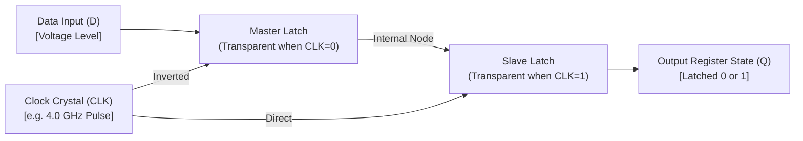
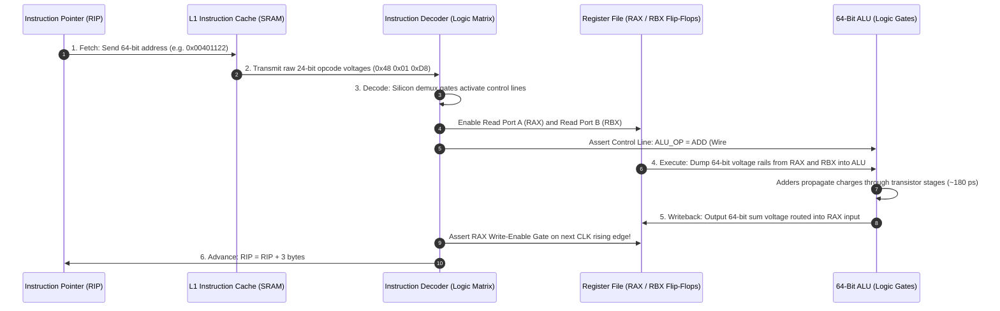
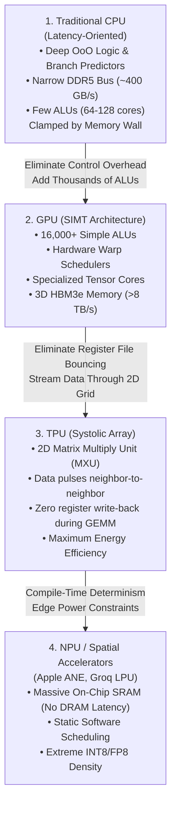
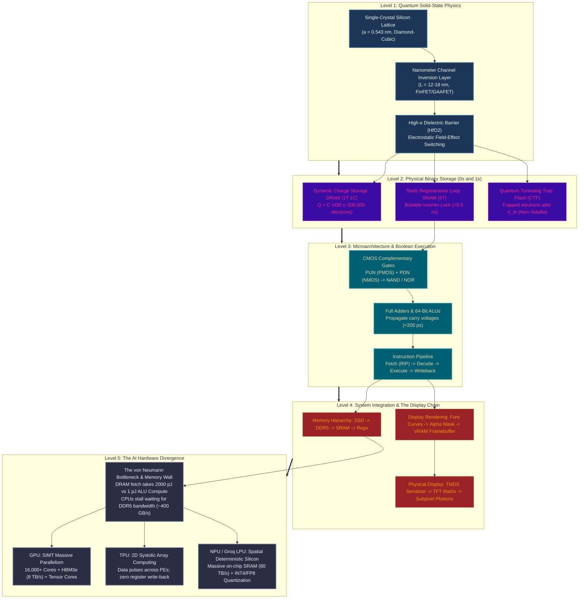

# 🔬 What is a Nanometer Silicon Channel?

> **The Executive Summary**: A **nanometer silicon channel** is the microscopic electrical switch inside a modern CPU, GPU, or AI chip that turns ON and OFF billions of times per second. Every calculation, conditional branch, and neural network inference is physically performed by electrostatically opening and closing tens of billions of these atomic-scale silicon bridges.
>
> **Reference / Context**: [from-physics-to-cpu-silicon.html](file:///d:/madhan-utils/learning/courses/ai-ml-course/explanations/from-physics-to-cpu-silicon.html) | [from-cpu-registers-to-global-system-resources.md](file:///d:/madhan-utils/learning/courses/ai-ml-course/explanations/from-cpu-registers-to-global-system-resources.md)

---

## 📑 Master Architecture Navigation

1. [Foundational Prerequisites &amp; Core Terminology](#1--foundational-prerequisites--core-terminology)
2. [What is the Nanometer Silicon Channel? (The Complete Assembly)](#2--what-is-the-nanometer-silicon-channel-the-complete-assembly)
3. [The Real-World Analogy: The Flexible Garden Hose &amp; Foot Pedal](#3--the-real-world-analogy-the-flexible-garden-hose--foot-pedal)
4. [Physical Anatomy &amp; Atomic Scale](#4--physical-anatomy--atomic-scale)
5. [Visual Mechanism: OFF State vs. Inversion Layer ON State](#5--visual-mechanism-off-state-vs-inversion-layer-on-state)
6. [How It Works: The Field-Effect Switching Cycle](#6--how-it-works-the-field-effect-switching-cycle)
7. [The Three Structural Generations of Silicon Channels](#7-️-the-three-structural-generations-of-silicon-channels)
8. [The Quantum Limits &amp; Common Engineering Gotchas](#8-️-the-quantum-limits--common-engineering-gotchas)
9. [From Transistor Switches to Binary Storage: How 0s and 1s are Physically Stored](#9--from-transistor-switches-to-binary-storage-how-0s-and-1s-are-physically-stored)
10. [From Silicon Switching to High-Level Execution &amp; Screen Display](#10--from-silicon-switching-to-high-level-execution--screen-display)
11. [The Fatal CPU Bottleneck in AI Computations: Microarchitectural Breakdown](#11--the-fatal-cpu-bottleneck-in-ai-computations-a-deep-physical--microarchitectural-breakdown)
12. [The Accelerator Revolution: GPUs, TPUs, and NPUs](#12--the-accelerator-revolution-gpus-tpus-and-npus)
13. [The Complete Macro Synthesis: From Nanometer Silicon to Trillion-Parameter LLMs](#13-️-the-complete-macro-synthesis-from-nanometer-silicon-to-trillion-parameter-llms)

---

### 1. 🧱 Foundational Prerequisites & Core Terminology

Before examining how the channel operates at nanometer dimensions, you must understand the five physical components and principles that assemble it:

```
┌──────────────────────────────────────────────────────────────────────────────────┐
│                             TRANSISTOR TERMINOLOGY MAP                           │
│                                                                                  │
│                        [ GATE ] (Prerequisite 3)                                 │
│                           │                                                      │
│                           ▼ (Electrons cannot cross!)                            │
│        [ HIGH-κ DIELECTRIC / INSULATOR ] (Prerequisite 4)                        │
│                           │                                                      │
│                           ▼ Invisible Electrostatic Field (Prerequisite 5)       │
│  [ SOURCE ] ────────► [ SINGLE-CRYSTAL SILICON CHANNEL ] ────────► [ DRAIN ]     │
│ (Prerequisite 2)             (Prerequisite 1)                    (Prerequisite 2)│
└──────────────────────────────────────────────────────────────────────────────────┘
```

#### Prerequisite 1: What is a "Crystal" & Silicon Morphologies (Amorphous vs. Poly vs. Single-Crystal)

##### 1.0 🧊 What is a "Crystal" and What Does "Crystalline" Mean?

In everyday speech, people hear "crystal" and picture shiny glass chandeliers, diamond jewelry, or decorative quartz prisms. In physics and semiconductor engineering, **shine, transparency, and beauty are completely irrelevant**:

> **The Physics Definition of a Crystal**: A **crystal** is a solid material whose constituent atoms are arranged in a microscopic, highly ordered, three-dimensional geometric pattern that repeats periodically without interruption in all directions.
>
> **What "Crystalline" Means**: The term **crystalline** describes matter possessing **long-range periodic translational symmetry**. If you measure the exact coordinates and bond angles of one atom in a crystalline solid, you can mathematically predict where an atom will sit 100 million atomic layers away in any direction $(x, y, z)$.

```
                      THE ANATOMY OF A CRYSTAL LATTICE
   
       Unit Cell (Smallest Repeating Block)       Extended Periodic Crystal
              ●─────────────●                   ●───●───●───●───●───●
             /│            /│                   │   │   │   │   │   │
            ●─┼───────────● │                   ●───●───●───●───●───●
            │ │           │ │     Repeating ──► │   │   │   │   │   │
            │ ●───────────┼─●      in (X,Y,Z)   ●───●───●───●───●───●
            │/            │/                    │   │   │   │   │   │
            ●─────────────●                     ●───●───●───●───●───●
           (Silicon Unit Cell:                 (Long-Range Spatial Symmetry)
            Side a = 0.543 nm)
```

The core concepts of crystallography every engineer must know:

1. **The Space Lattice**: An imaginary, infinite three-dimensional mathematical grid of points in space where atoms sit.
2. **The Unit Cell**: The smallest repeating geometric building block of the crystal. By stacking identical unit cells side-by-side like uniform bricks, the entire macroscopic solid is generated. In silicon, the unit cell is a **diamond-cubic cube** of side length $a = 0.543\text{ nanometers}$ containing 8 silicon atoms.
3. **Crystalline vs. Non-Crystalline (Amorphous)**:
   - **Crystalline Solids (Quartz, Iron, Silicon)**: Possess **long-range order**. Every atom is locked into a predictable, repeating coordinate grid. They have sharp, exact melting points because every atomic bond requires the exact same thermal energy to break.
   - **Non-Crystalline / Amorphous Solids (Window Glass, Candle Wax, Plastic)**: Possess **short-range order only**. An atom might bond to neighboring atoms, but the bond angles and distances are random and warped. There is no repeating pattern. They do not have an exact melting point; they simply soften gradually over a temperature range.
4. **The Lego Analogy**:
   - **Amorphous**: A chaotic pile of Lego bricks tossed into a toy bin. A few bricks click together by chance, but there is no uniform structure.
   - **Polycrystalline**: Ten small, neat Lego towers dropped into a box and jammed together at random, tilted angles. Inside each tower the bricks are aligned, but where the towers collide, jagged gaps and cracks form (**grain boundaries**).
   - **Single-Crystal (Monocrystalline)**: One gigantic, perfectly snapped-together Lego skyscraper where every single brick across the entire city block follows the exact same geometric grid without a single gap or crack.
5. **Why Crystallinity Dictates Quantum Computing Mechanics (Bloch's Theorem, 1928)**:
   In 1928, physicist **Felix Bloch** proved that an electron travelling through a perfectly periodic crystalline lattice does *not* crash into every individual atom like a pinball. Instead, because the atoms are spaced with mathematical regularity, the quantum electron wave undergoes constructive interference, gliding effortlessly through the crystal as a coherent **Bloch wave**. If the crystalline periodicity is broken (by amorphous disorder or grain boundaries), the wave crashes, scattering the electron and causing massive electrical resistance.

---

##### 1.1 Silicon Morphologies: Amorphous vs. Polycrystalline vs. Single-Crystal

Silicon on a beach is quartz sand ($\text{SiO}_2$); silicon in low-cost calculators is amorphous; silicon in rooftop solar panels is polycrystalline. But inside a high-performance microprocessor (CPU/GPU), **single-crystal silicon (mono-Si)** is physically mandatory.

```
1. AMORPHOUS SILICON (a-Si)      2. POLYCRYSTALLINE SILICON (Poly-Si)      3. SINGLE-CRYSTAL SILICON (Mono-Si)
      ●   ●    ●                        ┌─────┬──────┐                          ●───●───●───●───●
     / \   \  / \                       │ ╱ ╱ │ ╲ ╲  │ Grain                    │   │   │   │   │
    ●───●   ●    ●                      ├─────┼──────┤ Boundaries               ●───●───●───●───●
     \ /     \  /                       │ ╲ ╲ │ ╱ ╱  │ (Trap Charges!)          │   │   │   │   │
   (Chaotic, Disordered)                └─────┴──────┘                          ●───●───●───●───●
   Mobility: < 1 cm²/V·s                Mobility: 10 - 50 cm²/V·s               (Flawless Infinite Lattice)
   Used in: Pocket calculators          Used in: Solar cells, older gates       Mobility: ~1,400 cm²/V·s
                                                                                Used in: CPU Transistor Channels
```

---

##### 1.2 Defining the Three Allotropes / Morphologies

1. **Amorphous Silicon ($a\text{-Si}$)**:

   - **Structure**: Has no long-range atomic order. Silicon atoms form a chaotic, distorted network with varying bond angles and lengths. Many atoms have missing neighbors, creating open "dangling bonds" (unpaired electrons).
   - **Pros**:
     - Extremely cheap to manufacture.
     - Can be vapor-deposited at low temperatures ($<250^\circ\text{C}$) over massive surfaces, including flexible plastics and large sheets of display glass.
     - High optical absorption coefficient for visible light.
   - **Cons**:
     - Catastrophic electron mobility ($\mu_e < 1\text{ cm}^2/\text{V}\cdot\text{s}$)—over **$1,000\times$ slower** than single-crystal silicon.
     - Enormous density of defect states ($10^{15} - 10^{17}\text{ defects/cm}^3$) that trap charge carriers.
     - Suffers from the Staebler-Wronski effect (electrical performance degrades under light exposure).
   - **Typical Applications**: Low-cost pocket calculators, thin-film solar cells, and basic LCD flat-panel display backplanes (where transistors only switch at $60\text{ Hz}$).
2. **Polycrystalline Silicon ($\text{Poly-Si}$ or Polysilicon)**:

   - **Structure**: Composed of millions of microscopic single-crystal grains (each between $10\text{ nm}$ and $1\mu\text{m}$ in size) packed together at random orientations. Where these grains collide, they form jagged, chaotic interfaces called **grain boundaries**.
   - **Pros**:
     - Moderate manufacturing cost.
     - Can be deposited via Chemical Vapor Deposition (CVD) onto oxidized wafers.
     - Can be heavily doped with boron or phosphorus to act as an electrical conductor (conductor/gate material).
     - Better mobility than amorphous silicon ($\mu_e \approx 10 - 50\text{ cm}^2/\text{V}\cdot\text{s}$).
   - **Cons**:
     - Grain boundaries act as severe potential barriers and carrier traps that scatter electrons like brick walls.
     - High spatial variability: electrical resistance fluctuates wildly across microscopic dimensions depending on whether a grain boundary is present.
   - **Typical Applications**: Residential rooftop solar panels, high-voltage power diodes, early MOSFET gate electrodes (1970s–2000s), and active-matrix OLED display driver backplanes (LTPS - Low-Temperature Poly-Silicon).
3. **Single-Crystal Silicon (Monocrystalline Silicon / $\text{Mono-Si}$)**:

   - **Structure**: The entire solid object—from the outer edge of a $300\text{ mm}$ wafer across trillions of unit cells down to a $15\text{ nm}$ transistor channel—is **one single, continuous, unbroken diamond-cubic crystalline lattice**. Every silicon atom is covalently bonded to four neighbors in a rigid $sp^3$ tetrahedral geometry spaced $0.543\text{ nm}$ apart, with **zero internal grain boundaries**.
   - **Pros**:
     - Highest possible electron mobility ($\mu_e \approx 1,400\text{ cm}^2/\text{V}\cdot\text{s}$, hole mobility $\approx 450\text{ cm}^2/\text{V}\cdot\text{s}$).
     - Completely deterministic, predictable electrical properties across billions of transistors.
     - Enables electrons to travel as coherent quantum waves (Bloch waves) without scattering off internal defects.
     - Highly predictable anisotropic chemical and plasma etching along specific crystallographic planes ($\langle 100 \rangle, \langle 110 \rangle$).
   - **Cons**:
     - Extremely expensive, energy-intensive, and slow to manufacture.
     - Requires melting raw silicon in quartz crucibles at $1425^\circ\text{C}$ and pulling ingots over days.
     - Rigid and brittle; cannot be deposited onto flexible or large-area glass substrates.
   - **Typical Applications**: Microprocessors (CPUs, GPUs, TPUs, NPUs), DRAM and Flash memory, and high-efficiency aerospace solar cells.

---

##### 1.3 Comprehensive Head-to-Head Comparison

| Characteristic                          | Amorphous Silicon ($a\text{-Si}$) | Polycrystalline Silicon ($\text{Poly-Si}$) | Single-Crystal Silicon ($\text{Mono-Si}$)                   |                                                                                                                  |                                                       |
| :-------------------------------------- | :------------------------------------------------------------------------------------------------------------------------------------------------- | :--------------------------------------------------------------------------------------------------------------- | :---------------------------------------------------- |
| **Crystalline Order**             | No order (completely chaotic)                                                                                                                      | Short-range order ($10\text{nm}-1\mu\text{m}$ grains)                                                          | Infinite long-range order (entire wafer is 1 crystal) |
| **Internal Grain Boundaries**     | None (no crystals exist)                                                                                                                           | **Extremely dense (millions per mm²)**                                                                    | **Zero (completely absent)**                    |
| **Electron Mobility ($\mu_e$)** | $< 1 \, \text{cm}^2/\text{V}\cdot\text{s}$                                                                                                       | $10 - 50 \, \text{cm}^2/\text{V}\cdot\text{s}$ | **$\sim 1,400 \, \text{cm}^2/\text{V}\cdot\text{s}$** |                                                       |
| **Defect State Density**          | Very High ($10^{16}\text{ cm}^{-3}$) | High at grain boundaries ($10^{12}\text{ cm}^{-2}$) | Ultra-Low ($<10^{10}\text{ cm}^{-3}$)           |                                                                                                                  |                                                       |
| **Operating Frequency**           | Kilohertz ($\sim 60\text{ Hz} - 100\text{ kHz}$) | Megahertz ($\sim 1\text{ MHz} - 50\text{ MHz}$) | **Gigahertz ($>5.0\text{ GHz}$)** |                                                                                                                  |                                                       |
| **Manufacturing Cost**            | Very Low                                                                                                                                           | Moderate                                                                                                         | High                                                  |
| **Substrate Flexibility**         | Flexible plastics, thin glass                                                                                                                      | Glass sheets, ceramic wafers                                                                                     | Rigid circular wafers ($300\text{mm}$)              |
| **CPU Channel Suitability**       | ❌**Completely Impossible**                                                                                                                  | ❌**Fails at Nanometer Scale**                                                                             | **100% Mandatory Standard**                     |

---

##### 1.4 Why Microprocessors Strictly Require Single-Crystal Silicon (And Reject Others)

Why do Intel, TSMC, AMD, and Apple spend billions buying single-crystal silicon wafers rather than cheap poly-Si or amorphous films? The laws of physics dictate three non-negotiable reasons:

1. **The Nanoscale Scale-Mismatch Disaster (The Grain Boundary Catastrophe)**:
   In a modern $3\text{nm}$ or $2\text{nm}$ class CPU, the transistor channel is only **$12\text{ to }18\text{ nanometers}$ long and $3\text{ to }5\text{ nanometers}$ thick**.

   - A single crystalline grain in polycrystalline silicon is between $50\text{ nm}$ and $1,000\text{ nm}$ across.
   - If a chip were fabricated on poly-Si, some transistor channels would land inside a grain (acting somewhat normally), while adjacent channels would have a jagged **grain boundary cutting right through their center**.
   - The dangling bonds along that boundary would act like an electrostatic trap, shifting the transistor's threshold voltage ($\Delta V_{th}$) by hundreds of millivolts and spiking its resistance by $1,000\%$.
   - A CPU requires **50 billion transistors to switch with picosecond synchronization**. With poly-Si, timing skew and race conditions would cause **$0\%$ functional die yield**.
2. **Gigahertz Electron Velocity ($>5\text{ GHz}$ Clock Speeds)**:
   A CPU core running at $5.0\text{ GHz}$ has a clock cycle of only **$200\text{ picoseconds}$**. Within that window, signals must traverse multiple logic gate stages.

   - In amorphous silicon ($\mu < 1$), it takes an electron over $100\text{ picoseconds}$ just to crawl across a single $15\text{ nm}$ channel!
   - In single-crystal silicon ($\mu \approx 1,400$), electrons accelerate under electric fields into quasi-ballistic velocity saturation ($v_{sat} \approx 10^7\text{ cm/s}$), crossing the $15\text{ nm}$ channel in **under $0.2\text{ picoseconds}$** ($200\text{ femtoseconds}$). Only single-crystal silicon is fast enough for gigahertz computing.
3. **Atomic-Scale Anisotropic Etching for 3D FinFETs & GAAFET Nanosheets**:
   To carve vertical 3D fins ($5\text{ nm}$ wide) and horizontally suspended nanosheet ribbons ($3\text{ nm}$ thick), fabs rely on plasma etching and chemical baths that dissolve silicon along specific crystallographic atomic planes (e.g., etching the $\langle 100 \rangle$ direction while leaving the $\langle 110 \rangle$ plane intact).

   - In amorphous or polycrystalline silicon, atoms and grains are randomly oriented; chemical etching eats away in chaotic, ragged blobs.
   - In single-crystal silicon, because the atomic lattice is mathematically uniform across the entire wafer, chemical reagents etch razor-straight atomic planes, enabling the manufacturing of three-dimensional FinFET and GAAFET transistors.
4. **Electronic-Grade Silicon (EGS) Purity & The Czochralski Method (1916)**:
   To maintain this flawless single crystal, the raw silicon is purified to **"Eleven Nines" ($99.999999999\%$)**—fewer than 1 contaminant atom per 10 billion silicon atoms. Discovered by Polish chemist **Jan Czochralski**, a single-crystal seed is dipped into $1425^\circ\text{C}$ molten silicon and slowly pulled upward while rotating. Liquid atoms freeze onto the seed in identical crystal orientation, producing a monolithic cylinder (**boule**) weighing over $100\text{ kg}$ and containing over $10^{26}$ silicon atoms locked into a single geometric grid. Slicing this cylinder produces the mirror-polished wafers that power every modern computer.

#### Prerequisite 2: Source and Drain — Carrier Injector & Collector

A transistor channel does not generate charge carriers; it merely acts as a switchable conduit between two heavily doped reservoirs. Understanding how these two terminals inject and collect carriers is essential to understanding why modern transistors switch at gigahertz speeds and where physical scaling hits hard resistance.

---

##### 2.0 🔄 The Physical Symmetry Paradox: What Makes a Terminal "Source" vs. "Drain"?

[Certain] In standard planar MOSFETs, 3D FinFETs, and GAAFET nanosheets, the Source and Drain regions are fabricated **physically and metallurgically symmetrical**. When a wafer leaves the foundry line, the silicon crystal, epitaxial doping, and metal silicide contact at one end of the channel are identical to the other end.

What dictates which terminal acts as the **Source** and which acts as the **Drain** is entirely **the direction of the applied operating voltage ($V_{DS}$)** and the polarity of the mobile carriers:

> **The Universal Semiconductor Law**:
>
> - **Source ($S$)**: The terminal that **supplies (injects)** majority charge carriers into the channel.
> - **Drain ($D$)**: The terminal that **drains (collects / sweeps out)** majority charge carriers from the channel.

```
                  CARRIER FLOW VS. CONVENTIONAL CURRENT
  
  1. NMOS TRANSISTOR (Electrons, q = -e)
     [ SOURCE (0V) ] ═══════ Electron Flow (e⁻) ═══════► [ DRAIN (+0.7V) ]
                     ◄── Conventional Current (I_DS) ───
  
  2. PMOS TRANSISTOR (Holes, q = +e)
     [ SOURCE (+0.7V) ] ═════════ Hole Flow (h⁺) ════════► [ DRAIN (0V) ]
                        ─── Conventional Current (I_SD) ───►
```

| Transistor Type | Majority Carrier                                                               | Source Terminal Bias                                                                        | Drain Terminal Bias                            | Physical Carrier Motion                     | Conventional Current ($I$) |
| :-------------- | :----------------------------------------------------------------------------- | :------------------------------------------------------------------------------------------ | :--------------------------------------------- | :------------------------------------------ | :--------------------------- |
| **NMOS**  | **Electrons ($e^-$)**                                                  | Lower Potential (Ground,$0\text{V}$) | Higher Potential ($+V_{DD} \approx 0.7\text{V}$) | **Source $\to$ Channel $\to$ Drain** | **Drain $\to$ Source ($I_{DS}$)** |                              |
| **PMOS**  | **Holes ($h^+$)** | Higher Potential ($+V_{DD} \approx 0.7\text{V}$) | Lower Potential (Ground,$0\text{V}$)                                                      | **Source $\to$ Channel $\to$ Drain** | **Source $\to$ Drain ($I_{SD}$)** |                              |

If you invert the power rails on an NMOS transistor by applying $+0.7\text{V}$ to the left contact and $0\text{V}$ to the right contact, their roles instantly reverse: the right contact becomes the Source and the left contact becomes the Drain.

---

##### 2.1 🧪 Degenerate Doping ($N^+$ / $P^+$): Building the Infinite Carrier Reservoirs

Why do circuit diagrams designate the terminals as $N^+$ and $P^+$ rather than standard $N$ and $P$?

1. **The Numbers Behind Degenerate Doping**:
   - **Intrinsic (Pure) Silicon**: At room temperature ($300\text{ K}$), thermal vibrations break few covalent bonds, yielding an intrinsic carrier density of only $n_i \approx 1.5 \times 10^{10}\text{ carriers/cm}^3$ (practically an insulator).
   - **Standard Doped Silicon (Well / Substrate)**: Doped with boron or phosphorus at $\sim 10^{15}\text{ to }10^{17}\text{ atoms/cm}^3$ (roughly 1 dopant atom per 1 million silicon atoms).
   - **Degenerately Doped Source/Drain ($N^+ / P^+$)**: Doped at **$> 10^{20}\text{ to }5 \times 10^{20}\text{ atoms/cm}^3$** (more than 1 dopant atom for every 100 to 500 silicon atoms!).
2. **Quantum Band Consequence: The Fermi Level Shift**:
   In standard semiconductors, the Fermi energy level ($E_F$) sits quietly inside the bandgap between the conduction band ($E_c$) and valence band ($E_v$).
   In a degenerately doped $N^+$ Source, the donor impurity concentration ($N_D$) is so dense that individual dopant electron orbitals overlap into an impurity band that merges directly with the conduction band:
   - The Fermi level ($E_F$) is pushed **straight up into the conduction band** ($E_F > E_c$).
   - The Source terminal no longer behaves as a semiconductor requiring thermal activation; it behaves as a **quasi-metal**. Conduction electrons fill the available energy states up to the Fermi sea, creating an essentially inexhaustible carrier reservoir ($\sim 10^{20}\text{ electrons/cm}^3$).
3. **Why the Channel is Kept Undoped (Intrinsic)**:
   If high doping makes silicon conductive, why not heavily dope the channel too? Because dopant atoms are fixed ionized charges (e.g., $\text{P}^+$ or $\text{As}^+$). If placed inside a $15\text{ nm}$ channel, these ionized ions would act like electrostatic speed bumps, scattering electrons via Coulomb forces (ionized impurity scattering) and causing massive **Random Dopant Fluctuation (RDF)**, where a 1-atom variation between two neighboring transistors shifts their switching voltage ($\Delta V_{th}$) by tens of millivolts. In modern FinFETs and GAAFETs, the channel is left essentially pure (undoped), while all heavy doping is strictly confined to the Source and Drain.

---

##### 2.2 ⚡ The Operating Mechanism: Injection, Drift, and Collection

```
                    THE THREE-STAGE CARRIER LIFECYCLE
 
 [ SOURCE (N+) ]           [ UNDOPED CHANNEL ]           [ DRAIN (N+) ]
  (Reservoir)               (Transit Bridge)              (Collector)
 ┌─────────────┐       ┌────────────────────────┐       ┌─────────────┐
 │ Free e⁻ Sea │ ────► │  High Longitudinal     │ ────► │ Swept Out   │
 │ E_F > E_c   │       │  Electric Field (E_x)  │       │ into Metal  │
 │ (Injection) │       │  v_sat ≈ 10⁷ cm/s      │       │ (Collection)│
 └─────────────┘       └────────────────────────┘       └─────────────┘
        ▲                                                      │
        └────────────── Conventional Current (I_DS) ───────────┘
```

The operation of the Source and Drain breaks down into three physical phases:

1. **Carrier Injection (Source Terminal)**:
   - When the gate voltage is zero ($V_{GS} = 0\text{V}$), an electrostatic energy barrier ($\Delta \Phi_B$) stands between the Source electron reservoir and the channel.
   - When the gate voltage rises ($V_{GS} \ge V_{th}$), the gate's transverse electric field pulls down the channel's energy band edge, collapsing this barrier.
   - High-energy electrons in the Source reservoir spill over the lowered barrier into the channel via **thermionic emission** and **quasi-ballistic injection**. The Source acts as the emitter nozzle.
2. **Carrier Transit & Velocity Saturation (The Channel)**:
   - Once electrons enter the channel, they are seized by the **longitudinal electric field** ($\vec{E}_{\parallel}$) created by the voltage difference between the Drain and Source:
     $$
     \vec{E}_{\parallel} = \frac{V_{DS}}{L} = \frac{0.7\text{ V}}{15 \times 10^{-7}\text{ cm}} \approx 4.67 \times 10^5 \, \text{V/cm}
     $$
   - This electric field is massive—far higher than the breakdown voltage of air ($3 \times 10^4\text{ V/cm}$). Under this extreme force, electrons accelerate until they collide with silicon lattice vibrations (optical phonons). Their speed saturates at **$v_{sat} \approx 1 \times 10^7\text{ cm/s}$** ($100\text{ km/s}$), crossing the $15\text{ nm}$ channel in under $0.15\text{ picoseconds}$.
3. **Carrier Collection & Pinch-Off (Drain Terminal)**:
   - At the Drain end, the positive potential ($V_D = +0.7\text{V}$) creates a steep electrostatic cliff.
   - Any electron reaching the end of the channel is immediately captured by this potential drop and swept violently into the Drain contact.
   - As $V_{DS}$ increases, the channel near the drain pinches off (the inversion charge drops to near-zero at the drain edge). Electrons do not stop; instead, they are swept across the drain depletion region by the intense electric field. The Drain acts as an electrostatic vacuum cleaner, absorbing carriers without allowing them to reflect back into the channel.

```
                 ENERGY BAND PROFILE ALONG THE CHANNEL
  
   Energy (E)
      ▲
      │  [ SOURCE ]
      │   Conduction Band (E_c)
      │  ██████████\       Gate Barrier Collapses (V_GS ≥ V_th)
      │  ██████████ \  . - - - - - - - .
      │  (e⁻ pool)   \                  \
      │  ───────────  \                  \   [ DRAIN ]
      │  Fermi Sea     \                  \  ██████████
      │                 \                  \ ██████████
      │                  \──────────────────\────────── (E_F_drain)
      │                      CHANNEL          High V_DS Drop
      └─────────────────────────────────────────────────────► Position (x)
             Source Injection               Drain Collection
```

---

##### 2.3 🌊 The Hydraulic Analogy: Reservoir, Sluice Gate, and Waterfall Basin

To visualize this without getting bogged down in band diagrams:

```
 [ MOUNTAIN RESERVOIR ]       [ SLUICE GATE ]           [ WATERFALL GORGE ]
       (Source)                   (Gate)                      (Drain)
    ~~~~~~~~~~~~~                                       
    ~~~~~~~~~~~~~                                         │   │ (Deep gorge)
    ~~~~~~~~~~~~~  ════════► ┌───┐ ══════════════► ╲      │   │
    (Vast water pool)        │   │ (Channel flume)  ╲     │   ▼
                             └───┘                   ╲────┴─────────
                             Pedal lifts gate         Water plummets into
                             allowing water out       drain basin below
```

- **The Source is a massive mountain reservoir**: It stores an enormous, constant supply of water at high potential energy ($N^+$ carrier pool).
- **The Gate is a vertical sluice gate**: It blocks the reservoir outlet. When you crank open the gate ($V_{GS} \ge V_{th}$), water rushes out.
- **The Channel is the narrow canal flume**: Water rushes across the flume at maximum speed.
- **The Drain is a vertical waterfall dropping into a deep canyon**:
  - Once water tumbles over the edge of the waterfall, it is gone.
  - Making the canyon $100\text{ meters}$ deeper ($V_{DS} \uparrow$) **does not pull any more water out of the reservoir**—because the water flow rate is strictly dictated by how high the sluice gate is lifted ($V_{GS}$), not how deep the gorge below falls. This is why a transistor's current **saturates** in active operation!

---

##### 2.4 🔬 Modern Nanoscale Reality: The Contact Resistance Bottleneck & 3D Epitaxial Engineering

In textbook transistors from the 1990s, Source and Drain were simple flat regions formed by shooting ions into the silicon wafer (ion implantation). In modern $3\text{nm}$ FinFET and $2\text{nm}$ GAAFET chips, Source and Drain engineering is where the hardest battles in semiconductor physics are fought:

```
  EVOLUTION OF SOURCE / DRAIN ARCHITECTURE
  
  1. Planar Implantation (Legacy)    2. 3D Raised Epitaxial S/D (Modern FinFET / GAAFET)
        Gate                               Gate
      ┌──────┐                           ┌──────┐
      │ Metal│                           │ Metal│
  ────┴──────┴────                   ────┴──────┴────
  [N+] Channel [N+]                  / \ Channel / \  <-- Faceted SiGe or Si:P
  ════════════════                   \ /         \ /      Diamond Epitaxy
    Silicon Wafer                     ═════════════       Embedded Mechanical Strain!
```

1. **The Parasitic Resistance Catastrophe ($R_{ext}$)**:
   In legacy nodes ($180\text{ nm}$), the channel was long and had high electrical resistance ($R_{channel} \gg R_{source} + R_{drain}$).
   In modern $3\text{nm}$ transistors, the channel is so microscopically short ($15\text{ nm}$) that its intrinsic resistance has dropped to near-zero. Instead, the **parasitic external series resistance ($R_{ext} = R_{contact} + R_{spread} + R_{extension}$)** of the Source and Drain contacts now accounts for **$>35\%$ of total transistor resistance**!
   - If electrons cannot cleanly enter from the metal wiring into the silicon Source, it does not matter how fast the channel switches—the transistor chokes on its own contacts.
2. **The Metal-Semiconductor Schottky Barrier**:
   When upper copper/cobalt interconnect wires connect to the silicon Source and Drain, they form a **metal-semiconductor junction**. By default, quantum mechanics forms an energetic **Schottky barrier** at this interface that blocks current. To smash this barrier down to zero, fabs deposit ultra-thin metallic contact layers (e.g., Titanium Silicide $\text{TiSi}_2$, Cobalt Silicide $\text{CoSi}_2$, or Nickel-Platinum Silicide $\text{NiPtSi}$) that pin the Fermi level and allow electrons to tunnel freely through the contact interface without electrical resistance.
3. **3D Raised Epitaxial Source/Drain (ESD)**:
   Because FinFET fins ($5\text{ nm}$ wide) and GAAFET nanosheets ($3\text{ nm}$ thick) are far too fragile to survive violent ion implantation, foundries use **Selective Epitaxial Growth (SEG)**:
   - They grow diamond-faceted 3D crystalline nodules of silicon alloy directly onto the ends of the channels inside high-temperature chemical vapor deposition chambers.
   - These raised nodules dramatically enlarge the surface contact area, reducing the contact resistance ($R_c$) by over $60\%$.
4. **Strain Engineering: Boosting Carrier Velocity for Free**:
   Foundries intentionally poison the Source/Drain crystal alloy to physically stretch or squeeze the adjacent silicon channel:
   - **PMOS Transistors (Compressive Strain)**: The Source and Drain are grown with **Silicon-Germanium ($\text{Si}_{1-x}\text{Ge}_x$)**. Because germanium atoms are physically larger than silicon atoms ($a_{Ge} = 0.565\text{ nm}$ vs $a_{Si} = 0.543\text{ nm}$), the crystal lattice pushes inward against the silicon channel. This **compressive stress** deforms the silicon lattice, splitting the valence band degeneracy and boosting hole mobility by **$200\text{ to }300\%$**!
   - **NMOS Transistors (Tensile Strain)**: The Source and Drain are grown with **Carbon-doped Silicon ($\text{Si:C}$)** or heavily in-situ **Phosphorus-doped Silicon ($\text{Si:P}$)**. Because carbon atoms are smaller than silicon, they pull outward on the channel. This **tensile stress** aligns the conduction band valleys along the transport direction, reducing electron effective mass and boosting electron mobility by **$50\text{ to }100\%$**.

---

##### 2.5 📊 Architectural Comparison: Source vs. Drain vs. Channel vs. Gate

| Transistor Region                                                                                                                                                                                                                                                                               | Fundamental Role                                                                                                                                                                                                                | Doping Type & Density                                                                                                                                                                                                                        | Material System | Voltage State (NMOS) | Physics Phenomenon / Bottleneck |
| :---------------------------------------------------------------------------------------------------------------------------------------------------------------------------------------------------------------------------------------------------------------------------------------------- | :------------------------------------------------------------------------------------------------------------------------------------------------------------------------------------------------------------------------------ | :------------------------------------------------------------------------------------------------------------------------------------------------------------------------------------------------------------------------------------------- | :-------------- | :------------------- | :------------------------------ |
| **Source ($S$)** | **Carrier Injector** (Emitter reservoir) | Degenerate ($N^+ / P^+ \sim 5 \times 10^{20}\text{ cm}^{-3}$) | Raised Epitaxial Si:P / SiGe | Low ($0\text{V}$ / GND) | Thermionic & ballistic injection over barrier; contact resistance ($R_c$) bottleneck |                                                                                                                                                                                                                                 |                                                                                                                                                                                                                                              |                 |                      |                                 |
| **Channel**                                                                                                                                                                                                                                                                               | **Switchable Conduit** (Conductive bridge)                                                                                                                                                                                | Intrinsic / Undoped ($< 10^{15}\text{ cm}^{-3}$) | Monocrystalline Silicon ribbon/fin | Dynamic ($0\text{V} \to 0.7\text{V}$) | Inversion layer formation; velocity saturation ($v_{sat} \approx 10^7\text{ cm/s}$); quantum tunneling |                 |                      |                                 |
| **Drain ($D$)** | **Carrier Collector** (Evacuation sink) | Degenerate ($N^+ / P^+ \sim 5 \times 10^{20}\text{ cm}^{-3}$) | Raised Epitaxial Si:P / SiGe | High ($+V_{DD} \approx 0.7\text{V}$)                                                                               | Pinch-off sweep; high-field carrier collection; Drain-Induced Barrier Lowering (DIBL)                                                                                                                                           |                                                                                                                                                                                                                                              |                 |                      |                                 |
| **Gate ($G$)** | **Valve Actuator** (Remote electrostatic control) | Metallic Conductor ($n_e \sim 10^{23}\text{ cm}^{-3}$)                                                                                                                                                     | Work-function metal +$\text{HfO}_2$ High-$\kappa$ | Control Signal ($0\text{V} \leftrightarrow 0.7\text{V}$) | Transverse electric field ($10^7\text{ V/m}$); zero DC current ($I_G \approx 0$); dielectric breakdown |                                                                                                                                                                                                                                              |                 |                      |                                 |

---

#### Prerequisite 3: The Gate — The Remote Control Terminal

The **Gate** is the valve control electrode positioned directly adjacent to (or wrapping around) the silicon channel. Unlike a mechanical switch, the Gate **never touches the channel directly**. It modulates the channel's internal conductivity remotely using an electric field.

#### Prerequisite 4: "Insulated" & The High-$\kappa$ Dielectric — The Non-Contact Barrier

- **What "Insulated" Means**: There is **zero direct electrical conductivity** between the Gate metal and the Silicon Channel. Valence electrons in the insulator are locked into tight chemical bonds ($E_g > 5-9\text{ eV}$). DC current cannot cross into the channel:

  $$
  I_{Gate} \approx 0 \, \text{Amperes}
  $$

  Because the gate is insulated, maintaining a transistor in an ON state draws almost zero continuous power.
- **What "Dielectric" Means**: A dielectric is an insulator that polarizes when exposed to an electric field. Its internal charges stretch slightly, transmitting the electric force straight through to the silicon underneath without passing any electrons.
- **What "$\kappa$" (Kappa) Means**: The dielectric constant (relative permittivity). It measures how effectively a material transmits and concentrates electric flux lines relative to a vacuum ($\kappa_{vacuum} = 1$).
- **The 2005 Tunneling Crisis & The High-$\kappa$ Breakthrough**:
  For decades, the gate insulator was silicon dioxide ($\text{SiO}_2$, $\kappa \approx 3.9$). As transistors shrunk, $\text{SiO}_2$ had to be thinned down to $1.2\text{ nm}$ (barely 5 atoms thick!). At 5 atoms, electrons simply quantum-tunneled straight through the glass, causing massive leakage that melted chips with idle heat.
  In 2007, Intel introduced **Hafnium Oxide ($\text{HfO}_2$, $\kappa \approx 25$)**. Because $\kappa$ is $>5\times$ higher, the physical wall could be made **$5\times$ thicker** while delivering the **exact same electrostatic control** ($C = \frac{\kappa \varepsilon_0 A}{d}$). The thicker barrier stopped quantum leakage cold.

```
Old SiO2 Dielectric (κ ≈ 3.9, 1.2nm thin)         High-κ Hafnium Oxide (κ ≈ 25, 3nm thick)
Gate: [ + + + + + + ]                            Gate: [ + + + + + + ]
Wall: ░░░░░░░░░░░░░░░ (Only 5 atoms thick!)       Wall: ▓▓▓▓▓▓▓▓▓▓▓▓▓▓▓▓▓▓▓▓▓▓▓▓ (Thick!)
Sil:  ═══ ➔ ➔ ➔ ═════                            Sil:  ════════════════════════
Electrons LEAK straight through!                 NO LEAKAGE! High-κ maintains
(Quantum Tunneling Breakdown)                    intense field without current leak!
```

#### Prerequisite 5: "Electrostatic" Control — Force-at-a-Distance

Unlike **electrodynamics** (where electric charges travel in a continuous circuit loop, like power in a light bulb wire), **electrostatics** governs the forces and potentials produced by **stationary, pooled charges**:

- When you apply $+0.8\text{V}$ to the Gate, positive charges accumulate and sit stationary on the metal plate.
- Even though the charges cannot physically cross the insulating dielectric, their **electrostatic field** penetrates through the glass via Coulomb's Law ($F_e = q\vec{E}$).
- This field reaches deep into the silicon substrate and pulls mobile negative electrons upward toward the dielectric boundary, forming the conductive bridge.
- It is identical to holding a powerful magnet above a glass table to drag iron filings across the underside without ever touching them.

---

### 2. 🎯 What is the Nanometer Silicon Channel? (The Complete Assembly)

With the five prerequisites defined, we can now assemble them into the complete transistor:

In modern microprocessors, the **nanometer silicon channel** is the microscopic physical bridge of **single-crystal silicon** ($\text{Si}$) situated between the **Source** (carrier injector) and the **Drain** (carrier collector).

Its electrical conductivity is dynamically switched between an insulator (Switch OFF / Logic `0`) and a conductor (Switch ON / Logic `1`) by the **electrostatic field** of the adjacent, **insulated Gate** operating across the **high-$\kappa$ dielectric**.

```
                           [ Insulated Gate Electrode ]
                          ┌────────────────────────────┐
                          │ High-κ Dielectric (1.2 nm) │
  Source Terminal (N+) ───┼────────────────────────────┼─── Drain Terminal (N+)
  [ Carrier Injector ]    │  NANOMETER SILICON CHANNEL │    [ Carrier Collector ]
                          │  Length (L): 10-18 nm      │
                          │  Thickness: 3-5 nm         │
                          │  (~10-18 Silicon Atoms)    │
                          └────────────────────────────┘
```

Every calculation, conditional branch, cache fetch, and AI tensor dot product executed by hardware boils down to electrostatically opening and closing **tens of billions** of these nanometer channels billions of times per second.

---

### 3. 💡 The Real-World Analogy: The Flexible Garden Hose & Foot Pedal

Think of a nanometer silicon channel like a **flexible silicone garden hose** running between a high-pressure water spigot (**Source**) and a bucket (**Drain**):

```
                       [ Foot / Spring Clamp ] (Gate)
                                 │ Push down = Pinch shut (OFF)
                                 ▼ Release   = Water surges (ON)
   [ Water Spigot ] ═════════════════════════════════════► [ Drain Bucket ]
      (Source)               (Flexible Hose)                    (Drain)
```

- In a standard hose, water flows freely until you step on it. In an enhancement-mode silicon transistor, the situation is reversed: a mechanical spring clamp keeps the hose pinched completely flat (**Switch OFF**). Water cannot pass.
- When you press a foot pedal (**Gate Voltage, $V_{GS}$**), an electromagnetic actuator counteracts the clamp, forcing the hose walls open. Water surges through to the bucket (**Switch ON**).
- The narrower and shorter the hose, the less water pressure is required to fill the bucket quickly, and the faster you can pulse the valve. But if the hose walls become as thin as tissue paper ($<3\text{ nm}$), water droplets begin sweating directly through the rubber molecules (**Quantum Tunneling Leakage**), even when pinched completely shut.

---

### 4. 🔬 Physical Anatomy & Atomic Scale

Inside a commercial $3\text{nm}$ or $2\text{nm}$ class microprocessor (e.g., Apple M4, Intel Core Ultra 200, NVIDIA Blackwell), the physical dimensions of the channel operate near fundamental atomic limits:

| Dimension / Parameter                                  | Physical Value                                                                                          | Atomic Scale Equivalence                                                                                                       | Engineering Role                                     |
| :----------------------------------------------------- | :------------------------------------------------------------------------------------------------------ | :----------------------------------------------------------------------------------------------------------------------------- | :--------------------------------------------------- |
| **Silicon Lattice Constant ($a$)**             | $0.543\text{ nm}$                                                                                     | Unit cell cube of 8 silicon atoms                                                                                              | Fundamental atomic grid spacing                      |
| **Physical Channel Length ($L$)**              | $12\text{ to }18\text{ nm}$                                                                           | $\sim 22\text{ to }33$ silicon unit cells                                                                                    | Distance electrons must transit from Source to Drain |
| **Channel Thickness / Fin Width ($T_{si}$)**   | $3\text{ to }5\text{ nm}$ | **$6\text{ to }10$ unit cells ($10\text{ to }18$ atoms wide!)** | Vertical or lateral width of the conduction slab                                                                               |                                                      |
| **Gate Oxide Dielectric Thickness ($t_{ox}$)** | $1.2\text{ to }1.5\text{ nm}$                                                                         | $\sim 3\text{ to }4$ molecular layers of $\text{HfO}_2$                                                                    | Insulating barrier preventing gate leakage           |
| **Transit Time ($\tau_{transit}$)**            | $< 0.2\text{ picoseconds}$                                                                            | $2 \times 10^{-13}\text{ seconds}$                        | Time taken for a saturated electron to cross$L$                |                                                      |
| **Operating Channel Voltage ($V_{DD}$)**       | $0.65\text{ to }0.85\text{ V}$                                                                        | $\sim 0.7\text{ V}$ across $15\text{ nm}$               | Produces intense field:$\vec{E} \sim 5 \times 10^7\text{ V/m}$ |                                                      |

---

### 5. 🎨 Visual Mechanism: OFF State vs. Inversion Layer ON State

```mermaid
flowchart TD
    subgraph OFF_STATE["1. OFF State (V_GS = 0V) — Insulating Barrier"]
        direction LR
        S1["Source (N+)<br>High Electron Pool"] -->|Blocked by Barrier| B1["P-Type Substrate Channel<br>High Energy Potential Barrier (No Inversion)"]
        B1 -.->|Zero Current (I_D ≈ 0)| D1["Drain (N+)"]
    end

    subgraph ON_STATE["2. ON State (V_GS ≥ V_th) — Conductive Inversion Channel"]
        direction LR
        S2["Source (N+)<br>High Electron Pool"] ==>|Electrons Surge Through| B2["Inversion Layer Formed!<br>Gate Field pulls 10^19 e-/cm³ to interface"]
        B2 ==>|Saturation Current (I_D ~ mA)| D2["Drain (N+)"]
    end
```

---

### 6. ⚡ How It Works: The Field-Effect Switching Cycle

```
                             GATE ELECTRODE (Metal)
                                       │ +0.8V
                         ┌─────────────┴─────────────┐
                         │   Dielectric Oxide (HfO2) │
  SOURCE (N+)            ├───────────────────────────┤            DRAIN (N+)
┌──────────────┐  -  -  -│- - - - - - - - - - - - - -│- -  -  - ┌──────────────┐
│ Highly Doped │ ──────► │   ELECTRONS ACCUMULATE    │ ──────►  │ Highly Doped │
│ Free e- Pool │         │    (INVERSION LAYER)      │          │ Free e- Pool │
└──────────────┘         └───────────────────────────┘          └──────────────┘
                               P-Type Silicon Body
```

1. **Equilibrium (OFF)**:
   Between the two heavily doped N-type pools (Source and Drain) sits P-type silicon containing mostly positive mobile holes. The opposing carrier types create natural depletion barrier zones ($P\text{-}N$ junctions). Under zero gate bias ($V_{GS} = 0$), this energy barrier prevents electrons from crossing. Current is virtually zero ($I_D \approx 0$).
2. **Applying the Transverse Field**:
   When a positive voltage ($V_{GS} > V_{th} \approx 0.4\text{V}$) is placed on the Gate electrode, it creates a massive transverse electric field ($\sim 10^7\text{ V/m}$) pointing downward through the insulating dielectric.
3. **Band Bending & Inversion**:
   This field pushes mobile holes away from the interface and pulls minority conduction-band electrons upward toward the dielectric boundary.
4. **Conductive Pathway Formed**:
   When the surface electron concentration exceeds the native hole concentration, the surface crystal **inverts** its electrical nature from P-type to N-type. A continuous, low-resistance metallic-like electron highway forms, allowing current ($I_D \sim \text{mA}$) to rush from Source to Drain.
5. **Switching Off**:
   Dropping the gate voltage back to $0\text{V}$ instantly dissolves the inversion layer in picoseconds, resetting the channel to an insulator.

---

### 7. 🏗️ The Three Structural Generations of Silicon Channels

To combat electrical leakage as transistors shrunk below optical limits, the geometry of the channel had to evolve from flat two-dimensional sheets to fully suspended three-dimensional ribbons:

```
1. PLANAR MOSFET (1960–2011)        2. FinFET (2011–2022)         3. GAAFET Nanosheet (2022+)
      [ GATE METAL ]                   ┌───[GATE]───┐               ┌───[GATE]───┐
  ───────────────────────              │ ┌────────┐ │               │ ┌────────┐ │  Ribbon 3
  [Dielectric (Top Only)]              │ │Silicon │ │               │ └────────┘ │
  ═══════════════════════              │ │Channel │ │               ├───[GATE]───┤
     Silicon Substrate                 │ │Fin (3D)│ │               │ ┌────────┐ │  Ribbon 2
    (Bottom Leaks into Body)           │ └────────┘ │               │ └────────┘ │
                                       └───[GATE]───┘               ├───[GATE]───┤
                                      Gate wraps 3 sides!           │ ┌────────┐ │  Ribbon 1
                                                                    │ └────────┘ │
                                                                    └───[GATE]───┘
                                                                   Gate wraps all 4 sides!
```

1. **Planar Channel (1960–2011)**:
   - *Geometry*: Flat 2D interface beneath a top-only gate electrode.
   - *Failure Mode*: As length $L$ dropped below $28\text{nm}$, the Drain terminal's positive voltage overpowered the Gate and sucked electrons through the bottom substrate (**Drain-Induced Barrier Lowering / DIBL**). Planar transistors could no longer be turned OFF.
2. **FinFET 3D Channel (2011–2022)**:
   - *Geometry*: The silicon channel was pulled up into a thin vertical knife-edge "fin" ($W_{fin} \approx 5-7\text{ nm}$).
   - *Advantage*: The gate metal wrapped around the top, left, and right sides of the fin, clamping the channel electrostatically from three directions and suppressing sub-channel leakage down to $7\text{nm}$.
3. **GAAFET (Gate-All-Around / Nanosheet) Channel (2022–Present)**:
   - *Geometry*: The fin is sliced horizontally into 3 to 4 vertically stacked flat ribbons of single-crystal silicon ($\approx 3\text{nm}$ thick, $\approx 20-40\text{nm}$ wide), suspended in air during fabrication.
   - *Ultimate Control*: The gate dielectric and metal completely envelop every ribbon on **all four sides ($360^\circ$)**, providing the maximum electrostatic confinement physically permitted by electromagnetic theory.

---

### 8. ⚠️ The Quantum Limits & Common Engineering Gotchas

> [!CAUTION]
> **Gotcha #1: Foundry Node Labels ("3nm", "2nm") are NOT Channel Dimensions**
> Neither TSMC "3nm" nor Intel "18A" contains any structural feature measuring $3\text{ nanometers}$ or $1.8\text{ nanometers}$. The physical gate length ($L$) in a "3nm" chip is actually **$12\text{ to }16\text{ nm}$**, and the contacted poly pitch (CPP) is $\approx 45-50\text{ nm}$. Node names are marketing metrics denoting equivalent transistor density scaling, not physical dimensions.

> [!WARNING]
> **Gotcha #2: Direct Source-to-Drain Quantum Tunneling**
> If the physical channel length $L$ is scaled below $\sim 5\text{ nanometers}$ (approx. 10 silicon atoms long), the electron's de Broglie wavelength ($\lambda = h/p$) becomes comparable to the barrier width. Electrons bypass the gate's electrostatic potential barrier entirely via **quantum mechanical wave tunneling**. The transistor remains permanently stuck in a conducting state and cannot be switched OFF.

> [!NOTE]
> **Gotcha #3: Carrier Velocity Saturation**
> In classical mechanics, doubling the electric field doubles the acceleration and drift speed of carriers ($v = \mu E$). In a nanometer channel where the longitudinal electric field exceeds $10^5\text{ V/cm}$, electrons collide with acoustic lattice vibrations (phonons) so intensely that their speed saturates at a ceiling of **$v_{sat} \approx 1 \times 10^7\text{ cm/s}$**. Increasing the core voltage beyond this point does not make the CPU switch faster; it only generates wasted thermal dissipation ($P = I^2 R$).

---

### 9. 💾 From Transistor Switches to Binary Storage: How 0s and 1s are Physically Stored

#### 9.1 The Fundamental Fallacy: Transistors Alone Do NOT Store Bits

[Certain] A standalone MOSFET or GAAFET transistor **cannot store a bit**. It is an active switch, physically analogous to a spring-loaded water valve. When gate voltage is removed ($V_{GS} = 0\text{V}$), the conductive channel immediately collapses into an insulator. It has no physical mechanism to "remember" that current flowed through it a nanosecond prior.

To store binary state (`0` or `1`), semiconductor engineers assemble transistors into three distinct physical and topological configurations:

```
┌────────────────────────────────────────────────────────────────────────────────────────┐
│                        THE THREE PHYSICAL STORAGE TOPOLOGIES                           │
├──────────────────────────┬─────────────────────────────┬───────────────────────────────┤
│ 1. Dynamic Charge Trap   │ 2. Regenerative Feedback    │ 3. Quantum-Isolated Barrier   │
│    (DRAM: 1T-1C)         │    (SRAM: 6T / Registers)   │    (NAND Flash: Floating Gate)│
├──────────────────────────┼─────────────────────────────┼───────────────────────────────┤
│ Physical Mechanism:      │ Physical Mechanism:         │ Physical Mechanism:           │
│ Real electrons trapped   │ Cross-coupled inverters     │ Electrons quantum-tunneled    │
│ inside an electrostatic  │ driving opposing voltage    │ into an isolated silicon      │
│ capacitor reservoir.     │ rails (bistable loop).      │ island surrounded by glass.   │
│                          │                             │                               │
│  WL ───[ Gate ]          │   VDD             VDD       │      Control Gate             │
│           │              │    │               │        │    ─────────────────          │
│  BL ───[Channel]───( C ) │   [P1]──NodeQ───┬─[P2]      │    ░░░░ Oxide ░░░░░          │
│                    │     │    │     │      │  │        │    ▒ Floating Gate ▒ (Trap)  │
│                   GND    │   [N1]───┴───NodeQB[N2]     │    ░░ Tunnel Oxide ░         │
│                          │    │               │        │    ═════ Channel ═══         │
│                          │   GND             GND       │                              │
├──────────────────────────┼─────────────────────────────┼───────────────────────────────┤
│ Volatility: Volatile     │ Volatility: Volatile        │ Volatility: Non-Volatile      │
│ Persistence: ~32-64 ms   │ Persistence: While powered  │ Persistence: > 10 Years       │
│ Latency: ~50-80 ns       │ Latency: < 0.5-2 ns         │ Latency: ~10,000-50,000 ns    │
│ Density: 1 bit / 1 cell  │ Density: 6-30 trans / bit   │ Density: 1-4 bits / cell      │
│ Location: Main Memory    │ Location: L1/L2/L3, Regs    │ Location: NVMe SSD Storage    │
└──────────────────────────┴─────────────────────────────┴───────────────────────────────┘
```

---

#### 9.2 The 1T-1C DRAM Cell: Capacitive Charge Trapping

[Certain] System RAM (DDR4 / DDR5) is built entirely from **1T-1C cells** (One Transistor, One Capacitor):

```
       Wordline (WL) [Row Select]
            │
            ▼
        ┌───────┐
Bitline │ Gate  │
(BL) ───┤Channel├───────● [ Storage Node ]
        └───────┘       │
      Access Transistor │
                       === Deep-Trench / Cylinder Capacitor (C ≈ 25–30 fF)
                        │  Trapped Charge: Q = C · V_DD (~150,000 electrons)
                       GND
```

1. **Physical Anatomy**:
   - **Access Transistor**: A single NMOS channel serving as an isolation valve.
   - **Storage Capacitor**: A microscopic, three-dimensional cylinder or deep trench etched into the silicon substrate, coated with a high-$\kappa$ dielectric (e.g., Zirconium Dioxide, $\text{ZrO}_2$, $\kappa \approx 35-40$). Capacitance is ultra-tiny: $C \approx 25\text{ to }30\text{ femtofarads}$ ($10^{-15}\text{ F}$).
2. **Writing a Binary `1`**:
   - Bitline (column) is driven to full voltage rail $V_{DD}$ ($\sim 1.1\text{V}$).
   - Wordline (row) is pulled HIGH ($V_{WL} > V_{DD} + V_{th}$), opening the access transistor channel.
   - Current rushes into the capacitor, storing an electrostatic charge:
     $$
     Q = C \times V_{DD} \approx (30 \times 10^{-15}\text{ F}) \times (1.1\text{ V}) \approx 3.3 \times 10^{-14}\text{ Coulombs}
     $$

     Divided by elementary charge $e = 1.602 \times 10^{-19}\text{ C}$, this corresponds to **$\sim 200,000\text{ trapped electrons}$**.
   - Wordline drops to $0\text{V}$, closing the channel. The electrons remain trapped in the capacitor.
3. **Writing a Binary `0`**:
   - Bitline is clamped to Ground ($0\text{V}$).
   - Wordline is pulsed HIGH. Trapped electrons discharge into the bitline to ground.
4. **Reading & The Destructive Read Cycle**:
   - The Bitline has significant parasitic capacitance ($C_{BL} \approx 100\text{ to }200\text{ fF}$). Before reading, it is pre-charged to exactly half rail: $V_{PRE} = V_{DD} / 2 \approx 0.55\text{V}$.
   - Wordline opens the access transistor. The microscopic charge in the storage capacitor shares itself across the large Bitline:
     $$
     \Delta V = \frac{C_S}{C_S + C_{BL}} \left( V_{Initial} - \frac{V_{DD}}{2} \right)
     $$
   - The resulting voltage shift $\Delta V$ is only **$30\text{ to }60\text{ millivolts}$**!
   - A high-speed analog differential **Sense Amplifier** detects this perturbation:
     - If voltage nudges upward ($+50\text{ mV}$), the amplifier snaps to $V_{DD}$ (Logic `1`).
     - If voltage dips downward ($-50\text{ mV}$), the amplifier snaps to $0\text{V}$ (Logic `0`).
   - **Destructive Read Penalty**: The read operation drains the capacitor. The sense amplifier must immediately drive the Bitline to full rail to **re-write** the original charge back into the cell before the Wordline closes.
5. **The Thermal Decay Crisis & Refresh Cycle ($t_{REFI}$)**:
   - No dielectric is infinite. Electrons leak across the junction ($I_{subthreshold}$) and through the capacitor dielectric at a rate of $\sim 1\text{ fA}$.
   - Within $\sim 30-100\text{ milliseconds}$, a stored `1` drains below the threshold of detection.
   - **The Fix**: The memory controller must issue periodic **Auto-Refresh (REF)** commands every $64\text{ ms}$ (at $\le 85^\circ\text{C}$) or $32\text{ ms}$ (at $>85^\circ\text{C}$), reading and re-amplifying all rows. This steals $\sim 5-10\%$ of total DRAM bandwidth.

---

#### 9.3 The 6T SRAM Cell: Static Regenerative Voltage Feedback

[Certain] CPU Registers, L1, L2, and L3 caches require sub-nanosecond read/write operations and cannot tolerate destructive readouts or refresh cycles. They use the **6-Transistor Static RAM (6T SRAM)** cell:

```
                  V_DD (+0.8V)               V_DD (+0.8V)
                       │                          │
                   [P1 / PMOS]                [P2 / PMOS]
                       │                          │
  BL ────[M5/Pass]─────●────── Node Q ────────────┼────────┐
           │           │                          │        │
      Wordline (WL)    │                          │        │
           │       [N1 / NMOS]                [N2 / NMOS]  │
           │           │                          │        │
           │          GND                        GND       │
           │                                               │
           │                                               │
  BL_B ──[M6/Pass]────────────────── Node Q_Bar ───────────┘
```

1. **Circuit Topology**:
   - Two CMOS cross-coupled inverters: Inverter 1 ($P_1 + N_1$) and Inverter 2 ($P_2 + N_2$).
   - Two NMOS access pass transistors ($M_5 + M_6$) controlled by the horizontal Wordline.
2. **The Bistable Energy Well (Regenerative Feedback)**:
   - Assume Node $Q$ is at high voltage ($V_{DD} = 0.8\text{V}$, Logic `1`).
   - Node $Q$ drives the gates of Inverter 2: it switches NMOS $N_2$ hard ON and PMOS $P_2$ hard OFF.
   - This pulls the complementary node $\bar{Q}$ to Ground ($0\text{V}$, Logic `0`).
   - Node $\bar{Q}$ at $0\text{V}$ feeds back into Inverter 1: it switches PMOS $P_1$ hard ON and NMOS $N_1$ hard OFF.
   - $P_1$ continuously channels current from $V_{DD}$ directly into Node $Q$, keeping it locked at `1`.
   - The circuit forms an **active, self-reinforcing electrostatic lock**. Any minor thermal noise or quantum fluctuation is instantly quenched by the opposing transistors.
3. **Read Operation (Non-Destructive)**:
   - Both Bitline ($BL$) and Bitline Complement ($\overline{BL}$) are precharged to $V_{DD}$.
   - Wordline ($WL$) is pulsed HIGH.
   - Because Node $\bar{Q}$ is at $0\text{V}$, current flows from $\overline{BL}$ through $M_6$ and $N_2$ to Ground, pulling the voltage on $\overline{BL}$ downward.
   - Node $Q$ is at $V_{DD}$, so $BL$ remains flat at $V_{DD}$.
   - A sense amplifier reads the voltage difference $V(BL) - V(\overline{BL}) > 0$ within **$\approx 0.3\text{ nanoseconds}$**. The state inside $Q$ and $\bar{Q}$ is **never destroyed**.
4. **The Area Tradeoff**:
   - 1 bit in DRAM = 1 transistor + 1 trench ($<0.001 \, \mu\text{m}^2$).
   - 1 bit in 3nm SRAM = 6 transistors + 8 contact vias ($0.021 \, \mu\text{m}^2$).
   - SRAM is **$\approx 20\times\text{ to }50\times$ physically larger** than DRAM per bit, which is why a CPU has only 32–128 megabytes of SRAM cache while the motherboard has 32–128 gigabytes of DRAM.

---

#### 9.4 Non-Volatile Floating-Gate & Charge-Trap Flash: Quantum Traps

[Certain] Solid-State Drives (SSDs) and USB flash memory must retain data when power is completely severed ($V_{DD} = 0\text{V}$). They use **Floating-Gate MOSFETs** or modern **Charge-Trap Flash (CTF)**:

```
                            Control Gate (Wordline)
                    ┌──────────────────────────────────────┐
                    │ Metal / Heavily Doped Polysilicon    │
                    ├──────────────────────────────────────┤
                    │ Blocking Oxide (Dielectric)          │
                    ├──────────────────────────────────────┤
                    │ ▒▒▒ FLOATING GATE / CHARGE TRAP ▒▒▒  │ <── Imprisoned Electrons
                    ├──────────────────────────────────────┤
                    │ Tunnel Oxide (8-10 nm SiO2 barrier)  │ <── Quantum Barrier
 ┌──────────────────┴──────────────────────────────────────┴──────────────────┐
 │ [ SOURCE (N+) ]             SILICON CHANNEL             [ DRAIN (N+) ]    │
 └────────────────────────────────────────────────────────────────────────────┘
                              P-Type Silicon Substrate
```

1. **Programming (Writing a `0` via Fowler-Nordheim Tunneling)**:
   - To inject electrons, a high voltage pulse ($+18\text{V}$ to $+24\text{V}$) is applied to the Control Gate while keeping the substrate at $0\text{V}$.
   - This creates an astronomical electric field exceeding $10^9\text{ V/m}$ ($10\text{ MV/cm}$) across the ultra-thin ($8\text{ nm}$) tunnel oxide barrier.
   - Under this field, the triangular energy barrier thins to the point where electrons from the conduction band of the substrate **quantum-tunnel directly through the forbidden bandgap of the oxide insulator** into the isolated Floating Gate or Silicon Nitride ($\text{Si}_3\text{N}_4$) trap layer.
2. **The Electrostatic Shielding Effect**:
   - Once trapped, the negative electrons cannot escape because the tunnel oxide barrier height is $3.1\text{ eV}$ and the temperature is only room energy ($k_B T \approx 0.026\text{ eV}$). They remain trapped for $>10\text{ years}$.
   - The trapped negative charge generates an opposing electrostatic field that **shields** the silicon channel beneath it.
3. **Threshold Voltage Shift ($\Delta V_{th}$)**:
   - In an erased cell (no trapped electrons), applying $V_{GS} = 2.0\text{V}$ to the Control Gate is sufficient to invert the channel and turn the transistor ON ($V_{th, erased} \approx 2.0\text{V}$).
   - In a programmed cell (packed with trapped electrons), the negative shielding forces you to apply a much higher voltage (e.g., $V_{GS} = 5.0\text{V}$) before the channel will turn ON ($V_{th, programmed} \approx 5.0\text{V}$).

```
 Drain Current (I_D)
      ▲
      │       Erased State ("1")          Programmed State ("0")
      │          (No Charge)                 (Trapped Electrons)
      │             ┌───┐                       ┌───┐
      │            │     │                     │     │
      │           │       │                   │       │
      │          │         │                 │         │
      │         │           │               │           │
      └─────────●───────────┼───────────────●───────────┼──────► Gate Voltage (V_GS)
             V_th,1         │             V_th,0
                            ▼
                     V_Read Applied (e.g. 3.5V)
                     - Erased cell turns ON  (I_D flows  -> Logic '1')
                     - Prog.  cell stays OFF (I_D blocks -> Logic '0')
```

4. **Multi-Level Cells (MLC, TLC, QLC)**:
   - Modern SSDs do not just store binary 1 and 0. By metering the exact number of tunneled electrons into 16 discrete charge quantities, a single transistor exhibits 16 distinct $V_{th}$ levels, encoding **4 bits per transistor (QLC - Quad-Level Cell)**!
5. **Endurance Wear-Out**:
   - Forcing high-energy electrons through the $8\text{ nm}$ oxide barrier repeatedly creates atomic defects and broken bonds ($E'$ centers). After $\approx 1,000\text{ to }3,000$ write/erase cycles (for TLC/QLC), the oxide barrier degrades, electrons leak out, and the cell fails permanently.

---

#### 9.5 D-Flip-Flops and CPU Registers: Clock-Edge Synchronized State

[Certain] Inside the execution core, the CPU cannot rely on simple latches because data would stream unpredictably through combinational logic. It uses **Master-Slave D-Flip-Flops** (constructed from 20 to 30 transistors):



- When the clock is LOW (`0`), the Master latch samples the input data $D$, while the Slave latch stays locked, isolating downstream logic.
- At the exact **rising edge** of the clock (transition from `0` to `1`), the Master instantly freezes its sampled state and transfers it into the Slave latch.
- The state $Q$ is now guaranteed to remain stable and jitter-free for the entire clock period ($250\text{ picoseconds}$ at $4.0\text{ GHz}$), providing clean, deterministic operands to the Arithmetic Logic Unit.

---

### 10. 🔄 From Silicon Switching to High-Level Execution & Screen Display

#### 10.1 Synthesizing Boolean Logic: Complementary MOS (CMOS)

[Certain] Individual transistors are wired in complementary pairs to eliminate static power consumption. A standard CMOS logic cell combines:

1. **Pull-Up Network (PUN)**: PMOS transistors connected to $V_{DD}$ (conduct when gate is LOW / `0`).
2. **Pull-Down Network (PDN)**: NMOS transistors connected to Ground (conduct when gate is HIGH / `1`).

```
         CMOS INVERTER (NOT GATE)               CMOS 2-INPUT NAND GATE
               V_DD (+0.8V)                           V_DD (+0.8V)
                    │                                      ├──────────────┐
              ┌─────┴─────┐                                │              │
              │  P1 (PMOS)│                          [P1 / PMOS]    [P2 / PMOS]
  Input A ────┤Gate       ├──── Output Y                   │              │
              │  N1 (NMOS)│                                ├──────────────┴── Output Y
              └─────┬─────┘                                │
                    │                                [N1 / NMOS] ◄── Input A
                   GND                                     │
                                                     [N2 / NMOS] ◄── Input B
                                                           │
                                                          GND
  Truth Table:                              Truth Table:
  In (A) │ Out (Y)                          A │ B │ Y
  ───────┼────────                          ──┼───┼──
    0    │   1   (P1 ON,  N1 OFF)           0 │ 0 │ 1  (P1, P2 ON; PDN open)
    1    │   0   (P1 OFF, N1 ON)            0 │ 1 │ 1  (P1 ON, N2 OFF)
                                            1 │ 0 │ 1  (P2 ON, N1 OFF)
                                            1 │ 1 │ 0  (P1, P2 OFF; N1+N2 ON to GND)
```

By connecting PMOS in parallel and NMOS in series, you construct a **NAND** gate. By connecting PMOS in series and NMOS in parallel, you construct a **NOR** gate.
Under Boolean algebra (Sheffer Stroke), **NAND is a universal gate**: any mathematical calculation, conditional branch, or neural network activation in existence can be assembled entirely out of networked NAND gates.

---

#### 10.2 Combining Gates into Arithmetic Logic Units (ALUs)

[Certain] To add two binary bits ($A$ and $B$) with an incoming carry bit ($C_{in}$), we construct a **Full Adder** from XOR, AND, and OR gates (totaling 28 transistors):

$$
S = A \oplus B \oplus C_{in}
$$

$$
C_{out} = (A \cdot B) + (C_{in} \cdot (A \oplus B))
$$

```
         1-BIT FULL ADDER                      64-BIT CARRY-LOOKAHEAD ADDER (ALU)
         ┌───────────────┐                       ┌──────────┐ ┌──────────┐     ┌──────────┐
  A ────►│               ├─── Sum (S)     A[0..3]│ Adder[0] │ │ Adder[1] │ ... │ Adder[15]│
  B ────►│  Full Adder   │                B[0..3]│ (4-bit)  │ │ (4-bit)  │     │ (4-bit)  │
Cin ────►│ (28 Trans.)   ├─── Cout               └───┬──────┘ └───┬──────┘     └───┬──────┘
         └───────────────┘                           │            │                │
                                                     ▼            ▼                ▼
                                            Fast Lookahead Carry Generation Logic Box
```

Stacking 64 full adders together with parallel prefix carry networks (Kogge-Stone or Brent-Kung trees) forms a **64-bit integer ALU**. In $<200\text{ picoseconds}$, electrical charges propagate through the logic tree to calculate the 64-bit sum of two numbers.

---

#### 10.3 The Machine Code Fetch-Decode-Execute Lifecycle

[Certain] What is "machine code"? It is not text. It is a physical pattern of high and low voltages stored across consecutive memory cells:

```
  Human Assembly:    ADD RAX, RBX
  Hexadecimal Byte:  0x48 0x01 0xD8
  Physical Bits:     01001000  00000001  11011000
  Voltage Rails:     L H L L H L L L   L L L L L L L H   H H L H H L L L
                     (0V, 0.8V, 0V...)
```



---

#### 10.4 The Complete Journey: From High-Level Code to Voltage Rails

Trace the execution of a Python statement `result = x + y`:

```
1. HUMAN CODE:
   Python text: `result = x + y` (Stored as ASCII/UTF-8 byte characters on NVMe SSD)

2. PARSING & BYTECODE:
   CPython interpreter compiles text into bytecode: `BINARY_ADD` (Opcode 23)

3. JIT / RUNTIME COMPILATION:
   Underlying C runtime / JIT engine lowers this to machine instruction: `ADD RAX, RBX`

4. SSD TO DRAM:
   PCIe controller uses DMA (Direct Memory Access) to burst the bytes from NAND Flash
   into DRAM 1T-1C trench capacitors on DDR5 motherboard memory sticks.

5. DRAM TO SRAM CACHE:
   CPU memory controller pulls 64-byte cache lines over the DDR5 bus into L3, then L2,
   then L1 SRAM caches, charging and latching the 6T cross-coupled inverters.

6. INSTRUCTION DECODE:
   The Instruction Decoder's combinational logic tree asserts control wires across the core.

7. PHYSICAL EXECUTION:
   Electrostatic fields open billions of nanometer GAAFET channels in the ALU adders.
   Electrons drift through the single-crystal silicon channels at 10^7 cm/s.
   The 64-bit sum is latched into the RAX flip-flop register.
```

---

#### 10.5 The Display Pipeline: How Silicon State Renders as Text on a Screen

[Certain] How do the bits inside the CPU/GPU registers physically transform into visible letter shapes (`A`, `D`, `D`) on a user's monitor?

```
┌──────────────────────────────────────────────────────────────────────────────────┐
│                             THE DISPLAY RENDER PIPELINE                          │
│                                                                                  │
│  [ CPU Core ] ──► [ Font Rasterizer ] ──► [ Window Compositor ] ──► [ PCIe Bus ] │
│  Calculates       FreeType / DirectWrite   Generates desktop         Transfers   │
│  output string    converts vector curves   pixel layer into          bitmaps     │
│  "Hello World"    into grayscale alpha     unified RGBA buffer       to VRAM     │
│                   glyph bitmap                                                   │
│                                                                        │         │
│                                                                        ▼         │
│  [ Monitor Subpixels ] ◄── [ DisplayPort TMDS ] ◄── [ Display Scan-Out Engine ]  │
│  TFT transistors turn      Serializer converts      Reads GPU Framebuffer in     │
│  RGB subpixel crystals     pixel RGB colors to      VRAM at 144 Hz refresh rate  │
│  to let backlight pass     gigahertz differential   (3840x2160 pixels x 4 bytes) │
│  into your eyes!           voltage pulses over wire                              │
└──────────────────────────────────────────────────────────────────────────────────┘
```

1. **Vector Glyph Decomposition**:
   - The CPU holds the character byte `0x41` (`'A'`).
   - The Operating System font engine (e.g., FreeType, DirectWrite) loads the TrueType / OpenType font file.
   - The font file does not contain images; it contains **mathematical Bézier curves** ($P(t) = (1-t)^2 P_0 + 2(1-t)t P_1 + t^2 P_2$).
   - The CPU rasterizes these curves into an **alpha mask** (a 2D matrix of coverage numbers, e.g., $16 \times 24$ pixels).
2. **Window Composition & The Framebuffer**:
   - The compositor (Wayland, Windows DWM) blends the glyph alpha mask into the application window's RGBA pixel buffer, then composites all windows into the primary **Framebuffer** in GPU memory (VRAM).
   - A $4\text{K}$ display framebuffer ($3840 \times 2160$) requires **$\approx 33.2\text{ Megabytes}$** per frame ($3840 \times 2160 \times 4\text{ bytes per pixel}$).
3. **Display Engine Scan-Out**:
   - The GPU's dedicated Display Controller hardware operates asynchronously from the 3D graphics core.
   - Every $6.94\text{ milliseconds}$ ($144\text{ Hz}$), it scans the entire 33.2 MB Framebuffer row by row, pixel by pixel.
4. **Physical Wire Serialization (DisplayPort / HDMI)**:
   - For every pixel, the 24-bit color value (8-bit Red, 8-bit Green, 8-bit Blue) is serialized using Transition-Minimized Differential Signaling (TMDS) or DisplayPort Main Link packet encoding.
   - High-speed differential transmitters pulse copper wires at **$>10\text{ Gigabits per second}$**, creating high-frequency electromagnetic waves across the monitor cable.
5. **The Display Panel TFT Matrix**:
   - Inside your monitor sits another massive silicon sheet: a glass substrate covered in an **Active Matrix of Thin-Film Transistors (AM-TFT)** made of Indium Gallium Zinc Oxide (IGZO) or Amorphous Silicon ($a\text{-Si}$).
   - There are **$24,883,200\text{ individual transistors}$** on a $4\text{K}$ screen ($3840 \times 2160 \times 3\text{ subpixels}$).
   - The display timing controller asserts row lines, opening the TFT channels for that scanline.
   - In an **LCD**: The voltage across the subpixel twists liquid crystal molecules by a precise angle, polarizing light and allowing backlighting to pass through colored Red, Green, or Blue filters.
   - In an **OLED**: The transistor channels electric current directly through an organic light-emitting diode, causing electron-hole recombination that emits photons directly at specific optical wavelengths ($\approx 630\text{ nm}$ Red, $532\text{ nm}$ Green, $465\text{ nm}$ Blue).
   - Those photons hit the rhodopsin proteins in your retina, activating neural action potentials in your optic nerve. **You perceive the character "A" displayed on your screen.**

---

### 11. 🧱 The Fatal CPU Bottleneck in AI Computations: A Deep Physical & Microarchitectural Breakdown

#### 11.1 The Mathematical Nature of AI Workloads: GEMM Dominance

[Certain] General-purpose desktop and server workloads (operating systems, web browsers, databases, compilers) spend their time executing complex, unpredictable instruction streams dominated by pointer chasing, hash lookups, dynamic dispatch, and conditional branching (`if / else` statements).

In stark contrast, modern Deep Learning models—Convolutional Networks, Transformers, and Large Language Models (LLMs)—spend **$>95\%\text{ to }99\%$ of their execution time inside a single linear algebra primitive**: **General Matrix Multiply (GEMM)**:

$$
C = \alpha (A \times B) + \beta C
$$

Where $A$ is an $M \times K$ activation matrix and $B$ is a $K \times N$ weight matrix.

```
       Matrix A (Activations)            Matrix B (Weights)             Matrix C (Output)
             [ M x K ]                       [ K x N ]                      [ M x N ]
        ┌─────────────────┐             ┌─────────────────┐            ┌─────────────────┐
        │                 │             │     ● Column j  │            │                 │
    Row │ ● ● ● ● ● ● ● ● │      x      │     ●           │     =  Row │       ● (i,j)   │
     i  │                 │             │     ●           │       i  │                 │
        │                 │             │     ●           │            │                 │
        └─────────────────┘             └─────────────────┘            └─────────────────┘
```

Every single output element $C_{ij}$ is a vector dot product:

$$
C_{ij} = \sum_{k=1}^{K} A_{ik} \cdot B_{kj}
$$

Computing matrix $C$ requires:

- **$2 \cdot M \cdot N \cdot K$ floating-point operations (FLOPs)**: $M \cdot N \cdot K$ multiplications and $M \cdot N \cdot K$ additions.
- For a standard LLM layer in a 70-Billion parameter model (where $M=2048$, $K=8192$, $N=8192$):
  $$
  \text{Operations per layer} = 2 \times 2048 \times 8192 \times 8192 \approx \mathbf{274.8 \times 10^9 \, \text{FLOPs (274 GFLOPs)}}
  $$
- With 80 Transformer layers, a single forward pass requires **tens of trillions of arithmetic operations**.

---

#### 11.2 The von Neumann Bottleneck and The Memory Wall

[Certain] The fatal flaw of the modern CPU when applied to AI is the **von Neumann Architecture**: the computational engine (CPU Core) and the data storage (System DRAM) are physically separated by tens of centimeters of motherboard traces.

```
┌──────────────────────────────────────────────────────────────────────────────────┐
│                         THE VON NEUMANN BOTTLENECK                               │
│                                                                                  │
│   ┌───────────────────────────┐                     ┌────────────────────────┐   │
│   │         CPU CORE          │                     │      SYSTEM DRAM       │   │
│   │                           │    Motherboard      │      (DDR5 DIMM)       │   │
│   │   [ ALU / Execution ]     │◄═══ Copper Bus ════►│                        │   │
│   │   Takes: ~1 pJ            │    Takes: ~2000 pJ  │   1T-1C Capacitors     │   │
│   │   Time:  0.2 ns (1 cycle) │    Time:  60-80 ns  │   Holds Weights &      │   │
│   │                           │    (250+ cycles!)   │   Activations          │   │
│   └───────────────────────────┘                     └────────────────────────┘   │
└──────────────────────────────────────────────────────────────────────────────────┘
```

##### The Energy & Latency Abyss:

Consider the physical cost of moving bits versus computing on them:

| Operation                                       | Physical Mechanism                                                                                                                                                                              | Energy Dissipation        | Latency (Time)                  |
| :---------------------------------------------- | :---------------------------------------------------------------------------------------------------------------------------------------------------------------------------------------------- | :------------------------ | :------------------------------ |
| **32-Bit Arithmetic Operation (ADD/FMA)** | 28 transistors toggling over$15\text{ nm}$ silicon | **$\approx 1.0\text{ to }3.0\text{ pJ}$** | **$0.25\text{ ns}$ (1 clock cycle)**                                         |                           |                                 |
| **Read 32 Bits from L1 SRAM Cache**       | 6T inverter access over$0.5\text{ mm}$ local wire                                                                                                                                             | $\approx 5.0\text{ pJ}$ | $1.0\text{ ns}$ (4 cycles)    |
| **Read 32 Bits from L3 SRAM Cache**       | Traversing crossbar ring over$10\text{ mm}$ die                                                                                                                                               | $\approx 50\text{ pJ}$  | $15-20\text{ ns}$ (50 cycles) |
| **Read 32 Bits from System DRAM (DDR5)**  | Driving package pins, PCB motherboard traces, DIMM buffers ($150\text{ mm}$) | **$\approx 1,500\text{ to }2,500\text{ pJ}$** | **$60\text{ to }80\text{ ns}$ (250+ cycles!)** |                           |                                 |

> [!CAUTION]
> **The Takeaway**: Fetching two 32-bit floating point numbers from DRAM consumes **over $1,000\times$ more energy** and takes **$250\times$ more time** than actually performing the math on the silicon!
> When a CPU executes an AI workload, it spends **$99\%$ of its energy merely pushing electrons down external copper wires**, while its execution ALUs sit idle in a state of starvation.

---

#### 11.3 The Roofline Model: Arithmetic Intensity

[Certain] The performance ceiling of any computer architecture is formalized by Williams, Waterman, and Patterson in the **Roofline Model**:

$$
\text{Attainable Performance (TFLOP/s)} = \min \left( \text{Peak Compute Capacity}, \, \text{Operational Intensity} \times \text{Memory Bandwidth} \right)
$$

Where **Operational Intensity ($I$)** is defined as:

$$
I = \frac{\text{Floating Point Operations (FLOPs)}}{\text{DRAM Bytes Fetched}}
$$

```
 Attainable
 GFLOP/s ▲                Peak Compute Ceiling (e.g. 2.0 TFLOP/s)
         │               ┌────────────────────────────────────────────────────────
         │              /
         │             /  ◄── COMPUTE-BOUND REGION (Matrix multiplication with high reuse)
         │            /
         │           /
         │          / ◄── MEMORY-BOUND REGION (Slope = Memory Bandwidth)
         │         /      Attainable FLOP/s = Operational Intensity × Bandwidth
         │        /
         │       /
         └──────●────────────────────────────────────────────────────────────────►
              Ridge Point                               Operational Intensity (FLOPs/Byte)
```

In LLM Inference during the autoregressive token generation phase:

- To generate a single new token, the model must stream **every single weight parameter** from memory once:
  $$
  \text{Bytes Read} = \text{Parameters} \times \text{Bytes per Parameter}
  $$
- For a 70B parameter model in 16-bit precision ($\text{FP16} = 2\text{ bytes}$), generating **one single token** requires reading:
  $$
  70 \times 10^9 \times 2\text{ bytes} = \mathbf{140\text{ Gigabytes of data}}
  $$
- The math performed per weight byte read is essentially **1 multiply-accumulate (2 FLOPs)**:
  $$
  I \approx \frac{2\text{ FLOPs}}{2\text{ Bytes}} = \mathbf{1.0 \, \text{FLOP/Byte}}
  $$
- An elite 64-core server CPU (e.g., AMD EPYC 9654) has an 8-channel DDR5 memory subsystem delivering a theoretical peak bandwidth of **$460\text{ GB/s}$**.
- Applying the Roofline formula:
  $$
  \text{Attainable Speed} = 1.0\text{ FLOP/Byte} \times 460\text{ GB/s} = \mathbf{460\text{ GFLOP/s}}
  $$
- Even though the CPU cores are theoretically capable of delivering **$5,000\text{ GFLOP/s}$** of compute, the memory bus throttles the chip, locking it to **less than $10\%$ of its arithmetic capability**.
- **Token Generation Rate on CPU**:
  $$
  \text{Speed} = \frac{460\text{ GB/s}}{140\text{ GB/token}} \approx \mathbf{3.2 \, \text{tokens per second}}
  $$

  This is intolerably slow for real-time human interaction.

---

#### 11.4 Microarchitectural Mismatch: Latency Engines vs. Throughput Engines

[Certain] Why can't we just pack more ALUs onto a CPU die? Because a CPU is fundamentally designed around the wrong engineering philosophy for AI.

```
┌──────────────────────────────────────────────────────────────────────────────────┐
│                           CPU vs GPU SILICON DIE BUDGET                          │
├─────────────────────────────────────────┬────────────────────────────────────────┤
│           TYPICAL CPU CORE DIE          │          TYPICAL GPU SM DIE            │
├─────────────────────────────────────────┼────────────────────────────────────────┤
│ ┌─────────────────────────────────────┐ │ ┌────────────────────────────────────┐ │
│ │ Branch Predictor (TAGE Neural Net)  │ │ │ Warp Scheduler & Instruction Cache │ │
│ ├─────────────────────────────────────┤ │ ├────────────────────────────────────┤ │
│ │ Out-of-Order Engine: ROB & Renaming │ │ │                                    │ │
│ ├─────────────────────────────────────┤ │ │  TENS OF THOUSANDS OF              │ │
│ │ Instruction Decode & Micro-Op Queue │ │ │  SIMPLE ARITHMETIC ALUs / FPUs     │ │
│ ├─────────────────────────────────────┤ │ │  & TENSOR CORES                    │ │
│ │ GIANT L1 / L2 / L3 SRAM CACHES      │ │ │                                    │ │
│ │ (Consumes 70-80% of silicon area!)  │ │ │  (Consumes 70-80% of silicon!)     │ │
│ ├─────────────────────────────────────┤ │ │                                    │ │
│ │ [ALUs] (Only 10-20% of die area!)   │ │ ├────────────────────────────────────┤ │
│ └─────────────────────────────────────┘ │ │ Shared Memory / L1 Data Cache      │ │
│                                         │ └────────────────────────────────────┘ │
│ Philosophy: Minimize Single-Thread      │ Philosophy: Maximize Aggregate         │
│ Latency at all costs.                   │ Arithmetic Throughput.                 │
└─────────────────────────────────────────┴────────────────────────────────────────┘
```

1. **The Curse of Speculative Execution & Branch Prediction**:
   - A CPU devotes millions of transistors to **Branch Target Buffers (BTBs)**, branch history tables, and speculative execution engines that guess where conditional jumps will land.
   - **In AI Computations**: Matrix multiplication loops have static, perfectly deterministic trip counts (e.g., `for (int k=0; k<8192; k++)`). The branch is taken 8,191 times and fails once. Sophisticated branch predictors are **$100\%$ wasted silicon area and idle thermal dissipation**.
2. **The Curse of Out-of-Order (OoO) Scheduling**:
   - Modern CPUs use gigantic **Reorder Buffers (ROBs)** (e.g., 512 entries in Intel Golden Cove) and register renaming arrays to analyze instructions dynamically, reordering them around memory stalls.
   - **In AI Computations**: Data dependencies in linear algebra are statically known at compile time. Dynamic hardware reordering provides zero benefit over a simple compiler-scheduled loop.
3. **The Cache Inefficiency Trap**:
   - Modern CPUs dedicate $>50\%$ of their die area to multi-level SRAM caches (L2, L3) to keep working sets close to the ALU.
   - **In AI Computations**: A 70B parameter model is **$140\text{ Gigabytes}$**. A massive CPU L3 cache is **$128\text{ Megabytes}$** ($0.128\text{ GB}$). The model parameters exceed the cache capacity by **over $1,000\times$**. Every single memory access results in a cache miss, rendering the multi-megabyte SRAM cache hierarchy completely useless.

---

### 12. 🚀 The Accelerator Revolution: GPUs, TPUs, and NPUs

To bypass the von Neumann bottleneck and the CPU architectural mismatch, the computing industry underwent an architectural divergence:



---

#### 12.1 The GPU Architecture: SIMT, Warps, and Latency Hiding

[Certain] Rather than engineering a few giant cores to execute a serial thread as fast as possible, a **Graphics Processing Unit (GPU)** strips away branch predictors and out-of-order execution, packing thousands of small, power-efficient arithmetic units onto the silicon.

```
                  NVIDIA HOPPER / BLACKWELL STREAMING MULTIPROCESSOR (SM)
┌───────────────────────────────────────────────────────────────────────────────────────┐
│ [ Warp Scheduler 1 ] [ Warp Scheduler 2 ] [ Warp Scheduler 3 ] [ Warp Scheduler 4 ]   │
├───────────────────────────────────────────────────────────────────────────────────────┤
│ ┌───────────────┐ ┌───────────────┐ ┌───────────────┐ ┌───────────────┐               │
│ │ 32 FP32 Cores │ │ 32 FP32 Cores │ │ 32 FP32 Cores │ │ 32 FP32 Cores │ (128 Total)   │
│ ├───────────────┤ ├───────────────┤ ├───────────────┤ ├───────────────┤               │
│ │ 16 FP64 Cores │ │ 16 FP64 Cores │ │ 16 FP64 Cores │ │ 16 FP64 Cores │ (64 Total)    │
│ ├───────────────┤ ├───────────────┤ ├───────────────┤ ├───────────────┤               │
│ │ 16 INT32 Cores│ │ 16 INT32 Cores│ │ 16 INT32 Cores│ │ 16 INT32 Cores│ (64 Total)    │
│ ├───────────────┴─┴───────────────┴─┴───────────────┴─┴───────────────┤               │
│ │       4 x 4th-GEN TENSOR CORES (Dense Matrix Multiply-Accumulate)   │               │
│ ├─────────────────────────────────────────────────────────────────────┤               │
│ │ Massive 256 KB Register File (SRAM) & 228 KB Shared Memory / L1     │               │
└───────────────────────────────────────────────────────────────────────┘
```

1. **Single Instruction, Multiple Threads (SIMT)**:
   - GPU cores do not fetch instructions independently.
   - Instructions are issued to groups of **32 parallel threads** called a **Warp** (NVIDIA) or **64 threads** called a **Wavefront** (AMD).
   - One single instruction decoder broadcasts the command `ADD R1, R2, R3` across 32 physical ALUs simultaneously, each ALU operating on a different data element. Instruction decode overhead drops by **$32\times$**.
2. **Zero-Overhead Latency Hiding**:
   - When a CPU core requests data from DRAM, it stalls and tries to find independent instructions using its complex out-of-order buffer.
   - When a GPU Warp requests data from DRAM, the hardware **Warp Scheduler** simply flags the entire warp as "Sleeping".
   - In the very next clock cycle (**with zero CPU-style context-switch latency**), the scheduler selects another warp from a pool of 64 resident warps that is ready to compute, feeding the ALUs with work.
   - By interleaving thousands of active threads, memory latency is **completely hidden behind parallel arithmetic throughput**.

---

#### 12.2 Dedicated Tensor Cores: Fused Matrix Multiply-Accumulate (MMA)

[Certain] Traditional GPU CUDA cores compute 1 scalar operation per cycle. In 2017 (Volta architecture), NVIDIA introduced **Tensor Cores**: specialized hardwired arithmetic circuits dedicated exclusively to small matrix tile operations:

$$
D = A \times B + C
$$

```
  Traditional CUDA Core (Scalar):                 Tensor Core (Matrix Tile):
  Cycle 1: Multiply a * b                         1 Single Clock Cycle:
  Cycle 2: Add c to product                       Multiplies two [4 x 4] matrices in FP16
  Yield: 1 MAC per 2 cycles                       and accumulates into a [4 x 4] matrix in FP32
                                                  Yield: 64 FMA operations PER CYCLE!
```

```
       Matrix A (4x4)                 Matrix B (4x4)
    ┌────┬────┬────┬────┐          ┌────┬────┬────┬────┐
    │ A0 │ A1 │ A2 │ A3 │          │ B0 │ B1 │ B2 │ B3 │
    ├────┼────┼────┼────┤          ├────┼────┼────┼────┤
    │ A4 │ A5 │ A6 │ A7 │     x    │ B4 │ B5 │ B6 │ B7 │
    ├────┼────┼────┼────┤          ├────┼────┼────┼────┤
    │ A8 │ A9 │ A10│ A11│          │ B8 │ B9 │ B10│ B11│
    ├────┼────┼────┼────┤          ├────┼────┼────┼────┤
    │ A12│ A13│ A14│ A15│          │ B12│ B13│ B14│ B15│
    └────┴────┴────┴────┘          └────┴────┴────┴────┘
              │                              │
              └──────────────┬───────────────┘
                             ▼
              ┌─────────────────────────────┐
              │ 64 Multipliers in Parallel  │
              └──────────────┬──────────────┘
                             ▼
              ┌─────────────────────────────┐
              │  Adder Reduction Trees      │
              └──────────────┬──────────────┘
                             │
                             ▼  Accumulate with Matrix C
                    Matrix D (4x4 Output)
```

In modern architectures (NVIDIA Blackwell):

- A single GPU die packs **hundreds of 5th-Generation Tensor Cores**.
- They execute native $16 \times 16 \times 16$ matrix multiplications in a single hardware cycle.
- Tensor Cores support **Microscopic Scaling Formats (FP4, FP8, BF16)**, driving peak compute on a single chip from $\sim 2\text{ TFLOP/s}$ (standard CPU) to **over $2,200\text{ TFLOP/s}$ ($2.2\text{ PFLOP/s}$)**—a **$1,000\times$ increase in arithmetic density**!

---

#### 12.3 High Bandwidth Memory (HBM3e) & 2.5D Advanced Packaging

[Certain] To feed these thousands of Tensor Cores and defeat the Memory Wall, GPUs abandoned standard motherboard DDR5 memory channels in favor of **High Bandwidth Memory (HBM)**:

```
┌────────────────────────────────────────────────────────────────────────────────────────┐
│                        2.5D PACKAGING: TSMC CoWoS CROSS-SECTION                        │
│                                                                                        │
│                           Integrated Heat Spreader (IHS)                               │
│  ┌──────────────────────────────────────────────────────────────────────────────────┐  │
│  │                                                                                  │  │
│  │   ┌─────────────────────┐ Micro-   ┌────────────────┐ ┌────────────────┐         │  │
│  │   │                     │ Bumps    │ DRAM Die 4     │ │ DRAM Die 4     │         │  │
│  │   │                     │  ▼▼▼     ├────────────────┤ ├────────────────┤ TSVs    │  │
│  │   │   GPU LOGIC DIE     │ ░░░░░    │ DRAM Die 3     │ │ DRAM Die 3     │ (Through│  │
│  │   │   (TSMC 3nm/4nm)    │          ├────────────────┤ ├────────────────┤ Silicon │  │
│  │   │  (Tens of Billions  │          │ DRAM Die 2     │ │ DRAM Die 2     │  Vias)  │  │
│  │   │   of GAAFET Gates)  │          ├────────────────┤ ├────────────────┤  ││││   │  │
│  │   │                     │          │ DRAM Die 1     │ │ DRAM Die 1     │  ││││   │  │
│  │   │                     │          ├────────────────┤ ├────────────────┤  ▼▼▼▼   │  │
│  │   │                     │          │ Base Logic Die │ │ Base Logic Die │         │  │
│  │   └──────────┬──────────┘          └───────┬────────┘ └───────┬────────┘         │  │
│  │              │ Solder Micro-Bumps          │                  │                  │  │
│  │  ════════════╧═════════════════════════════╧══════════════════╧════════════════  │  │
│  │         SILICON INTERPOSER (Microscopic High-Density Interconnect Wires)         │  │
│  │  ──────────────────────────────────────────────────────────────────────────────  │  │
│  │              │ C4 Solder Bumps                                                   │  │
│  │ ┌────────────┴─────────────────────────────────────────────────────────────────┐ │  │
│  │ │                   ORGANIC PACKAGE SUBSTRATE (PCB)                            │ │  │
│  │ └────────────────────────────────────┬─────────────────────────────────────────┘ │  │
│  └──────────────────────────────────────┼───────────────────────────────────────────┘  │
│                                         ▼ BGA Solder Balls to System Motherboard        │
└────────────────────────────────────────────────────────────────────────────────────────┘
```

1. **Vertical 3D DRAM Stacking**:
   - DRAM silicon dies are polished down to just **$30\text{ to }40\text{ micrometers}$ thick** (thinner than a human hair).
   - 8, 12, or 16 DRAM dies are vertically stacked and interconnected by thousands of microscopic copper pillars passing through the bulk silicon called **Through-Silicon Vias (TSVs)**.
2. **The Silicon Interposer (TSMC CoWoS)**:
   - Instead of routing memory signals across a lossy, high-capacitance fiberglass motherboard ($150\text{ mm}$ long), the GPU die and HBM stacks are placed **side-by-side on an ultra-pure slice of passive silicon called an Interposer**, separated by mere fractions of a millimeter.
   - Lithographic interconnects on the interposer are microscopic ($<1\mu\text{m}$ pitch), allowing **$1,024\text{ to }2,048\text{ parallel data wires per HBM stack}$** (compared to a narrow 64-bit bus on a DDR5 stick).
3. **Head-to-Head Bandwidth Reality**:
   - Server CPU with 8-Channel DDR5: **$\approx 300-460\text{ GB/s}$**.
   - NVIDIA H200 with 6 stacks of HBM3e: **$\approx 4,800\text{ GB/s}$ ($4.8\text{ TB/s}$)**.
   - NVIDIA Blackwell B200 with HBM3e: **$\approx 8,000\text{ GB/s}$ ($\mathbf{8.0\text{ Terabytes per second}}$)**!
   - This **$20\times\text{ to }25\times$ bandwidth multiplication** smashes through the Memory Wall, allowing trillion-parameter LLMs to run at interactive conversational speeds.

---

#### 12.4 Google TPU & Systolic Array Computing: Eliminating the Register File

[Certain] Even on an advanced GPU, energy is wasted: every time a Tensor Core computes an intermediate multiply-add, it must write the result into a local SRAM Register File, then read it back out for the next stage:

$$
\text{SRAM Register} \xrightarrow{\text{Read}} \text{ALU} \xrightarrow{\text{Write}} \text{SRAM Register} \xrightarrow{\text{Read}} \text{ALU} \xrightarrow{\text{Write}} \text{SRAM Register}
$$

In 2015, Google engineers designed the **Tensor Processing Unit (TPU)** around an ancient but radical concept proposed by H.T. Kung in 1982: **The Systolic Array**.

```
                           INPUT ACTIVATIONS (Streamed from Left)
                         A0        A1        A2        A3
                         │         │         │         │
                         ▼         ▼         ▼         ▼
                 ┌──────────┬──────────┬──────────┬──────────┐
      Row 0 ────►│ PE (0,0) │ PE (0,1) │ PE (0,2) │ PE (0,3) │
                 └────┬─────┴────┬─────┴────┬─────┴────┬─────┘
                      │          │          │          │
                 ┌────▼─────┬────▼─────┬────▼─────┬────▼─────┐
      Row 1 ────►│ PE (1,0) │ PE (1,1) │ PE (1,2) │ PE (1,3) │
                 └────┬─────┴────┬─────┴────┬─────┴────┬─────┘
                      │          │          │          │
                 ┌────▼─────┬────▼─────┬────▼─────┬────▼─────┐
      Row 2 ────►│ PE (2,0) │ PE (2,1) │ PE (2,2) │ PE (2,3) │
                 └────┬─────┴────┬─────┴────┬─────┴────┬─────┘
                      │          │          │          │
                 ┌────▼─────┬────▼─────┬────▼─────┬────▼─────┐
      Row 3 ────►│ PE (3,0) │ PE (3,1) │ PE (3,2) │ PE (3,3) │
                 └────┬─────┴────┬─────┴────┬─────┴────┬─────┘
                      │          │          │          │
                      ▼          ▼          ▼          ▼
                       ACCUMULATED OUTPUT MATRIX C (Pushed Downward)
```

1. **The Biological Analogy**:
   - Like the human heart pumping blood through arteries and tissues in rhythmic pulses (**systole**), a systolic array pulses data through a 2D grid of tightly interconnected **Processing Elements (PEs)** without ever returning to memory.
2. **How the Matrix Multiply Unit (MXU) Works**:
   - Google TPU v4/v5 contains massive $128 \times 128$ or $256 \times 256$ grids of PEs ($65,536\text{ physical ALUs per array}$).
   - **Weight-Stationary Operation**:
     - The neural network weight parameters are pre-loaded into local internal registers inside each PE and remain locked stationary.
     - Activation inputs stream in horizontally from the left edge (staggered by 1 clock cycle per row).
     - At each clock tick, each PE multiplies its stationary weight by the passing input, adds the result to the incoming partial sum from the top neighbor, and passes the updated sum to the bottom neighbor:
       $$
       C_{out} = C_{in} + (A_{in} \times W_{local})
       $$
     - Simultaneously, the activation $A_{in}$ is passed unchanged to the right-hand neighbor.
3. **The Radical Efficiency Win**:
   - A $256 \times 256$ matrix multiplication requires **$16.7\text{ Million operations}$**, but reads activations from memory only once and reads weights from memory only once!
   - **Zero intermediate register file writes occur during the entire matrix computation.**
   - Eliminating the register file bounce slashes power dissipation by **$>80\%$**, allowing Google TPUs to run at blistering density inside warehouse-scale AI data centers.

---

#### 12.5 NPUs & Domain-Specific Spatial Silicon (Apple ANE, Groq TSP)

[Certain] The pursuit of maximum efficiency led to **Neural Processing Units (NPUs)** and domain-specific spatial processors:

```
┌────────────────────────────────────────────────────────────────────────────────────────┐
│                      NPU & SPATIAL SILICON SPECIALIZATION                              │
├──────────────────────────────────────────┬─────────────────────────────────────────────┤
│ 1. Apple Neural Engine (ANE)             │ 2. Groq Tensor Streaming Processor (LPU)    │
├──────────────────────────────────────────┼─────────────────────────────────────────────┤
│ • Fixed-Function Edge Silicon            │ • Deterministic Spatial Silicon             │
│ • Directly integrated into unified M-chip│ • Eliminated DRAM entirely; packs 230 MB    │
│   memory alongside CPU and GPU cores.    │   of on-chip SRAM delivering 80 TB/s!       │
│ • Dedicated hardware for:                │ • Zero hardware instruction schedulers,     │
│   - INT8 / FP16 quantized convolution    │   zero branch predictors, zero caches.      │
│   - Softmax and GELU activation hardware │ • The compiler statically schedules every   │
│   - Layer Normalization state machines   │   transistor and wire hop cycle-by-cycle.   │
│ • Delivers 38 TOPS within a 5-Watt       │ • Delivers >500 tokens/second on open LLMs  │
│   fanless smartphone/laptop envelope!    │   with pure deterministic sub-millisecond   │
│                                          │   first-token latency.                      │
└──────────────────────────────────────────┴─────────────────────────────────────────────┘
```

---

#### 12.6 The Economics of Precision: FP32 to BF16, FP8, and INT4 Quantization

[Certain] In traditional scientific computing (climate modeling, astrophysics), 64-bit double precision (`FP64`) or 32-bit single precision (`FP32`) is mandatory to prevent floating-point drift.
In Deep Learning, neural networks are fundamentally **stochastic and noise-tolerant**: weights and activations can be aggressively compressed into lower bitwidths without degrading model intelligence.

```
 IEEE 754 FP32 (32 Bits):
 ┌──┬───────────────┬─────────────────────────────────────────────────────────┐
 │S │ 8-Bit Exponent│ 23-Bit Mantissa (Precision)                             │
 └──┴───────────────┴─────────────────────────────────────────────────────────┘
 
 Brain Floating Point BF16 (16 Bits):
 ┌──┬───────────────┬───────────────┐  Preserves FP32 dynamic dynamic range (8-bit exp),
 │S │ 8-Bit Exponent│ 7-Bit Mantissa│  sacrifices mantissa. Prevents underflow in training!
 └──┴───────────────┴───────────────┘
 
 Microscopic FP8 E4M3 (8 Bits):
 ┌──┬────────────┬───────────┐  Packed into modern Tensor Cores (Blackwell / Hopper)
 │S │ 4-Bit Exp  │ 3-Bit Mant│  Doubles throughput over FP16!
 └──┴────────────┴───────────┘
 
 Integer INT4 (4 Bits):
 ┌──────────┐  Allows 70B parameter models to fit inside 35 GB of memory!
 │ 4-Bit Val│  Enables LLMs to execute directly on consumer edge devices.
 └──────────┘
```

##### The Silicon Area Scaling Law ($O(N^2)$ Multiplier Area):

Why does bitwidth reduction cause an explosion in performance?

- An $N$-bit binary hardware multiplier requires an array of full adders whose physical transistor count scales quadratically:
  $$
  \text{Silicon Multiplier Area} \propto O(N^2)
  $$
- A 32-bit multiplier requires $\approx 32 \times 32 = 1,024$ bit-level product gates.
- An 8-bit multiplier requires only $\approx 8 \times 8 = 64$ bit-level product gates—**a $16\times$ reduction in physical silicon area**!
- By migrating from FP32 to FP8, chip designers can stamp **$16\times$ more physical multipliers** onto the exact same nanometer silicon floor, multiplying compute capacity with zero increase in chip size.
- Simultaneously, memory bandwidth consumption drops by **$75\%$** (reading 1 byte instead of 4 bytes per parameter), instantly quadrupling the chip's operational intensity on the Roofline curve.

---

### 13. 🗺️ The Complete Macro Synthesis: From Nanometer Silicon to Trillion-Parameter LLMs

#### 13.1 Comprehensive Architectural Head-to-Head Comparison

| Microarchitectural Parameter         | General-Purpose CPU (x86-64 / ARM)                     | Graphics Processing Unit (NVIDIA GPU)                | Google Tensor Processing Unit (TPU)                | Groq LPU / Specialized NPU                                          |
| :----------------------------------- | :----------------------------------------------------- | :--------------------------------------------------- | :------------------------------------------------- | :------------------------------------------------------------------ |
| **Primary Design Goal**        | **Minimum Latency** on unpredictable serial code | **Maximum Throughput** on parallel workloads   | **Maximum Energy Efficiency** on tensor GEMM | **Deterministic Ultra-Low Latency** inference                 |
| **Execution Paradigm**         | MIMD (Out-of-Order Speculative Execution)              | SIMT (Single Instruction, Multiple Threads)          | Spatial Systolic Array (Weight Stationary)         | Static Compiler-Scheduled Spatial Streaming                         |
| **Active Core Count**          | $8\text{ to }128$ giant cores                        | $10,000\text{ to }20,000$ simple stream cores      | $2\text{ to }4$ gigantic Matrix Multiply Units   | Hundreds of independent processing functional units                 |
| **Die Budget Allocation**      | **10–20% Compute**, 80% Cache & Control         | **70–80% Compute**, 20% Cache & Control       | **>85% Pure Arithmetic**, minimal control    | **~90% Pure SRAM & Arithmetic Units**                         |
| **Memory Subsystem**           | External DDR5 DRAM (Motherboard slots)                 | 3D-Stacked High Bandwidth Memory (HBM3e)             | High Bandwidth Memory (HBM) via Interposer         | **100% On-Chip SRAM (230 MB)**; zero external DRAM            |
| **Peak Memory Bandwidth**      | $\approx 300 - 460\text{ GB/s}$                      | $\approx \mathbf{3,500 - 8,000 \, \text{GB/s}}$    | $\approx 2,000 - 4,800\text{ GB/s}$              | $\mathbf{\approx 80,000 \, \text{GB/s}}$ (Internal SRAM crossbar) |
| **Branch Predictor**           | Ultra-sophisticated neural TAGE engine                 | None (Handled via warp divergence masking)           | None (Purely deterministic loops)                  | None (Handled at compile time)                                      |
| **Peak AI Compute (FP8/BF16)** | $\approx 2 - 5\text{ TFLOP/s}$                       | $\approx \mathbf{1,000 - 4,000 \, \text{TFLOP/s}}$ | $\approx 500 - 1,000\text{ TFLOP/s}$             | $\approx 750\text{ TFLOP/s}$                                      |
| **Ideal Workload**             | OS Kernels, Web Servers, Compilers, C++ Games          | Large LLM Training, Multi-Modal Pre-training         | Large-Scale Transformer Training & Inference       | Real-Time Conversational LLM Inference                              |

---

#### 13.2 Master End-to-End Hierarchy Map: From Atomic Lattice to AI Intelligence


